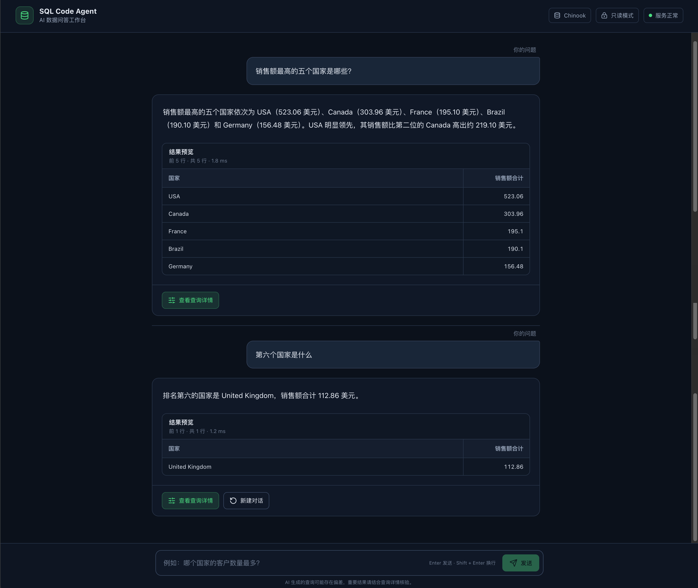

# 第 13 周作业：SQL Code Agent

本项目使用 LangChain 调用大语言模型，使用 LangGraph 编排 SQL Agent 工作流，并提供基于 FastAPI、React 和 Vite 的 Web 对话界面。用户可以在网页中输入自然语言问题，系统会查询 Chinook SQLite 数据库并返回中文答案、结构化结果和 SQL 执行详情。

## 作业内容

### 作业 1：使用 LangGraph 复现 SQL Agent

后端使用 `StateGraph` 实现数据库解析、相关表选择、SQL 生成、安全校验、错误改写、SQL 执行和答案汇总流程。

主要能力：

- 将中文自然语言问题转换为 SQLite 查询。
- 根据问题选择相关数据表，减少无关上下文。
- 使用条件路由控制 SQL 校验、执行、改写和拒绝流程。
- SQL 改写后重新执行完整安全校验，并限制最大重试次数。
- 仅允许只读查询，通过 SQLite 只读连接和 authorizer 阻止危险操作。
- 使用 Fake Model Gateway 进行无需 API Key 的单元测试。

### 作业 2：提供 Web 对话查询界面

项目使用 FastAPI 提供 SQL Agent API，使用 React/Vite 实现对话工作台。

主要能力：

- 通过网页输入自然语言问题。
- 使用 POST SSE 流式返回 Agent 执行阶段和最终答案。
- 展示查询结果表格，并可查看 SQL、选表和执行过程。
- 支持页面生命周期内的多轮追问。
- 浏览器只传递最近 5 个成功轮次，服务端不持久化会话。
- 模型 API Key 仅保存在后端，不会发送到浏览器。

## 运行效果

下面的示例先查询“销售额最高的五个国家是哪些”，随后继续追问“第六个国家是什么”。系统根据上一轮上下文完成多轮查询。



## 系统流程

```text
用户浏览器
    │
    │ POST /api/chat/stream
    ▼
React / Vite 前端
    │
    │ SSE 流式响应
    ▼
FastAPI 服务
    │
    ▼
LangGraph SQL Agent
    │
    ├─ 上下文改写
    ├─ 数据库解析
    ├─ 相关表选择
    ├─ SQL 生成
    ├─ SQL 安全校验 ──→ 危险请求拒绝
    ├─ SQL 执行 ──→ 失败后改写并重新校验
    └─ 查询结果汇总
    │
    ▼
Chinook SQLite 数据库
```

## 项目结构

```text
sql_code_agent/
├── data/
│   └── chinook.db                 # Chinook 示例数据库
├── doc/
│   ├── 需求分析.md
│   ├── 测试问题.md
│   ├── 多轮对话决策.md
│   ├── 基础 Python 代码实现框架.ipynb
│   └── query-result.png           # Web 查询效果
├── frontend/                      # React/Vite Web 工作台
│   ├── src/
│   ├── package.json
│   └── README.md
└── langchain-agent/               # LangChain/LangGraph 后端
    ├── src/langchain_sql_agent/
    │   ├── api.py                 # FastAPI 与 SSE 接口
    │   ├── chains.py              # LangChain 结构化模型链
    │   ├── graph.py               # LangGraph 状态、节点和路由
    │   ├── query_executor.py      # 只读 SQL 执行器
    │   ├── schema_service.py      # Schema 解析与脱敏
    │   └── sql_safety.py          # SQL 安全校验
    ├── tests/
    ├── README.md
    ├── 技术实现文档.md
    └── pyproject.toml
```

## 环境要求

- Python 3.12 或更高版本
- Node.js 20.19 或更高版本
- DeepSeek 或 OpenAI API Key

## 启动后端

进入后端目录并安装依赖：

```bash
cd langchain-agent
python -m pip install -e ".[dev]"
cp .env.example .env
```

在 `.env` 中配置模型。以 DeepSeek 为例：

```dotenv
SQL_AGENT_PROVIDER=deepseek
SQL_AGENT_MODEL=deepseek-chat
DEEPSEEK_API_KEY=your_api_key
SQL_AGENT_BASE_URL=https://api.deepseek.com
```

启动 FastAPI：

```bash
sql-agent-api
```

API 默认地址为 `http://127.0.0.1:8000`，OpenAPI 文档位于 `http://127.0.0.1:8000/docs`。

## 启动前端

打开另一个终端：

```bash
cd frontend
npm install
npm run dev
```

访问 `http://127.0.0.1:5173`。开发环境下，Vite 会将 `/api` 请求代理到 FastAPI。

## 测试与构建

运行后端测试：

```bash
cd langchain-agent
python -m pytest
```

运行前端测试与构建：

```bash
cd frontend
npm install
npm run lint
npm test
npm run build
```

后端测试覆盖 LangGraph 路由、模型链、API、Schema 解析、SQL 安全校验和只读查询执行。前端测试覆盖聊天状态、上下文处理、SSE 解析和查询详情展示。

## 相关文档

- [后端使用说明](./langchain-agent/README.md)
- [技术实现文档](./langchain-agent/技术实现文档.md)
- [前端使用说明](./frontend/README.md)
- [需求分析](./doc/需求分析.md)
- [多轮对话决策](./doc/多轮对话决策.md)
- [测试问题](./doc/测试问题.md)

> 本项目用于课程实验。生产环境还需要补充身份认证、访问控制、审计、数据权限和部署安全措施。
