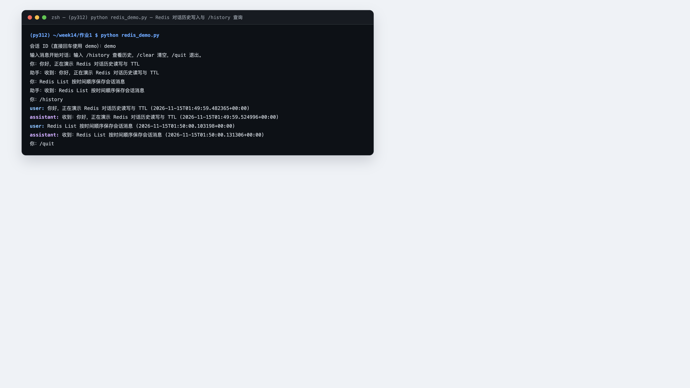
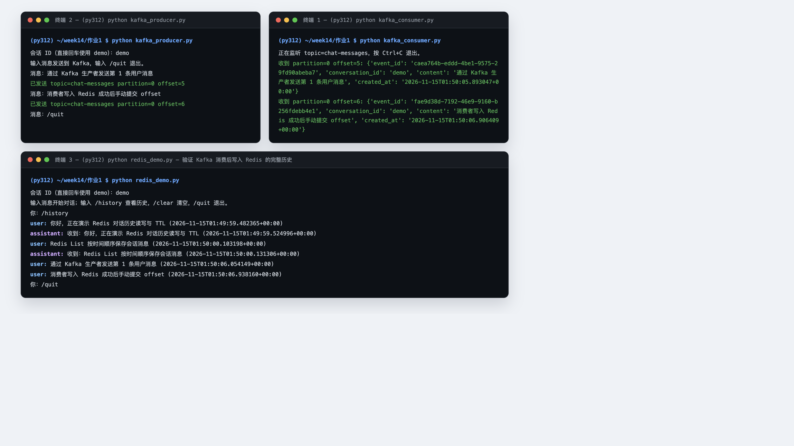

# 作业1：Redis 对话历史与 Kafka 消息传递

## 1. 作业目标

通过一个小型 Python 示例理解 Redis 和 Kafka 的基本用途：Redis 保存并读取对话历史，Kafka 在生产者和消费者之间传递消息。消费者收到 Kafka 消息后写入 Redis，串联成一个完整流程。

## 2. 功能说明

- `redis_demo.py`：命令行对话演示，支持保存消息、查看历史、清空历史。对话数据存储在 Redis，并设置 TTL。
- `kafka_producer.py`：从命令行读取消息，发送到 Kafka 的 `chat-messages` topic。
- `kafka_consumer.py`：消费 Kafka 消息，将用户消息保存到 Redis，并打印消息所在 partition 和 offset。
- `.env`：集中配置 Redis、Kafka 地址和历史记录过期时间。

## 3. 文件结构

```text
作业1/
├── README.md
├── requirements.txt
├── .env.example       # 配置模板
├── .gitignore
├── images/            # 运行演示截图
│   ├── redis-demo.png
│   └── kafka-redis-flow.png
├── redis_chat.py      # Redis 对话历史封装
├── redis_demo.py      # Redis 命令行演示
├── kafka_common.py    # Kafka 公共配置
├── kafka_producer.py  # Kafka 生产者
└── kafka_consumer.py  # Kafka 消费者，并写入 Redis
```

## 4. 运行环境

- macOS 或 Linux
- Python 3.12，使用已有 Conda 环境 `py312`
- 已启动且可从本机访问的 Redis 和 Kafka 服务

本项目不负责安装或启动 Redis、Kafka 服务。运行脚本的电脑必须能访问配置的服务器地址和端口。

## 5. 配置 Python 环境

进入作业目录并激活 Conda 环境：

```bash
cd 作业1
conda activate py312
```

安装 Python 依赖：

```bash
python -m pip install -r requirements.txt
```

确认当前解释器是 Conda 的 `py312` 环境：

```bash
python --version
which python
```

## 6. 配置 Redis 和 Kafka

复制配置模板：

```bash
cp .env.example .env
```

编辑 `.env`，将默认地址改为你自己的服务器地址：

```dotenv
REDIS_HOST=Redis服务器IP或域名
REDIS_PORT=6379
REDIS_PASSWORD=Redis密码
REDIS_DB=0
REDIS_TTL_SECONDS=86400

KAFKA_BOOTSTRAP_SERVERS=Kafka服务器IP或域名:9092
KAFKA_TOPIC=chat-messages
KAFKA_GROUP_ID=chat-message-demo
```

没有 Redis 密码时，将 `REDIS_PASSWORD` 留空。Kafka 有多个 bootstrap broker 时，用逗号分隔，例如：

```dotenv
KAFKA_BOOTSTRAP_SERVERS=10.0.0.10:9092,10.0.0.11:9092
```

`localhost` 只表示运行 Python 脚本的这台电脑。如果 Redis 或 Kafka 在远程服务器上，必须填写该服务器对本机开放的地址。`.env` 中可能包含密码，不要提交或截图暴露真实凭据；提交作业时保留 `.env.example` 即可。

## 7. 运行 Redis 对话历史演示

```bash
conda activate py312
python redis_demo.py
```

输入会话 ID，例如 `demo`，然后输入几条消息。支持以下命令：

- `/history`：查看该会话的最近消息
- `/clear`：清空该会话
- `/quit`：退出

Redis key 格式为 `homework1:chat:{conversation_id}`。每条消息以 JSON 形式存入 Redis List，包含 `role`、`content`、`created_at`；默认过期时间为 24 小时，可通过 `REDIS_TTL_SECONDS` 修改。

## 8. 运行 Kafka 生产者和消费者

先打开终端一，启动消费者：

```bash
conda activate py312
cd 作业1
python kafka_consumer.py
```

再打开终端二，启动生产者：

```bash
conda activate py312
cd 作业1
python kafka_producer.py
```

两边输入相同的会话 ID。生产者发送消息后，消费者应打印收到的事件，并将消息写进 Redis。之后可运行 `python redis_demo.py`，使用相同会话 ID 输入 `/history` 查看。

Kafka 事件示例：

```json
{
  "event_id": "自动生成的唯一事件 ID",
  "conversation_id": "demo",
  "content": "你好",
  "created_at": "UTC 时间"
}
```

消费者采用手动提交 offset：Redis 写入成功后才提交 Kafka offset。如果程序在写入 Redis 后、提交 offset 前退出，该消息可能被再次消费。生产环境需使用 `event_id` 做幂等处理；本作业将该行为作为消息确认机制的学习点。

## 9. 常见连接问题

### `NoBrokersAvailable`

Kafka 客户端无法连接到配置的 broker。检查：

1. `.env` 中 `KAFKA_BOOTSTRAP_SERVERS` 是否为正确的服务器地址和端口；远程 Kafka 不应误填 `localhost`。
2. Kafka 端口是否对运行脚本的电脑开放，可在 macOS 终端检查：

   ```bash
   nc -vz Kafka服务器IP 9092
   ```

3. Kafka 的 `advertised.listeners` 是否广播了客户端可访问的 IP/域名和端口。Bootstrap 地址可达但广播地址不可达时，客户端仍会连接失败。
4. Kafka 是否要求 SASL 或 TLS。如果启用了认证或加密，需要在客户端代码中补充相应安全配置。

Redis 连接失败时，检查 `.env` 中的主机、端口、密码以及服务器防火墙设置。确认 `.env` 位于作业目录，并从作业目录启动脚本。

## 10. Redis 命令与组件分工

- `RPUSH`：将新消息追加到对话列表末尾。
- `LRANGE`：读取最近若干条消息。
- `EXPIRE`：设置对话 key 的过期时间。
- `DEL`：清除对话历史。
- Redis 用于保存可快速读取的会话数据；Kafka 用于异步传递事件，降低生产者与消费者之间的耦合。

## 11. 演示截图与总结

### 11.1 Redis 对话写入与 `/history` 查询

运行 `python redis_demo.py`，写入对话消息并通过 `/history` 按时间顺序读取 Redis List 中的历史记录：



### 11.2 Kafka 生产消费与写入 Redis 全链路

分别启动 `kafka_consumer.py` 和 `kafka_producer.py` 发送消息到 `chat-messages` topic，消费者接收事件写入 Redis 后手动提交 offset，最后通过 `redis_demo.py` 验证完整历史记录：



### 11.3 实践总结

本次实践使用 Redis List（`RPUSH` + `LRANGE`）保存有序对话记录，并通过 `EXPIRE` 设置 TTL 自动清理过期会话；使用 Kafka topic 在生产者和消费者之间异步传递消息，并在 Redis 写入成功后手动提交消费 offset。远程连接 Kafka 时若服务端仅监听回环地址或 `advertised.listeners` 广播本地地址，可通过 SSH 端口转发将本地 `127.0.0.1:9092` 映射到远端 broker 解决 `NoBrokersAvailable` 问题。

## 12. 当前实现范围

Redis 演示中的“助手”只是回显输入内容，不调用大模型。Kafka 示例用于单机/课程学习。Redis 写入与 Kafka offset 提交不是跨系统事务，重复消费时可能重复写入对话历史。
