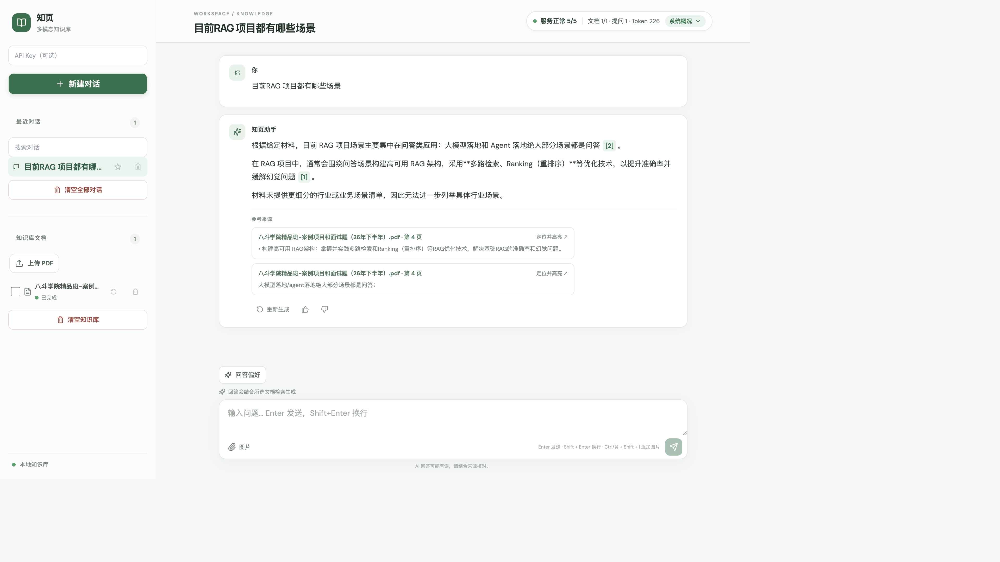
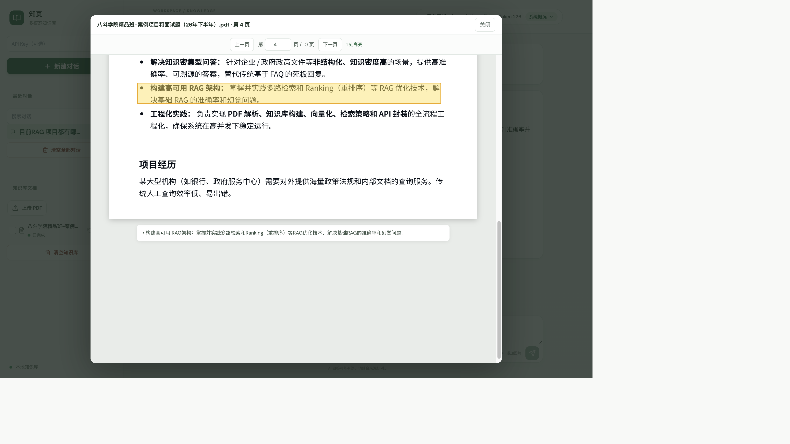
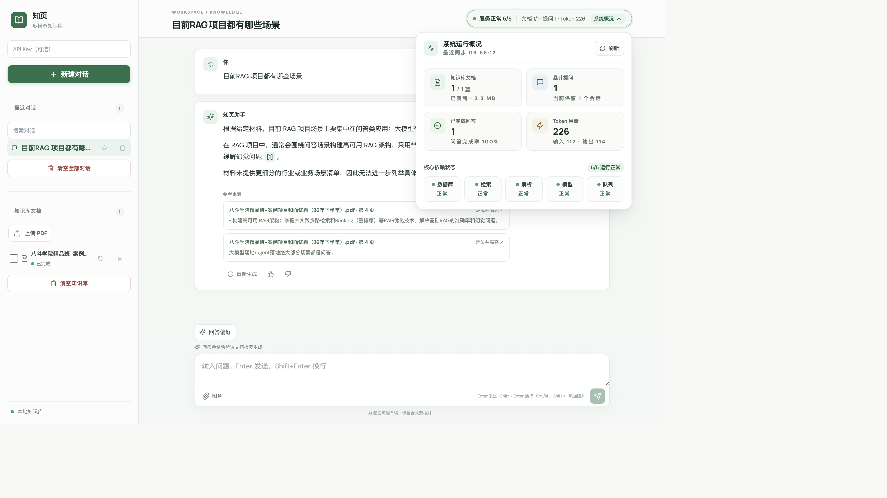

# Multimodal RAG API

基于 Python 3.12、FastAPI、SQLite、React/Vite 的多模态 RAG 知识库问答系统。支持 PDF 上传与异步解析（Kafka Outbox/Worker + MinerU v4）、Elasticsearch 混合检索、多轮图文流式问答（SSE）、来源引用定位与 PDF 原文高亮预览，以及知识库和系统运行监控。真实链路可对接 Kafka、MinerU、Elasticsearch 和 DeepSeek，同时支持本地离线开发模式。

## 运行效果

### 1. 知识库问答与来源引用

上传 PDF 文档解析入库后，支持自然语言多轮提问、SSE 流式生成回答，并自动标注参考来源页码与原文摘录：



### 2. 来源定位与 PDF 原文高亮预览

点击回答底部的引用来源卡片，可直接打开内置 PDF 预览器跳转到对应页码并高亮命中的原文段落：



### 3. 系统运行概况与核心链路状态监控

顶部状态栏实时汇总知识库文档、会话问答与 Token 用量，并检测 SQLite、Elasticsearch、MinerU、LLM、Kafka 五大核心服务连通状态：



## 开发环境

```bash
conda activate py312
python -m pip install -e .
cp .env.example .env
uvicorn app.main:app --reload
```

API 文档：`http://127.0.0.1:8000/docs`。首次启动时会从 `doc/multimodal_rag_schema.sql` 初始化 SQLite。默认数据库和文件存储位于 `data/`，路径可通过 `.env` 中的 `RAG_DATABASE_PATH`、`RAG_STORAGE_PATH` 调整。

上传接口为 `POST /api/v1/documents`，字段名 `files`，可一次上传最多 10 个 PDF，每个最大 100 MiB。查询接口包括 `GET /api/v1/documents` 和 `GET /api/v1/documents/{document_uid}`。所有普通响应采用统一的 `{success,data,error}` 包装。

## 当前接口

- `GET /api/v1/health`
- `POST /api/v1/documents`
- `GET /api/v1/documents`
- `GET /api/v1/documents/{document_uid}`
- `POST /api/v1/conversations`
- `GET /api/v1/conversations`
- `GET /api/v1/conversations/{conversation_uid}/messages`
- `POST /api/v1/conversations/{conversation_uid}/messages` (multipart `content`, optional `images[]`, SSE response)
- `GET /api/v1/documents/{document_uid}/assets/{asset_id}`
- `GET /api/v1/knowledge/stats` / `DELETE /api/v1/knowledge`
- `GET /api/v1/conversations/search?q=...` / `DELETE /api/v1/conversations`
- `GET /api/v1/conversations/{conversation_uid}/export.md`
- `GET /api/v1/stats/usage`, `GET /api/v1/logs`
- `GET/PUT /api/v1/settings`, `PUT /api/v1/messages/{message_uid}/feedback`

设置 `RAG_API_KEY` 后，除健康检查外的 `/api/v1` 请求需要通过 `X-API-Key` 传入该密钥。开发环境默认未设置密钥，便于本地开发；部署时应配置强随机密钥。

## PDF Worker

安装基础依赖后可在另一个终端运行 `conda activate py312 && python -m app.worker.executor`。Worker 读取 SQLite 中的待处理任务，使用 MinerU v4 批量上传链接流程提交本地 PDF、轮询并下载解析 ZIP，将 Markdown/JSON 产物按文档版本保存。运行前需在 `.env` 设置 `RAG_MINERU_API_URL=https://mineru.net/api/v4` 和 `RAG_MINERU_API_KEY`。

Worker 会将 MinerU Markdown 按标题和段落切块，写入配置的 Elasticsearch 索引，并在刷新确认后才将文档标为 `completed`。本地模式使用确定性开发向量；真实模式会加载 `BAAI/bge-small-zh-v1.5`，需先安装 `pip install -e '.[services]'` 并可访问模型文件。ES 连接认证读取 `.env` 中的用户名/密码或 API Key。

当 `RAG_ADAPTER_MODE=real` 时，`python -m app.worker.executor` 使用 Kafka Consumer Group 消费 Outbox 事件；offset 仅在 SQLite 成功领取任务或确认重复/终态消息后提交。Kafka 消费者与 FastAPI Outbox Dispatcher 分属独立进程。

当前分词有 jieba 可选实现和轻量回退；缺少 jieba 时使用正则分词。生产检索前建议安装并固定 jieba 版本，使索引和查询共用同一分词实现。

## Web MVP

```bash
cd web
pnpm install
pnpm dev
```

Vite 默认将 `/api` 请求代理到 `http://127.0.0.1:8000`；可通过 `VITE_API_PROXY` 指定开发代理地址，构建部署时可设置 `VITE_API_BASE_URL`。运行 `pnpm test` 执行前端测试，`pnpm build` 检查类型并构建静态资源。

## 后续阶段

1. Outbox Dispatcher、Kafka Worker、任务租约和 MinerU 解析。
2. 文档重新解析、删除及文件/索引清理恢复。
3. Elasticsearch 建索引、BGE 向量化、混合检索和来源快照。
4. 消息发送、图片附件、LLM 调用与 SSE 流式响应。
5. 认证、设置、统计、操作日志和完整 API Schema。

可选服务依赖通过 `pip install -e '.[services]'` 安装；当前代码不会在未配置时伪造真实服务已连接。
