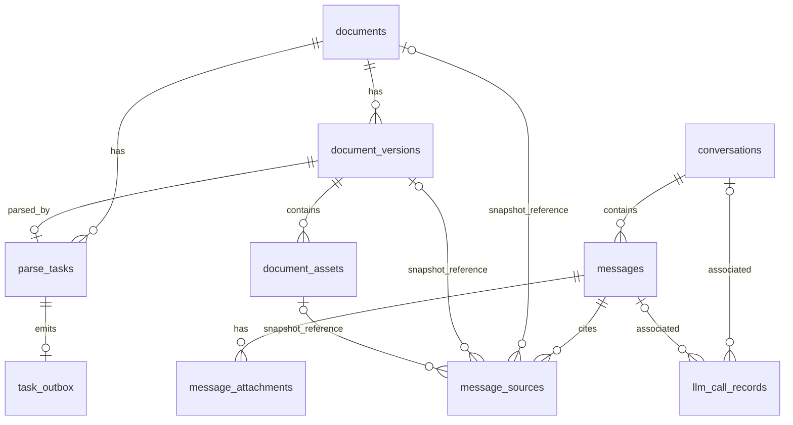

# 多模态 RAG 系统核心数据结构设计说明书 V1.0

- 版本：V1.0
- 状态：结构设计已确认；SQLite 初始化脚本已在独立测试库验证
- 数据库：SQLite
- 核心业务表：12 张

## 1. 设计目标与边界

SQLite 负责系统业务元数据、任务状态、对话消息、模型调用统计、用户偏好和操作日志。

其他数据的归属：

| 数据 | 存储位置 | 说明 |
|---|---|---|
| 原始 PDF | 本地文件系统 | 每份原始 PDF 只保存一份 |
| MinerU 解析产物 | 本地文件系统 | Markdown、JSON 等 |
| PDF 提取图片 | 本地文件系统 | 按解析版本隔离 |
| 用户上传图片 | 本地文件系统 | 按对话和消息隔离 |
| Chunk 正文和向量 | Elasticsearch | SQLite 只保存必要的外部 Chunk ID 和引用快照 |
| Kafka 消息 | Kafka | 传递任务元数据，不传 PDF 大文件 |
| 业务元数据与状态 | SQLite | 本说明书定义的 12 张表 |

## 2. 核心表清单

| 模块 | 表名 | 职责 |
|---|---|---|
| 文档管理 | `documents` | 原始 PDF 元数据、文档状态、当前有效解析版本 |
| 文档管理 | `document_versions` | 每次 PDF 解析的版本及状态 |
| 文档管理 | `document_assets` | 某个解析版本提取出的图片资源 |
| 任务管理 | `parse_tasks` | 每个解析版本对应的解析任务 |
| 任务管理 | `task_outbox` | 可靠投递 Kafka 的 Outbox 事件 |
| 对话管理 | `conversations` | 对话标题、置顶和时间 |
| 对话管理 | `messages` | 用户消息和 AI 回答 |
| 对话管理 | `message_attachments` | 用户上传并关联到消息的图片 |
| 回答引用 | `message_sources` | AI 回答引用来源及历史快照 |
| 模型调用 | `llm_call_records` | 每次真实模型 API 请求、重试、Token 和耗时 |
| 用户偏好 | `user_settings` | 通用键值形式的用户设置 |
| 系统运维 | `operation_logs` | 基础操作日志，保留 90 天 |

## 3. 关系模型



补充说明：

- `documents.current_version_id` 通过组合外键关联 `document_versions(document_id, id)`，保证当前版本属于该文档。
- `parse_tasks(document_id, document_version_id)` 通过组合外键保证任务关联的文档与解析版本一致。
- `message_sources` 的文档、版本、资源外键使用 `ON DELETE SET NULL`，保留历史快照。
- `llm_call_records` 对话和消息外键使用 `ON DELETE SET NULL`，避免用户删除对话时丢失统计记录。
- `operation_logs.resource_id` 是普通文本标识，不建立业务外键，保证日志可独立保留。

## 4. 字段字典

以下省略所有表中通用的 `id INTEGER PRIMARY KEY AUTOINCREMENT`，除非特别说明。所有 `created_at`、`updated_at`、`started_at`、`completed_at` 均采用 UTC ISO-8601 字符串 `YYYY-MM-DDTHH:MM:SSZ`。

### 4.1 documents

| 字段 | 类型 | 约束/说明 |
|---|---|---|
| `document_uid` | TEXT | NOT NULL、UNIQUE，业务唯一标识 |
| `filename` | TEXT | 原始文件名 |
| `file_path` | TEXT | 原始 PDF 本地路径 |
| `file_size` | INTEGER | 必须大于 0 |
| `file_hash` | TEXT | SHA-256 十六进制字符串，长度 64 |
| `status` | TEXT | `pending`、`processing`、`completed`、`failed`、`deleting` |
| `current_version_id` | INTEGER | 可空；当前可用于 RAG 的解析版本 |
| `created_at` | TEXT | 创建时间 |
| `updated_at` | TEXT | 更新时间 |

### 4.2 document_versions

| 字段 | 类型 | 约束/说明 |
|---|---|---|
| `document_id` | INTEGER | 外键关联 documents |
| `version_number` | INTEGER | 大于等于 1；同一文档内唯一 |
| `status` | TEXT | `pending`、`processing`、`completed`、`failed`、`cancelled` |
| `mineru_batch_id` | TEXT | MinerU 云端任务标识，可空 |
| `markdown_path` | TEXT | Markdown 产物路径，可空 |
| `json_path` | TEXT | JSON 产物路径，可空 |
| `created_at` | TEXT | 创建时间 |
| `started_at` | TEXT | 首次开始时间，可空 |
| `completed_at` | TEXT | 终态时间，可空 |

### 4.3 document_assets

| 字段 | 类型 | 约束/说明 |
|---|---|---|
| `document_version_id` | INTEGER | 外键关联解析版本 |
| `asset_type` | TEXT | 第一版仅 `image` |
| `filename` | TEXT | 资源文件名 |
| `file_path` | TEXT | 本地文件路径 |
| `page_number` | INTEGER | 正整数或 NULL |
| `mime_type` | TEXT | `image/jpeg`、`image/png`、`image/webp` |
| `file_size` | INTEGER | 大于 0 |
| `created_at` | TEXT | 创建时间 |

### 4.4 parse_tasks

| 字段 | 类型 | 约束/说明 |
|---|---|---|
| `task_uid` | TEXT | NOT NULL、UNIQUE |
| `document_id` | INTEGER | 与 document_version_id 组合关联版本 |
| `document_version_id` | INTEGER | NOT NULL、UNIQUE；一个版本对应一个解析任务 |
| `status` | TEXT | `pending`、`processing`、`completed`、`failed`、`cancelled` |
| `retry_count` | INTEGER | 自动通信重试次数，默认 0 |
| `next_retry_at` | TEXT | 下次重试时间，可空 |
| `error_type` | TEXT | 错误分类，可空 |
| `last_error` | TEXT | 最近一次错误信息，可空 |
| `created_at` | TEXT | 创建时间 |
| `started_at` | TEXT | 首次开始时间，可空 |
| `completed_at` | TEXT | 最终完成、失败或取消时间，可空 |
| `updated_at` | TEXT | 更新时间 |

### 4.5 task_outbox

| 字段 | 类型 | 约束/说明 |
|---|---|---|
| `event_uid` | TEXT | 事件唯一标识 |
| `task_id` | INTEGER | 外键关联任务，UNIQUE |
| `event_type` | TEXT | 事件类型 |
| `topic` | TEXT | Kafka Topic |
| `payload` | TEXT | JSON 消息内容 |
| `status` | TEXT | `pending`、`publishing`、`sent` |
| `publish_count` | INTEGER | 投递尝试次数 |
| `next_retry_at` | TEXT | 下次投递时间 |
| `locked_until` | TEXT | 投递租约到期时间 |
| `last_error` | TEXT | 最近投递错误 |
| `created_at` | TEXT | 创建时间 |
| `sent_at` | TEXT | Kafka 确认接收时间 |
| `updated_at` | TEXT | 更新时间 |

### 4.6 conversations

| 字段 | 类型 | 约束/说明 |
|---|---|---|
| `conversation_uid` | TEXT | 业务唯一标识 |
| `title` | TEXT | 自动生成标题，可由用户修改 |
| `is_title_manual` | INTEGER | 0/1；手动修改后不再自动覆盖 |
| `is_pinned` | INTEGER | 0/1；是否置顶 |
| `created_at` | TEXT | 创建时间 |
| `updated_at` | TEXT | 最近更新时间 |

### 4.7 messages

| 字段 | 类型 | 约束/说明 |
|---|---|---|
| `message_uid` | TEXT | 业务唯一标识 |
| `conversation_id` | INTEGER | 外键关联对话，级联删除 |
| `role` | TEXT | `user` 或 `assistant` |
| `content` | TEXT | 消息文本；允许空字符串以支持纯图片提问 |
| `status` | TEXT | 用户消息只能 `completed`；AI 消息为 `pending`、`streaming`、`completed`、`failed`、`interrupted` |
| `error_message` | TEXT | AI 生成失败信息，可空 |
| `created_at` | TEXT | 创建时间 |
| `updated_at` | TEXT | 更新时间 |

消息顺序使用 `(created_at, id)`。不使用 `parent_message_id`，不支持消息分支。编辑历史用户消息时，删除其后的消息，再基于修改后的问题重新生成。

### 4.8 message_attachments

| 字段 | 类型 | 约束/说明 |
|---|---|---|
| `attachment_uid` | TEXT | 业务唯一标识 |
| `message_id` | INTEGER | 外键关联用户消息 |
| `filename` | TEXT | 上传文件名 |
| `file_path` | TEXT | 用户图片本地路径 |
| `mime_type` | TEXT | JPEG、PNG、WEBP |
| `file_size` | INTEGER | 大于 0 且不超过 10 MiB |
| `sort_order` | INTEGER | 从 0 开始，同一消息内唯一 |
| `created_at` | TEXT | 创建时间 |

单次提问最多 5 张图片由 API 层校验；数据库约束单张最大 10 MiB。

### 4.9 message_sources

| 字段 | 类型 | 约束/说明 |
|---|---|---|
| `message_id` | INTEGER | 外键关联 AI 回答 |
| `document_id` | INTEGER | 可空；删除文档后置空 |
| `document_version_id` | INTEGER | 可空；删除版本后置空 |
| `chunk_id` | TEXT | Elasticsearch Chunk 外部标识 |
| `asset_id` | INTEGER | 可空；关联 PDF 提取图片，删除后置空 |
| `document_name` | TEXT | 必填，引用时的文档名称快照 |
| `page_number` | INTEGER | 正整数或 NULL |
| `content_snippet` | TEXT | 必填，引用内容摘要 |
| `source_order` | INTEGER | 同一回答内唯一的展示顺序 |
| `created_at` | TEXT | 创建时间 |

删除 PDF 或解析版本后保留引用快照，但不保证原文档仍可打开。

### 4.10 llm_call_records

| 字段 | 类型 | 约束/说明 |
|---|---|---|
| `call_uid` | TEXT | 每次真实 API 请求唯一标识 |
| `operation_uid` | TEXT | 同一逻辑操作的多次尝试共享 |
| `conversation_id` | INTEGER | 可空；删除对话后置空 |
| `message_id` | INTEGER | 可空；删除消息后置空 |
| `operation_type` | TEXT | `query_rewrite`、`response_generation`、`title_generation` |
| `provider` | TEXT | 服务商，例如 deepseek |
| `model_name` | TEXT | 模型名称 |
| `attempt_number` | INTEGER | 同一逻辑操作中的尝试序号 |
| `status` | TEXT | `running`、`success`、`failed`、`interrupted` |
| `input_tokens` | INTEGER | 输入 Token，可空 |
| `output_tokens` | INTEGER | 输出 Token，可空 |
| `total_tokens` | INTEGER | 总 Token，可空 |
| `latency_ms` | INTEGER | 调用耗时，可空 |
| `error_type` | TEXT | 错误类型，可空 |
| `error_message` | TEXT | 错误描述，可空 |
| `started_at` | TEXT | 请求开始时间 |
| `completed_at` | TEXT | 请求结束时间；running 时为空 |
| `created_at` | TEXT | 记录创建时间 |

每次真实请求（包括重试、失败）均单独记录。删除对话不删除模型调用记录。

### 4.11 user_settings

| 字段 | 类型 | 约束/说明 |
|---|---|---|
| `setting_key` | TEXT | 设置项唯一标识 |
| `setting_value` | TEXT | JSON 序列化的设置值 |
| `created_at` | TEXT | 创建时间 |
| `updated_at` | TEXT | 更新时间 |

默认值、数据类型和合法值由后端代码定义。系统级配置仍保存在后端配置文件中。

### 4.12 operation_logs

| 字段 | 类型 | 约束/说明 |
|---|---|---|
| `log_uid` | TEXT | 日志唯一标识 |
| `level` | TEXT | `INFO`、`WARNING`、`ERROR` |
| `category` | TEXT | `document`、`task`、`conversation`、`system`、`dependency`、`api`、`file`、`database` |
| `action` | TEXT | 具体操作名称 |
| `resource_type` | TEXT | 资源类型，可空 |
| `resource_id` | TEXT | 资源标识，可空，不建立外键 |
| `status` | TEXT | `success`、`failed`、`running`、`warning` 或 NULL |
| `message` | TEXT | 简短描述 |
| `details` | TEXT | JSON 附加信息，可空 |
| `created_at` | TEXT | 发生时间 |

日志只记录基础操作信息，不保存完整 Prompt、用户问题或图片内容。保留最近 90 天，网页查看，不提供导出。

## 5. 状态机与关键业务规则

### 5.1 文档与解析版本

- 新上传文档创建 `documents`、首个 `document_versions`、`parse_tasks`、`task_outbox`。
- 原始 PDF 只保存一份；每次重新解析创建新版本。
- 新版本解析成功后，在一个 SQLite 事务中更新 `documents.current_version_id`。
- 新版本失败时保留旧 `current_version_id`，旧版本继续可用。
- `documents.status` 表示文档最近一次解析操作/当前可用状态；`document_versions.status` 表示具体版本状态。
- 若重新解析失败但旧版本仍可用，文档应恢复为 `completed`，失败信息保留在任务和版本记录中。

### 5.2 文档删除恢复

删除流程：
1. SQLite 事务中将 `documents.status` 设置为 `deleting`。
2. 将关联 `parse_tasks` 和 `document_versions` 设置为 `cancelled`。
3. 提交事务。
4. 清理 Elasticsearch 对应文档/版本索引。
5. 清理原始 PDF、Markdown、JSON、提取图片等本地文件。
6. 删除 `documents` 行，由外键级联清理版本、资源、任务和 Outbox。
7. 如果清理中途失败，保留 `deleting` 状态，由后台恢复流程重试。

强制规则：
- `deleting` 不允许普通解析流程重新改为 `processing` 或 `completed`。
- Worker 在提交解析结果到 Elasticsearch 前必须重新检查文档和任务状态。
- Outbox 投递器必须通过关联任务过滤 `cancelled` 任务。
- 已经发到 Kafka 的消息仍可能被消费；Worker 收到后必须再次检查任务状态。
- MinerU 云端任务若无法取消，结果下载后也必须检查任务状态，取消任务不得写入 ES。
- 清理 ES 和文件的操作必须幂等。

Outbox 可投递任务的查询必须包含任务状态过滤，例如：

```sql
SELECT o.*
FROM task_outbox AS o
JOIN parse_tasks AS t ON t.id = o.task_id
JOIN documents AS d ON d.id = t.document_id
WHERE o.status = 'pending'
  AND t.status = 'pending'
  AND d.status != 'deleting'
  AND (o.next_retry_at IS NULL OR o.next_retry_at <= :now)
ORDER BY o.created_at
LIMIT :batch_size;
```

对 `publishing` 状态还需结合 `locked_until` 租约过期条件进行回收。投递器领取事件时应使用短事务和条件更新，避免多个投递器重复领取同一事件。

### 5.3 消息编辑与删除

- 编辑历史用户消息：更新原消息，删除其后所有消息；消息附件和引用通过外键级联删除。
- 对话删除：物理删除对话及其消息、附件记录和引用记录。
- 附件磁盘文件由应用层清理，数据库级联不会删除文件。
- 删除消息或对话后，`llm_call_records` 保留，关联 ID 置空。

### 5.4 模型调用记录

- 每次真实 API 请求插入一条 `running` 记录。
- 完成后更新为 `success`、`failed` 或 `interrupted`。
- 每次重试创建新记录，使用相同 `operation_uid`，递增 `attempt_number`。
- 流式输出中断后不得简单从头重试并把新内容追加到旧输出。
- Token 未被服务商准确返回时允许 NULL，不得伪造估算值。
- 启动恢复时，只将确认已失去执行者的遗留 `running` 记录标记为 `interrupted`。

## 6. 索引设计

初始化 SQL 已创建主要查询索引：

- 文档：创建时间、状态和创建时间。
- 资源：解析版本 ID。
- 解析任务：状态和下次重试时间。
- Outbox：状态、下次重试时间、租约时间。
- 对话：置顶状态和更新时间。
- 消息：对话 ID、创建时间、主键 ID。
- 引用：文档 ID、版本 ID、Chunk ID。
- 模型调用：创建时间、模型和状态、调用类型和状态、对话 ID、消息 ID。
- 操作日志：创建时间、分类和时间、级别和时间。

`UNIQUE` 约束已经创建唯一索引，不再额外创建重复普通索引。

## 7. SQLite 运行要求

每个 SQLite 连接都必须执行：

```sql
PRAGMA foreign_keys = ON;
PRAGMA busy_timeout = 5000;
```

数据库初始化时可以设置 WAL：

```sql
PRAGMA journal_mode = WAL;
```

应用使用 SQLAlchemy 时，应通过连接事件确保每个连接都启用外键约束。SQLite 的 WAL 模式仍然只有一个写入者，事务应尽量短，不要在数据库事务中等待 MinerU、Kafka 或 LLM 网络请求。

所有时间统一使用 UTC ISO-8601 字符串。应用层负责生成和更新时间，不依赖 SQLite 自动更新 `updated_at`。

## 8. 文件与数据库一致性

SQLite 外键只管理数据库记录，不管理文件系统。应用服务必须负责：
- 删除对话/消息前收集用户附件路径。
- 删除文档前收集原始 PDF 和全部解析产物路径。
- 数据库事务提交后执行文件删除。
- 文件删除失败时记录错误并通过后台清理流程重试。
- 定期检查存储目录中的孤立文件。
- 不要把本地 SQLite 数据库放在远程网络文件系统上。

## 9. 自动清理

操作日志每日清理一次：

```sql
DELETE FROM operation_logs
WHERE created_at < strftime('%Y-%m-%dT%H:%M:%SZ', 'now', '-90 days');
```

清理任务由 FastAPI 后台维护任务执行。

## 10. 初始化与验证

初始化脚本：`multimodal_rag_sqlite_schema_v1.sql`

独立 SQLite 测试验证：
- 12 张表创建成功。
- `PRAGMA foreign_key_check` 无错误。
- `PRAGMA integrity_check` 返回 `ok`。
- 文档删除后历史引用快照保留。
- 对话删除后模型调用记录保留并解除关联。
- 用户消息状态约束生效。
- 当前版本不能错误指向其他文档的解析版本。
- 解析任务不能关联其他文档的解析版本。
- 文档 `deleting`、版本/任务 `cancelled` 状态可写入。
- Outbox 的 `publishing` 状态必须有 `locked_until`。
- 模型调用可以从 `running` 恢复为 `interrupted`。
- 删除历史消息之后的消息时，其引用记录级联清理。

测试范围说明：
- 上述结果来自独立测试数据库，不代表用户 Mac 上的实际数据库已经初始化。
- 文件系统删除、Elasticsearch 清理、Kafka 投递和 Worker 并发恢复还需要集成测试。
- 本脚本适用于全新数据库；已有数据库结构升级需要单独迁移脚本，`CREATE TABLE IF NOT EXISTS` 不会修改已有表。

## 11. 后续待办

1. 在项目实际 Mac 环境中执行初始化脚本。
2. 集成测试文件清理、Elasticsearch 删除、Kafka Outbox、Worker 恢复。
3. 为已有数据库准备迁移脚本（若实际项目已经创建过旧结构）。
4. 进入 Kafka 消息结构设计。
5. 进入 Elasticsearch Index Mapping 设计。
6. 进入 API 接口设计。
