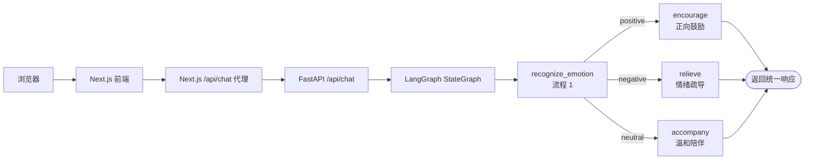

# 心语 · LangGraph 版

使用 **LangGraph StateGraph** 编排两阶段情感支持流程：

1. **流程 1 · 情感识别**：判断用户消息属于积极、消极还是中性。
2. **流程 2 · 策略回复**：根据标签走不同分支——积极时鼓励，消极时疏导，中性时陪伴。

前端使用 Next.js，后端使用 FastAPI，模型使用 DeepSeek 的 OpenAI 兼容接口。

## 架构



对应代码：

- `backend/app/workflow.py`：图构建、节点、条件边、提示词。
- `backend/app/emotion.py`：情感 JSON 的容错解析。
- `backend/app/main.py`：FastAPI 接口与异常映射。
- `frontend/app/api/chat/route.ts`：Next.js 服务端代理。
- `frontend/app/page.tsx`：对话界面与情感结果展示。

## 目录

```text
langgraph/
├── backend/
│   ├── app/
│   │   ├── config.py       # 环境变量配置
│   │   ├── llm.py          # DeepSeek ChatOpenAI 工厂
│   │   ├── schemas.py      # API / 内部数据结构
│   │   ├── emotion.py      # 模型 JSON 输出解析
│   │   ├── workflow.py     # LangGraph 图
│   │   └── main.py         # FastAPI 入口
│   ├── tests/
│   ├── .env.example
│   ├── requirements.txt
│   └── requirements-dev.txt
└── frontend/
    ├── app/
    │   ├── api/chat/route.ts
    │   ├── page.tsx
    │   ├── layout.tsx
    │   └── globals.css
    ├── .env.local.example
    └── package.json
```

## 快速开始

环境要求：Python 3.10+、Node.js 20.9+、npm。以下命令默认在 `langgraph/` 目录执行。

### 1. 准备 DeepSeek Key

在 <https://platform.deepseek.com/> 创建 API Key。

### 2. 启动后端

```bash
cd backend

python -m venv .venv
# Windows
.venv\Scripts\activate
# macOS / Linux
source .venv/bin/activate

pip install -r requirements.txt

# Windows
copy .env.example .env
# macOS / Linux
cp .env.example .env
```

编辑 `backend/.env`：

```dotenv
DEEPSEEK_API_KEY=sk-your-deepseek-api-key
```

启动：

```bash
uvicorn app.main:app --reload --port 8000
```

- 健康检查：<http://127.0.0.1:8000/api/health>
- Swagger：<http://127.0.0.1:8000/docs>

未配置 Key 时服务仍可启动，但 `/api/chat` 会返回 503 和清晰提示。

### 3. 启动前端

另开一个终端：

```bash
cd frontend
npm install

# Windows
copy .env.local.example .env.local
# macOS / Linux
cp .env.local.example .env.local

npm run dev
```

打开 <http://localhost:3000>。

## 配置

### 后端 `backend/.env`

| 变量 | 默认值 | 说明 |
| --- | --- | --- |
| `DEEPSEEK_API_KEY` | 空 | 必填；DeepSeek API Key |
| `DEEPSEEK_BASE_URL` | `https://api.deepseek.com` | OpenAI 兼容接口地址 |
| `DEEPSEEK_MODEL` | `deepseek-chat` | 模型名称 |
| `LLM_TEMPERATURE` | `0.3` | 采样温度 |
| `LLM_TIMEOUT_SECONDS` | `60` | 单次模型请求超时 |
| `LLM_MAX_TOKENS` | `600` | 回复最大 token |
| `CORS_ORIGINS` | `http://localhost:3000,http://127.0.0.1:3000` | 允许的跨域来源 |
| `LOG_LEVEL` | `INFO` | 日志级别 |

### 前端 `frontend/.env.local`

| 变量 | 默认值 | 说明 |
| --- | --- | --- |
| `API_BASE_URL` | `http://127.0.0.1:8000` | FastAPI 地址；仅服务端代理使用 |

所有配置由 `backend/app/config.py` 的 `Settings` 统一读取，没有硬编码的密钥或模型参数。

## API

### `GET /api/health`

```json
{
  "status": "ok",
  "framework": "langgraph",
  "model": "deepseek-chat",
  "llm_configured": true
}
```

### `POST /api/chat`

请求：

```json
{
  "message": "项目终于上线了，特别开心！"
}
```

响应：

```json
{
  "reply": "项目上线真的不容易，能感受到你的投入和开心。好好庆祝一下这份成果吧。",
  "emotion": {
    "label": "positive",
    "confidence": 0.96,
    "reason": "分享了好消息和成就感"
  },
  "strategy": "encouragement",
  "strategy_label": "正向鼓励"
}
```

`emotion.label` 取值：`positive` / `negative` / `neutral`。  
`strategy` 取值：`encouragement` / `relief` / `neutral`。

快速验证：

```bash
curl http://127.0.0.1:8000/api/chat \
  -H "Content-Type: application/json" \
  -d '{"message":"最近事情好多，有点焦虑。"}'
```

## 实现细节

### 流程 1：情感识别

- 提示词要求模型只输出 JSON：`label`、`confidence`、`reason`。
- `parse_emotion_json` 兼容 Markdown 代码块、中文标签（积极/消极/中性）和百分比置信度。
- 输出无法解析时，自动追加纠正消息重试一次，仍失败则返回 502。

### 流程 2：分支回复

| 分支 | 节点 | 策略 |
| --- | --- | --- |
| positive | `encourage` | 具体肯定、真诚鼓励、延续好心情 |
| negative | `relieve` | 接纳感受、不评判、给少量可执行建议 |
| neutral | `accompany` | 复述重点、表达愿意倾听、开放提问 |

回复提示词要求 2–4 句、使用用户语言，并禁止心理诊断。涉及自伤、伤人或紧急危险时，提示联系可信任的人或当地紧急援助。

### 校验与错误

- 请求消息经过 `strip`，空消息拒绝，最多 4000 字符。
- 缺少 `DEEPSEEK_API_KEY` → 503。
- 情感 JSON 解析失败 → 502。
- 模型/网络异常 → 502，详细堆栈只写后端日志，不返回前端。
- 前端代理保留后端 HTTP 状态和可读 `detail`。

### 当前范围

当前为**单轮、无会话记忆**设计：每次请求只分析当前消息。如需多轮上下文，可在图状态中加入历史消息，并在前端请求中携带最近 N 轮对话。

## 测试

```bash
cd backend
pip install -r requirements-dev.txt
pytest -q
```

包含情感解析、积极/消极/中性分支路由测试，不调用真实模型。

```bash
cd frontend
npm run build
```

构建会同时执行 TypeScript 类型检查。

## 说明

这是一个日常情绪陪伴示例，不构成医疗或心理诊断。若处于紧急危险中，请立即联系当地紧急服务或可信任的人。
