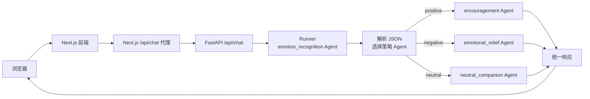

# 心语 · OpenAI Agents SDK 版

使用 **OpenAI Agents SDK** 串行运行两个阶段的情感支持流程：

1. **流程 1 · 情感识别 Agent**：输出积极、消极或中性的结构化判断。
2. **流程 2 · 策略 Agent**：根据判断选择鼓励、疏导或陪伴 Agent 生成回复。

模型通过 DeepSeek 的 OpenAI 兼容 Chat Completions 接口调用。前端使用 Next.js，后端使用 FastAPI。

## 架构



对应代码：

- `backend/app/workflow.py`：四个 Agent、DeepSeek 模型、两次 `Runner.run`、策略选择。
- `backend/app/emotion.py`：情感 JSON 容错解析。
- `backend/app/main.py`：FastAPI 接口、生命周期与异常映射。
- `frontend/app/api/chat/route.ts`：Next.js 服务端代理。
- `frontend/app/page.tsx`：对话界面与情感结果展示。

## Agents 设计

| Agent | 职责 |
| --- | --- |
| `emotion_recognition` | 流程 1；只返回 `label` / `confidence` / `reason` JSON |
| `encouragement` | 流程 2 正向分支；具体肯定、真诚鼓励 |
| `emotional_relief` | 流程 2 消极分支；接纳、疏导、少量可行建议 |
| `neutral_companion` | 流程 2 中性分支；倾听与开放提问 |

`AgentsEmotionWorkflow.run()` 先运行情感 Agent，解析 `final_output`，再用 Python 根据标签选择分支 Agent 并第二次调用 `Runner.run`。这里没有使用 handoff，因为后端需要显式掌握两次调用的顺序和错误处理。

### DeepSeek 接入要点

```python
from agents import OpenAIChatCompletionsModel
from openai import AsyncOpenAI

client = AsyncOpenAI(
    api_key=settings.deepseek_api_key.get_secret_value(),
    base_url=settings.deepseek_base_url,
)
model = OpenAIChatCompletionsModel(
    model=settings.deepseek_model,
    openai_client=client,
)
```

- DeepSeek 提供的是 **Chat Completions**，因此显式使用 `OpenAIChatCompletionsModel`，避免 SDK 走 OpenAI Responses API。
- 使用 `set_tracing_disabled(True)` 并在 `RunConfig(tracing_disabled=True)` 中再次关闭 tracing；本项目不向 OpenAI 上传追踪数据。
- 不依赖 OpenAI 官方账号，只需要 DeepSeek Key。

## 目录

```text
openai-agents/
├── backend/
│   ├── app/
│   │   ├── config.py       # 环境变量配置
│   │   ├── schemas.py      # API / 内部数据结构
│   │   ├── emotion.py      # 模型 JSON 输出解析
│   │   ├── workflow.py     # Agents + DeepSeek 编排
│   │   └── main.py         # FastAPI 入口
│   ├── tests/
│   ├── .env.example
│   ├── requirements.txt
│   └── requirements-dev.txt
└── frontend/
    ├── app/
    │   ├── api/chat/route.ts
    │   ├── page.tsx
    │   ├── layout.tsx
    │   └── globals.css
    ├── .env.local.example
    └── package.json
```

## 快速开始

环境要求：Python 3.10+、Node.js 20.9+、npm。以下命令默认在 `openai-agents/` 目录执行。

### 1. 准备 DeepSeek Key

在 <https://platform.deepseek.com/> 创建 API Key。

### 2. 启动后端

```bash
cd backend

python -m venv .venv
# Windows
.venv\Scripts\activate
# macOS / Linux
source .venv/bin/activate

pip install -r requirements.txt

# Windows
copy .env.example .env
# macOS / Linux
cp .env.example .env
```

编辑 `backend/.env`：

```dotenv
DEEPSEEK_API_KEY=sk-your-deepseek-api-key
```

启动：

```bash
uvicorn app.main:app --reload --port 8000
```

- 健康检查：<http://127.0.0.1:8000/api/health>
- Swagger：<http://127.0.0.1:8000/docs>

未配置 Key 时服务仍可启动，但 `/api/chat` 会返回 503 和清晰提示。

### 3. 启动前端

另开一个终端：

```bash
cd frontend
npm install

# Windows
copy .env.local.example .env.local
# macOS / Linux
cp .env.local.example .env.local

npm run dev
```

打开 <http://localhost:3000>。

## 配置

### 后端 `backend/.env`

| 变量 | 默认值 | 说明 |
| --- | --- | --- |
| `DEEPSEEK_API_KEY` | 空 | 必填；DeepSeek API Key |
| `DEEPSEEK_BASE_URL` | `https://api.deepseek.com` | OpenAI 兼容接口地址 |
| `DEEPSEEK_MODEL` | `deepseek-chat` | 模型名称 |
| `LLM_TEMPERATURE` | `0.3` | 采样温度 |
| `LLM_TIMEOUT_SECONDS` | `60` | 单次模型请求超时 |
| `LLM_MAX_TOKENS` | `600` | 回复最大 token |
| `AGENT_MAX_TURNS` | `2` | Agents SDK 单次运行最大轮数 |
| `CORS_ORIGINS` | `http://localhost:3000,http://127.0.0.1:3000` | 允许的跨域来源 |
| `LOG_LEVEL` | `INFO` | 日志级别 |

### 前端 `frontend/.env.local`

| 变量 | 默认值 | 说明 |
| --- | --- | --- |
| `API_BASE_URL` | `http://127.0.0.1:8000` | FastAPI 地址；仅服务端代理使用 |

所有配置由 `backend/app/config.py` 的 `Settings` 统一读取，没有硬编码的密钥或模型参数。

## API

### `GET /api/health`

```json
{
  "status": "ok",
  "framework": "openai-agents",
  "model": "deepseek-chat",
  "llm_configured": true
}
```

### `POST /api/chat`

请求：

```json
{
  "message": "最近事情好多，有点焦虑。"
}
```

响应：

```json
{
  "reply": "听起来最近的压力让你有些喘不过气，这些感受很真实。你愿意的话，可以慢慢说说最让你难受的部分。",
  "emotion": {
    "label": "negative",
    "confidence": 0.92,
    "reason": "表达了焦虑和压力"
  },
  "strategy": "relief",
  "strategy_label": "情绪疏导"
}
```

`emotion.label` 取值：`positive` / `negative` / `neutral`。  
`strategy` 取值：`encouragement` / `relief` / `neutral`。

快速验证：

```bash
curl http://127.0.0.1:8000/api/chat \
  -H "Content-Type: application/json" \
  -d '{"message":"今天很平静，没什么特别的。"}'
```

## 实现细节

### 流程 1：情感识别

- `Runner.run(emotion_recognition, ...)`，Agent 提示词要求仅返回 JSON。
- 兼容 Markdown 代码块、中文标签和百分比置信度。
- JSON 解析失败时重新运行一次纠正提示，仍失败则返回 502。

### 流程 2：策略 Agent

- 解析成功后，`_agent_for(label)` 选择对应 Agent 和策略标签。
- 将用户原话、情感标签、置信度、判断依据作为第二次 `Runner.run` 输入。
- 回复要求 2–4 句、使用用户语言、禁止心理诊断；风险内容引导联系可信任的人或当地紧急援助。

### 错误与资源处理

- 缺少 Key → 503；解析失败 → 502；模型/网络异常 → 502。
- FastAPI `lifespan` 在关闭时调用 `AsyncOpenAI.close()`。
- 前端代理传递后端状态码和可读错误，浏览器不直接持有模型 API Key。

### 当前范围

当前为**单轮、无会话记忆**设计。若要支持多轮，需要在后端维护会话历史，或使用 Agents SDK 的 Session 能力，并在请求中引入会话标识。

## 测试

```bash
cd backend
pip install -r requirements-dev.txt
pytest -q
```

包含情感解析与策略 Agent 选择测试，不调用真实模型。

```bash
cd frontend
npm run build
```

构建会同时执行 TypeScript 类型检查。

## 说明

这是一个日常情绪陪伴示例，不构成医疗或心理诊断。若处于紧急危险中，请立即联系当地紧急服务或可信任的人。
