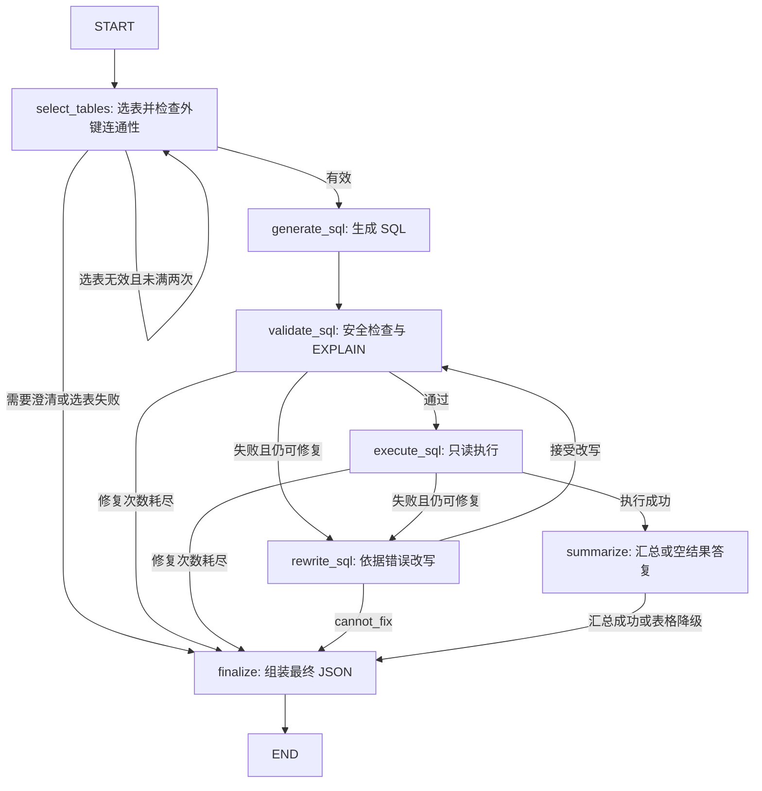

# Chinook SQL Agent

使用自然语言查询 Chinook 音乐商店 SQLite 数据库。程序通过四个 LLM Agent 完成选表、生成 SQL、错误修复和结果汇总，由 LangGraph `StateGraph` 的节点和条件边控制校验、执行及重试，最终输出 JSON。

本文按项目约定命名为 `REMADE.md`，作为项目使用说明。编码协作规范见 [AGENTS.md](AGENTS.md)。

## 当前状态

FastAPI 后端已实现自然语言查询、存活检查、就绪检查及交互式接口文档，与 CLI 共用现有工作流。请求响应及错误约定见 [后端接口设计](docs/api-design.md)，启动方式见下文“启动 HTTP 后端”。

网页对话前端已按审查通过的 [前端设计文档](docs/frontend-design.md) 实现，采用原生 HTML/CSS/JavaScript 模块，由现有 FastAPI 同源托管。启动后打开首页即可输入问题，查看答案、SQL、证据和限制说明，无需安装 Node.js 或单独启动前端服务。

主程序位于 `src/sql_agent/`，使用 LangGraph、LangChain、LangChain OpenAI 集成、Pydantic 和 SQLAlchemy。默认模型端点及模型名称来自源码配置；是否可调用取决于实际服务与账号。

仓库目前没有依赖清单、版本锁文件或打包配置，`tests/` 包含不调用外部模型的工作流和 HTTP 接口回归测试。下文安装命令根据源码直接依赖整理，不代表已锁定的完整依赖组合。`ref/` 中的 Notebook 和翻译示例是教学参考，不是主程序入口。

## 工作流程



- 数据库目录包含表、字段、行数和外键；选中的表会补充列统计与样例。
- 表选择最多尝试两次；SQL 默认允许初次尝试加三次改写。
- SQL 校验只编译，执行器使用只读连接，并限制执行时间、返回行数和单元格长度。
- 查询结果为空时不修复、不调用汇总模型；汇总失败时仍可返回表格答案。
- `QueryState` 保存选表反馈、SQL 尝试历史、校验结果、执行结果和最终输出；节点返回局部更新，不原地修改历史状态。
- 图在工作流实例初始化时编译，`run()` 通过 `graph.ainvoke()` 执行，每次查询使用独立状态。图步数上限随最大修复次数计算，业务重试次数仍由条件边限制。

图 API 的节点、状态更新和条件边用法参见 [LangGraph 官方文档](https://docs.langchain.com/oss/python/langgraph/graph-api)。

## 目录结构

```text
Week13/
├── AGENTS.md                    # 编码协作指南
├── REMADE.md                    # 项目使用说明
├── docs/api-design.md           # HTTP 接口契约与实现说明
├── docs/frontend-design.md      # 已审查的前端设计与验收说明
├── ref/
│   ├── chinook.db                # 示例数据库
│   ├── sql-agent.ipynb           # SQL Agent 教学参考
│   └── agent-demo.py             # 显式多 Agent 编排参考
├── src/sql_agent/
│   ├── __init__.py              # 导出 SQLAgentWorkflow、WorkflowOutput
│   ├── __main__.py              # python -m sql_agent 入口
│   ├── cli.py                   # 参数、输入、JSON 输出
│   ├── config.py                # 配置
│   ├── logging_config.py        # 标准错误日志
│   ├── models.py                # Pydantic 数据契约
│   ├── workflow.py              # LangGraph 节点、条件边与编译图
│   ├── api/
│   │   ├── app.py              # FastAPI 工厂、生命周期及请求日志
│   │   ├── dependencies.py     # 工作流注入与只读就绪检查
│   │   ├── schemas.py          # HTTP 请求和错误模型
│   │   ├── errors.py           # 统一异常响应
│   │   ├── routes/             # queries.py、health.py、web.py
│   │   └── static/             # HTML、CSS 与三个 JavaScript 模块
│   ├── agents/
│   │   ├── table_selector.py
│   │   ├── sql_generator.py
│   │   ├── sql_rewriter.py
│   │   └── result_summarizer.py
│   └── db/
│       ├── catalog.py           # schema、统计与缓存
│       ├── validator.py         # SQL 校验
│       └── executor.py          # 只读执行
└── tests/                       # 工作流、HTTP 及 frontend/ 前端测试
```

## 快速开始（Windows PowerShell）

在 `Week13` 目录执行以下命令。可使用已配置的 conda `py312` 环境，或按下面步骤创建 `.venv`；所有安装与启动命令应使用同一解释器。在已激活的 conda 环境中，将命令中的 `.\.venv\Scripts\python.exe` 替换为 `python`。

### 1. 创建环境并安装依赖

```powershell
python -m venv .venv
.\.venv\Scripts\python.exe -m pip install --upgrade pip
.\.venv\Scripts\python.exe -m pip install "langchain>=1,<2" langchain-openai langgraph "pydantic>=2,<3" "SQLAlchemy>=2,<3"
```

这里直接使用虚拟环境中的解释器，无需激活脚本。`langgraph` 用于工作流状态图编排；主程序不需要参考翻译示例使用的 `openai-agents`。当前没有打包配置，使用下面的 `PYTHONPATH` 设置加载源码。

### 2. 配置环境变量

```powershell
$env:PYTHONPATH = (Join-Path (Get-Location) 'src')
$env:DEEPSEEK_API_KEY = '替换为你的实际密钥'
$env:DEEPSEEK_URL = 'https://api.deepseek.com'
```

只在本机终端设置实际密钥，不要写进项目文件。环境变量仅对当前 PowerShell 及其子进程生效。项目没有自动读取 `.env` 的逻辑。

默认模型名称为 `deepseek-flash`；如果账号或端点不支持，请把 `SQL_AGENT_MODEL` 和 `SQL_AGENT_SUMMARY_MODEL` 都设置为服务实际支持的模型名称。代码使用结构化工具输出，并传入 `extra_body={"thinking": {"type": "disabled"}}`，更换服务时需检查其兼容性。

### 3. 运行查询

```powershell
.\.venv\Scripts\python.exe -m sql_agent "数据库中一共有多少首歌曲？"
.\.venv\Scripts\python.exe -m sql_agent "销售额最高的 5 个国家是哪些？" --log-level DEBUG
```

不传问题时，交互终端会提示输入；也支持从标准输入读取问题。成功进入查询流程后，最终 JSON 输出到标准输出，日志写入标准错误，可分别保存：

```powershell
.\.venv\Scripts\python.exe -m sql_agent "列出歌曲数量最多的 5 位艺术家" 1> result.json 2> run.log
```

日志可能包含问题、SQL、错误和答案片段。默认不写日志文件，文件来自上述重定向。Windows PowerShell 5.1 的重定向编码可能与 PowerShell 7 不同，读取保存的 JSON 时需注意编码。

### 4. 启动 HTTP 后端

在已有运行依赖的环境中补充 FastAPI 和 Uvicorn，并先按上文设置模型密钥和其他环境变量：

```powershell
.\.venv\Scripts\python.exe -m pip install "fastapi==0.136.3" "uvicorn==0.40.0"
$env:PYTHONPATH = (Join-Path (Get-Location) 'src')
.\.venv\Scripts\python.exe -m uvicorn sql_agent.api.app:create_app --factory --host 127.0.0.1 --port 8000
```

应用通过 lifespan 初始化自己的只读数据库目录、校验器和工作流，退出时释放引擎。包导入仍会创建模块级 Agent，因此密钥须在启动前配置；数据库缺失等启动错误会直接导致启动失败。启动后打开 [网页查询台](http://127.0.0.1:8000/)，也可查看 [接口文档](http://127.0.0.1:8000/docs)。

| 方法 | 路径 | 行为 |
| --- | --- | --- |
| GET | `/` | 网页对话查询入口 |
| GET | `/static/...` | 页面样式和 JavaScript 模块，仅开放前端静态目录 |
| POST | `/api/v1/queries` | 接收 `question`，等待查询完成并返回 `WorkflowOutput` |
| GET | `/healthz` | 200 / `{"status":"ok"}`，不访问数据库或模型 |
| GET | `/readyz` | 检查工作流已初始化、数据库可只读连接并执行 `SELECT 1`；成功为 200 / `{"status":"ready"}`，否则 503 |
| GET | `/docs` | 交互式接口文档 |
| GET | `/openapi.json` | OpenAPI 接口契约 |

在另一个 PowerShell 窗口提交问题，显式使用 UTF-8 请求体：

```powershell
$queryBody = @{ question = '数据库中一共有多少首歌曲？' } | ConvertTo-Json
Invoke-RestMethod -Method Post -Uri 'http://127.0.0.1:8000/api/v1/queries' -ContentType 'application/json; charset=utf-8' -Body ([System.Text.Encoding]::UTF8.GetBytes($queryBody))
```

`question` 必须为字符串，去掉首尾空白后为 1～2000 个字符；不接受额外字段。成功、澄清、空结果与表格降级返回 200，字段含义与下文 CLI 输出相同。错误响应统一为 `{"error":{"code":"...","message":"...","details":[]}}`：媒体类型错误 415、参数或 JSON 错误 422、工作流失败或内部异常 500、服务未就绪或数据库预检失败 503。工作流原始错误仅记录到日志，HTTP 500 返回固定提示；通过响应头 `X-Request-ID` 定位对应请求日志。

首版无对话记忆、流式输出或 HTTP 总超时；澄清后应重新提交完整问题。就绪检查不探测上游模型，也不保证后续查询不会失败。数据库路径及目录在应用启动时固定，修改数据库后应重启服务。默认启动命令仅监听本机，不配置鉴权和跨域。

### 5. 使用网页查询台

首页聊天输入框居中，采用透明、白色和偏白浅灰配色，不展示欢迎标语。输入完整问题后点击“发送”，或按 Enter；Shift+Enter 换行，中文输入法确认候选词不会发送。下方三个示例适用于默认 Chinook 库，点击仅填入问题。输入限制为去除首尾空白后 1～2000 个 Unicode 码点。

- 每条回复展示答案、证据、限制说明和所选表；可展开 SQL、原始响应 JSON，复制答案或 SQL。
- `row_count` 显示为“保留结果 N 行”，不是业务统计总数；截断时明确提示。没有 SQL 的澄清回复不会误显示为查询返回零行。
- 正文按纯文本保留换行，不解析 HTML 或 Markdown；汇总降级的 Markdown 表格也以文本展示。当前接口不返回原始行数组，页面不提供数据表格、图表或 CSV 导出。
- 聊天记录仅存在于当前页面内存，刷新或确认清空后丢失。每次请求仍独立，不会把历史记录传给模型；需要补充条件时点击“编辑问题”，修改成完整问题后重新发送。
- 等待期间可以编辑下一条草稿，不能重复发送。页面显示实际等待时间，不伪造执行阶段；无查询总超时或自动重试。
- “停止等待”只中断浏览器等待，服务端可能继续处理，再次提交可能产生并行查询。清空记录或关闭网页也不保证取消服务端工作。
- 服务状态来自一次 `/readyz` 检查，可手动重查；探针本身最多等待 5 秒，不持续轮询，也不保证模型可用。响应中的请求 ID 可用于定位服务端日志。

静态目录不会开放数据库、项目源码或其他文件；未知页面仍返回 404。无需新增环境变量或跨域配置。

## 配置项

所有配置都应在启动程序或导入 `sql_agent` 之前设置；运行中修改环境变量不会自动重建配置和 Agent。

| 环境变量 | 默认值 | 作用 |
| --- | --- | --- |
| `DEEPSEEK_API_KEY` | 无，运行查询必须设置 | 模型服务密钥 |
| `DEEPSEEK_URL` | `https://api.deepseek.com` | 模型 API 地址 |
| `SQL_AGENT_MODEL` | `deepseek-flash` | 选表、生成和改写模型 |
| `SQL_AGENT_SUMMARY_MODEL` | `deepseek-flash` | 结果汇总模型 |
| `SQL_AGENT_DB` | 项目根目录下的 `ref/chinook.db` | SQLite 文件；相对路径按项目根目录解析 |
| `SQL_AGENT_MAX_REPAIR_ATTEMPTS` | `3` | 初始 SQL 之后的最大改写次数 |
| `SQL_AGENT_MAX_ROWS` | `200` | 执行结果最多保留的行数 |
| `SQL_AGENT_MAX_SUMMARY_ROWS` | `50` | 最多交给汇总模型或降级表格展示的行数 |
| `SQL_AGENT_MAX_CELL_CHARS` | `2000` | 单元格文本长度限制，截断后追加 `...` |
| `SQL_AGENT_QUERY_TIMEOUT` | `5.0` | SQLite 执行阶段的时间限制，单位秒 |
| `SQL_AGENT_LOG_LEVEL` | `INFO` | 日志级别，可被 `--log-level` 覆盖 |

修复次数应使用非负整数，负值会在工作流初始化时报错；行数和文本长度使用正整数，超时使用正数。当前解析会对无法转换为数字的值回退到默认值，其他数值范围尚未完整校验。SQL 执行超时不覆盖数据库目录统计和模型调用，也不是整个请求的总超时。

## 示例数据库

随附数据库含 11 张业务表：

| 数据范围 | 表 |
| --- | --- |
| 音乐内容 | `artists`、`albums`、`tracks`、`genres`、`media_types` |
| 播放列表 | `playlists`、`playlist_track` |
| 客户与员工 | `customers`、`employees` |
| 销售与明细 | `invoices`、`invoice_items` |

常见关联包括 `artists → albums → tracks`、`customers → invoices → invoice_items → tracks`，以及 `playlists → playlist_track → tracks`。代码从数据库实际外键读取连接关系，不硬编码这些路径。

表名为小写，列名包含 `TrackId`、`AlbumId`、`Name` 等。可以提出歌曲统计、流派分布、销售排名等问题；不相关或信息不足的问题可能返回澄清请求。自定义数据库也必须是现有 SQLite 文件，多表选择依赖其中声明的外键关系。

## 输出格式

下例展示“数据库中一共有多少首歌曲？”的一种输出形式。`3503` 来自随附数据库的本地只读查询；示例文案及模型生成 SQL 不代表一次真实模型调用记录。

```json
{
  "question": "数据库中一共有多少首歌曲？",
  "answer": "数据库中共有 3503 首歌曲。",
  "sql": "SELECT COUNT(*) AS TrackCount FROM tracks",
  "tables": ["tracks"],
  "row_count": 1,
  "truncated": false,
  "repair_attempts": 0,
  "evidence": ["歌曲总数：3503"],
  "caveats": [],
  "error": null
}
```

- `row_count` 是保留的 SQL 结果行数。`COUNT(*)` 返回一行，因此这里为 `1`，并不是歌曲数量。
- `truncated` 只标记执行器是否因行数上限截断，不标记单元格截断、SQL 自身的 `LIMIT` 或汇总阶段只读取部分行。
- `repair_attempts` 记录已接受并进入后续尝试的改写数量；模型返回 `cannot_fix` 的调用不计入该值。
- `evidence` 为答案证据，`caveats` 为解释限制或降级原因。最终 JSON 不直接包含原始结果行数组。
- 流程返回非空 `error` 时，CLI 输出 JSON 并以状态码 `1` 退出。空问题、需要澄清或查询结果为空通常不设置 `error`；启动期依赖、模型初始化或数据库打开失败可能直接抛异常，不能保证所有失败都有 JSON。

## 在 Python 中调用

先按上文设置依赖、`PYTHONPATH` 和密钥，再运行：

```python
import asyncio

from sql_agent import SQLAgentWorkflow


async def main():
    workflow = SQLAgentWorkflow()
    result = await workflow.run("销售额最高的 5 个国家是哪些？")
    print(result.model_dump_json(indent=2))


if __name__ == "__main__":
    asyncio.run(main())
```

在已运行事件循环的 Notebook 中，直接使用 `await SQLAgentWorkflow().run(...)`。工作流也支持注入 `catalog`、`validator`、`executor` 和覆盖 `max_repair_attempts`，便于隔离验证。

可通过编译后的 `workflow.graph` 查看图结构，不需要执行模型调用：

```python
workflow = SQLAgentWorkflow()
print(workflow.graph.get_graph().draw_mermaid())
```

需要观察每个节点的更新时，可在异步函数中使用：

```python
async for update in workflow.graph.astream(
    {"question": "销售额最高的 5 个国家是哪些？"}, stream_mode="updates"
):
    print(update)
```

流式调用会执行真实查询，并返回内部状态更新。普通调用仍推荐 `run()`，它负责输入检查、日志和异常转为 `WorkflowOutput`；直接调用图时异常由调用方处理。当前不配置 checkpointer，不提供跨请求记忆或断点恢复。

## 验证与排查

不调用外部模型的语法检查：

```powershell
.\.venv\Scripts\python.exe -m compileall -q src/sql_agent
```

离线回归测试使用真实 LangGraph 和临时 SQLite 库，将四个 Agent 的 `ainvoke` 替换为异步模拟返回，不需要真实密钥，不修改示例数据库：

```powershell
.\.venv\Scripts\python.exe -m pip install pytest "httpx==0.28.1" "fastapi==0.136.3" "uvicorn==0.40.0"
.\.venv\Scripts\python.exe -m pytest tests -q
```

测试覆盖成功查询、选表重试与澄清、安全校验失败、执行失败、修复耗尽、`cannot_fix`、空结果、汇总降级、截断及重复调用的状态隔离。语法检查和离线测试不能代替真实模型集成测试。

`tests/api/` 另外覆盖 HTTP 输入及媒体类型校验、错误脱敏、请求 ID、OpenAPI、只读就绪检查、启动失败清理、正常退出释放资源，以及真实 LangGraph 并发查询隔离和慢 SQL 期间的健康检查响应。当前 LangGraph 在 `ainvoke()` 中将同步校验、执行节点分派到线程池；API 的启动初始化和数据库预检也在线程池中执行。

`tests/api/test_web.py` 验证首页、静态资源类型与缓存、未知路径、目录穿越防护、工作目录独立性和现有 API 契约。前端 HTTP 客户端测试可在已有 Node.js 20.20 或以上环境运行，使用内置测试工具，无需 npm 安装：

```powershell
node --test tests/frontend/test_api_client.mjs
```

可选的 `tests/frontend/browser-check.mjs` 通过临时本机静态服务器和模拟 HTTP 响应验证真实浏览器交互，不请求模型。需要独立准备 `playwright-core` 和浏览器；默认使用本机 Edge，也可通过 `BROWSER_EXECUTABLE` 指定已有 Chromium 路径。安装在项目外时，`PLAYWRIGHT_MODULE` 指向其绝对模块目录；设置完成后执行 `node tests/frontend/browser-check.mjs`。测试结束会关闭自己创建的浏览器和服务器。

本次前端验证：Python 语法检查、85 项 pytest 回归、7 项前端客户端测试及 8 组 Chromium 浏览器场景通过，并检查桌面与 375px 窄屏截图。浏览器覆盖正常结果、澄清、空结果、汇总降级、截断、复制失败、中文输入法、长度限制、错误响应、网络中断、外部文本展示和迟到响应隔离；使用的查询响应全部为替身，未执行真实模型端到端查询。

本机验证环境为 conda `py312`：FastAPI 0.136.3、Starlette 1.2.1、Uvicorn 0.40.0、HTTPX 0.28.1、Pydantic 2.13.4、LangGraph 1.2.10、SQLAlchemy 2.0.52、pytest 8.4.2。这是验证环境记录，不是完整依赖锁文件。

| 现象 | 排查方向 |
| --- | --- |
| `No module named sql_agent` | 确认从项目根目录运行，并将 `PYTHONPATH` 指向该目录的 `src` |
| 缺少 `langchain` 等模块 | 使用运行程序的同一个 Python 解释器安装依赖 |
| 缺少密钥或导入时初始化失败 | 在导入包之前设置 `DEEPSEEK_API_KEY`；模块级 Agent 可能先于 CLI 的密钥检查初始化 |
| 模型不存在、鉴权失败或请求参数不兼容 | 检查 API 地址、密钥、两个模型变量、工具调用及 `thinking` 参数支持情况 |
| 找不到数据库或无法打开 | 检查 `SQL_AGENT_DB`；相对路径以项目根目录为基准，数据库必须已经存在 |
| 返回澄清问题 | 补充统计口径，或确认表和外键是否能覆盖问题 |
| SQL 修复耗尽 | 查看 `error` 和标准错误日志，检查字段名、SQLite 语法及查询口径 |
| 答案变成表格 | SQL 已成功执行，但汇总 Agent 失败；查看 `caveats` 中的原因 |

## 当前限制

- 网页已有聊天界面，后端仍是单次问题查询，没有跨请求对话记忆、持久化聊天历史或自动迁移数据库功能。
- 只读 URI、关键词检查和编译校验提供多层限制，但不是完整的 SQL 语义验证或通用安全沙箱。生成 SQL 的“仅使用已选表”目前主要由提示词约束，校验器没有实现所选表白名单。
- 汇总模型默认只收到前 50 行；即使执行结果未超过 200 行，汇总也可能只覆盖部分结果，不能据此推断未提供数据的统计结论。
- 目录初始化会对各表和列收集统计信息；大数据库的初始化成本可能较高。CLI 的进程缓存以路径和文件修改时间判断更新；API 使用生命周期管理的独立目录，需重启以刷新。
- 问题、数据库结构、部分样例及结果会发送到配置的模型端点，使用自定义数据库时需要确认这些内容适合该服务。
- 依赖版本尚未锁定；本次迁移使用本机 `py312` 环境验证，未执行真实模型端到端查询。
