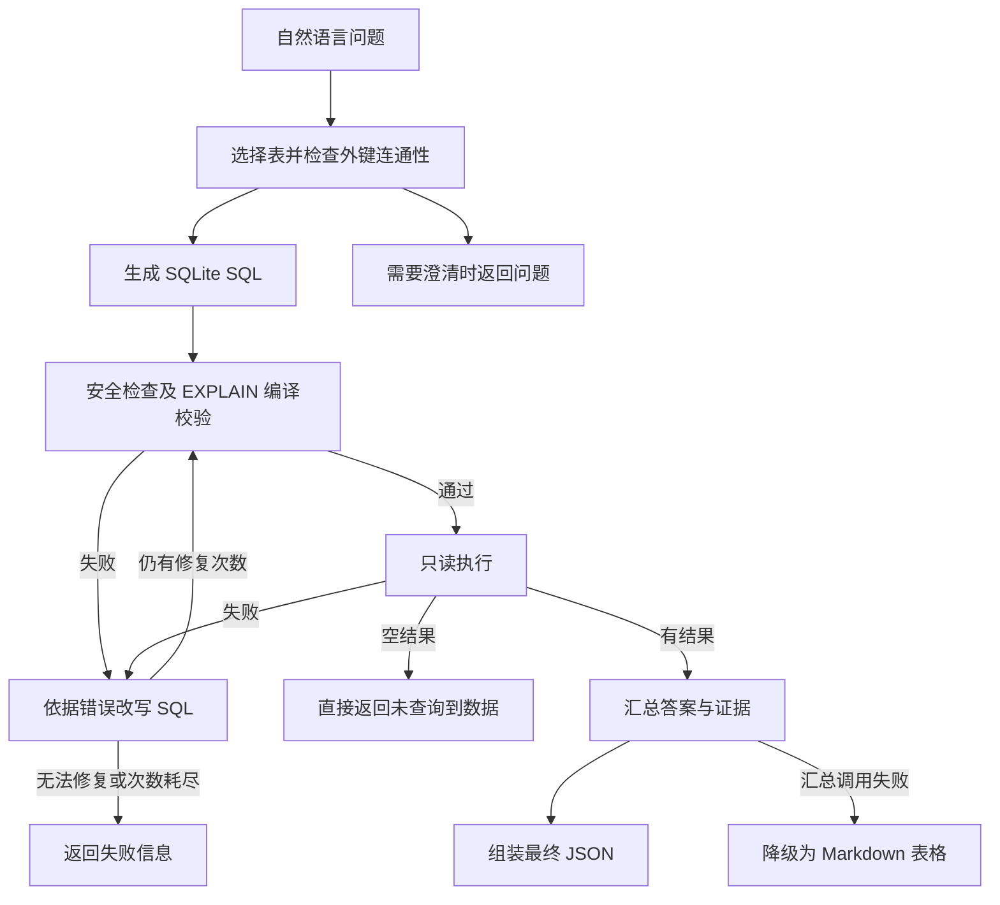

# Chinook SQL Agent

使用自然语言查询 Chinook 音乐商店 SQLite 数据库。程序通过四个 LLM Agent 完成选表、生成 SQL、错误修复和结果汇总，并由 Python 代码控制校验、执行及重试，最终输出 JSON。

本文按项目约定命名为 `REMADE.md`，作为项目使用说明。编码协作规范见 [AGENTS.md](AGENTS.md)。

## 当前状态

主程序位于 `src/sql_agent/`，使用 LangChain、LangChain OpenAI 集成、Pydantic 和 SQLAlchemy。默认模型端点及模型名称来自源码配置；是否可调用取决于实际服务与账号。

仓库目前没有依赖清单、版本锁文件或打包配置，`tests/` 为空。下文安装命令根据源码直接依赖整理，不代表已锁定并验证的完整依赖组合。`ref/` 中的 Notebook 和翻译示例是教学参考，不是主程序入口。

## 工作流程



- 数据库目录包含表、字段、行数和外键；选中的表会补充列统计与样例。
- 表选择最多尝试两次；SQL 默认允许初次尝试加三次改写。
- SQL 校验只编译，执行器使用只读连接，并限制执行时间、返回行数和单元格长度。
- 查询结果为空时不修复、不调用汇总模型；汇总失败时仍可返回表格答案。

## 目录结构

```text
Week13/
├── AGENTS.md                    # 编码协作指南
├── REMADE.md                    # 项目使用说明
├── ref/
│   ├── chinook.db                # 示例数据库
│   ├── sql-agent.ipynb           # SQL Agent 教学参考
│   └── agent-demo.py             # 显式多 Agent 编排参考
├── src/sql_agent/
│   ├── __init__.py              # 导出 SQLAgentWorkflow、WorkflowOutput
│   ├── __main__.py              # python -m sql_agent 入口
│   ├── cli.py                   # 参数、输入、JSON 输出
│   ├── config.py                # 配置
│   ├── logging_config.py        # 标准错误日志
│   ├── models.py                # Pydantic 数据契约
│   ├── workflow.py              # 显式流程编排
│   ├── agents/
│   │   ├── table_selector.py
│   │   ├── sql_generator.py
│   │   ├── sql_rewriter.py
│   │   └── result_summarizer.py
│   └── db/
│       ├── catalog.py           # schema、统计与缓存
│       ├── validator.py         # SQL 校验
│       └── executor.py          # 只读执行
└── tests/                       # 预留目录，目前为空
```

## 快速开始（Windows PowerShell）

在 `Week13` 目录执行以下命令。使用conda 中的py312环境。

### 1. 创建环境并安装依赖

```powershell
python -m venv .venv
.\.venv\Scripts\python.exe -m pip install --upgrade pip
.\.venv\Scripts\python.exe -m pip install "langchain>=1,<2" langchain-openai langgraph "pydantic>=2,<3" "SQLAlchemy>=2,<3"
```

这里直接使用虚拟环境中的解释器，无需激活脚本。`langgraph` 在当前选表模块中被直接导入；主程序不需要参考翻译示例使用的 `openai-agents`。当前没有打包配置，使用下面的 `PYTHONPATH` 设置加载源码。

### 2. 配置环境变量

```powershell
$env:PYTHONPATH = (Join-Path (Get-Location) 'src')
$env:DEEPSEEK_API_KEY = '替换为你的实际密钥'
$env:DEEPSEEK_URL = 'https://api.deepseek.com'
```

只在本机终端设置实际密钥，不要写进项目文件。环境变量仅对当前 PowerShell 及其子进程生效。项目没有自动读取 `.env` 的逻辑。

默认模型名称为 `deepseek-flash`；如果账号或端点不支持，请把 `SQL_AGENT_MODEL` 和 `SQL_AGENT_SUMMARY_MODEL` 都设置为服务实际支持的模型名称。代码使用结构化工具输出，并传入 `extra_body={"thinking": {"type": "disabled"}}`，更换服务时需检查其兼容性。

### 3. 运行查询

```powershell
.\.venv\Scripts\python.exe -m sql_agent "数据库中一共有多少首歌曲？"
.\.venv\Scripts\python.exe -m sql_agent "销售额最高的 5 个国家是哪些？" --log-level DEBUG
```

不传问题时，交互终端会提示输入；也支持从标准输入读取问题。成功进入查询流程后，最终 JSON 输出到标准输出，日志写入标准错误，可分别保存：

```powershell
.\.venv\Scripts\python.exe -m sql_agent "列出歌曲数量最多的 5 位艺术家" 1> result.json 2> run.log
```

日志可能包含问题、SQL、错误和答案片段。默认不写日志文件，文件来自上述重定向。Windows PowerShell 5.1 的重定向编码可能与 PowerShell 7 不同，读取保存的 JSON 时需注意编码。

## 配置项

所有配置都应在启动程序或导入 `sql_agent` 之前设置；运行中修改环境变量不会自动重建配置和 Agent。

| 环境变量 | 默认值 | 作用 |
| --- | --- | --- |
| `DEEPSEEK_API_KEY` | 无，运行查询必须设置 | 模型服务密钥 |
| `DEEPSEEK_URL` | `https://api.deepseek.com` | 模型 API 地址 |
| `SQL_AGENT_MODEL` | `deepseek-flash` | 选表、生成和改写模型 |
| `SQL_AGENT_SUMMARY_MODEL` | `deepseek-flash` | 结果汇总模型 |
| `SQL_AGENT_DB` | 项目根目录下的 `ref/chinook.db` | SQLite 文件；相对路径按项目根目录解析 |
| `SQL_AGENT_MAX_REPAIR_ATTEMPTS` | `3` | 初始 SQL 之后的最大改写次数 |
| `SQL_AGENT_MAX_ROWS` | `200` | 执行结果最多保留的行数 |
| `SQL_AGENT_MAX_SUMMARY_ROWS` | `50` | 最多交给汇总模型或降级表格展示的行数 |
| `SQL_AGENT_MAX_CELL_CHARS` | `2000` | 单元格文本长度限制，截断后追加 `...` |
| `SQL_AGENT_QUERY_TIMEOUT` | `5.0` | SQLite 执行阶段的时间限制，单位秒 |
| `SQL_AGENT_LOG_LEVEL` | `INFO` | 日志级别，可被 `--log-level` 覆盖 |

修复次数应使用非负整数，行数和文本长度使用正整数，超时使用正数。当前解析会对无法转换为数字的值回退到默认值，但没有完整的数值范围校验。SQL 执行超时不覆盖数据库目录统计和模型调用，也不是整个请求的总超时。

## 示例数据库

随附数据库含 11 张业务表：

| 数据范围 | 表 |
| --- | --- |
| 音乐内容 | `artists`、`albums`、`tracks`、`genres`、`media_types` |
| 播放列表 | `playlists`、`playlist_track` |
| 客户与员工 | `customers`、`employees` |
| 销售与明细 | `invoices`、`invoice_items` |

常见关联包括 `artists → albums → tracks`、`customers → invoices → invoice_items → tracks`，以及 `playlists → playlist_track → tracks`。代码从数据库实际外键读取连接关系，不硬编码这些路径。

表名为小写，列名包含 `TrackId`、`AlbumId`、`Name` 等。可以提出歌曲统计、流派分布、销售排名等问题；不相关或信息不足的问题可能返回澄清请求。自定义数据库也必须是现有 SQLite 文件，多表选择依赖其中声明的外键关系。

## 输出格式

下例展示“数据库中一共有多少首歌曲？”的一种输出形式。`3503` 来自随附数据库的本地只读查询；示例文案及模型生成 SQL 不代表一次真实模型调用记录。

```json
{
  "question": "数据库中一共有多少首歌曲？",
  "answer": "数据库中共有 3503 首歌曲。",
  "sql": "SELECT COUNT(*) AS TrackCount FROM tracks",
  "tables": ["tracks"],
  "row_count": 1,
  "truncated": false,
  "repair_attempts": 0,
  "evidence": ["歌曲总数：3503"],
  "caveats": [],
  "error": null
}
```

- `row_count` 是保留的 SQL 结果行数。`COUNT(*)` 返回一行，因此这里为 `1`，并不是歌曲数量。
- `truncated` 只标记执行器是否因行数上限截断，不标记单元格截断、SQL 自身的 `LIMIT` 或汇总阶段只读取部分行。
- `repair_attempts` 记录已接受并进入后续尝试的改写数量；模型返回 `cannot_fix` 的调用不计入该值。
- `evidence` 为答案证据，`caveats` 为解释限制或降级原因。最终 JSON 不直接包含原始结果行数组。
- 流程返回非空 `error` 时，CLI 输出 JSON 并以状态码 `1` 退出。空问题、需要澄清或查询结果为空通常不设置 `error`；启动期依赖、模型初始化或数据库打开失败可能直接抛异常，不能保证所有失败都有 JSON。

## 在 Python 中调用

先按上文设置依赖、`PYTHONPATH` 和密钥，再运行：

```python
import asyncio

from sql_agent import SQLAgentWorkflow


async def main():
    workflow = SQLAgentWorkflow()
    result = await workflow.run("销售额最高的 5 个国家是哪些？")
    print(result.model_dump_json(indent=2))


if __name__ == "__main__":
    asyncio.run(main())
```

在已运行事件循环的 Notebook 中，直接使用 `await SQLAgentWorkflow().run(...)`。工作流也支持注入 `catalog`、`validator`、`executor` 和覆盖 `max_repair_attempts`，便于隔离验证。

## 验证与排查

不调用外部模型的语法检查：

```powershell
.\.venv\Scripts\python.exe -m compileall -q src/sql_agent
```

当前没有自动化测试用例。后续添加 pytest 测试后，再安装 pytest 并执行 `python -m pytest tests -q`；语法检查不能代替功能测试或真实模型集成测试。

| 现象 | 排查方向 |
| --- | --- |
| `No module named sql_agent` | 确认从项目根目录运行，并将 `PYTHONPATH` 指向该目录的 `src` |
| 缺少 `langchain` 等模块 | 使用运行程序的同一个 Python 解释器安装依赖 |
| 缺少密钥或导入时初始化失败 | 在导入包之前设置 `DEEPSEEK_API_KEY`；模块级 Agent 可能先于 CLI 的密钥检查初始化 |
| 模型不存在、鉴权失败或请求参数不兼容 | 检查 API 地址、密钥、两个模型变量、工具调用及 `thinking` 参数支持情况 |
| 找不到数据库或无法打开 | 检查 `SQL_AGENT_DB`；相对路径以项目根目录为基准，数据库必须已经存在 |
| 返回澄清问题 | 补充统计口径，或确认表和外键是否能覆盖问题 |
| SQL 修复耗尽 | 查看 `error` 和标准错误日志，检查字段名、SQLite 语法及查询口径 |
| 答案变成表格 | SQL 已成功执行，但汇总 Agent 失败；查看 `caveats` 中的原因 |

## 当前限制

- 当前流程是单次问题查询，没有对话记忆、Web 界面或自动迁移数据库功能。
- 只读 URI、关键词检查和编译校验提供多层限制，但不是完整的 SQL 语义验证或通用安全沙箱。生成 SQL 的“仅使用已选表”目前主要由提示词约束，校验器没有实现所选表白名单。
- 汇总模型默认只收到前 50 行；即使执行结果未超过 200 行，汇总也可能只覆盖部分结果，不能据此推断未提供数据的统计结论。
- 目录初始化会对各表和列收集统计信息；大数据库的初始化成本可能较高。缓存以路径和文件修改时间判断更新。
- 问题、数据库结构、部分样例及结果会发送到配置的模型端点，使用自定义数据库时需要确认这些内容适合该服务。
- 依赖版本尚未锁定，当前机器缺少 LangChain 相关依赖；本次文档核对未执行真实模型端到端查询。
