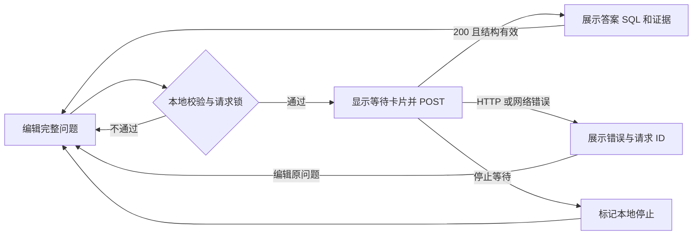

# SQL Agent 网页对话前端设计

状态：已获用户审查通过并实现。日期：2026-11-05。

本文记录审查通过的实现方式、交互和验收标准，页面、HTTP 托管与离线验收现已完成。现有后端契约见 [api-design.md](api-design.md)，启动及使用方法见 [REMADE.md](../REMADE.md)。

## 1. 实现方式

采用 **原生 HTML + CSS + JavaScript ES Modules，由现有 FastAPI 同源托管**。

用户启动一个 Python 服务，打开网页，输入自然语言问题，等待现有 SQL Agent 返回答案，在同一条回复中查看 SQL、证据和限制说明。前端调用已有 `POST /api/v1/queries`，业务编排继续由 `SQLAgentWorkflow` 完成。

| 方案 | 适配情况 | 本次决定 |
| --- | --- | --- |
| 原生 HTML/CSS/JS + FastAPI | 单页聊天、少量状态，直接复用现有 Python 服务，无 Node.js 运行或构建要求 | 采用 |
| React/Vue + TypeScript + Vite | 更适合多页面、复杂组件和持续扩展；当前需要额外引入构建、依赖及开发代理配置 | 后续需求扩大时重新评估 |
| Streamlit/Gradio | 能快速做演示，但会增加另一套应用入口与运行依赖，页面和交互定制方式也不同 | 本次不采用 |

选择依据是目前的单页范围和已有 HTTP 后端。原生方案需要自行保持状态与 DOM 更新一致，因此按请求、视图和交互拆分模块，不将逻辑全部写进一个 HTML 文件。上述比较是本项目的设计判断。

首版不新增第三方前端运行依赖、不加载 CDN、不增加 Python Web 框架。FastAPI 的静态资源挂载能力见 [官方文档](https://fastapi.tiangolo.com/tutorial/static-files/)。

## 2. 首版范围与对话含义

首版面向本机使用，包含：

- 中文聊天界面、多行文本输入、发送与等待状态。
- 当前页面内的多条问答记录；每条回复有自己的 SQL 和证据。
- 答案、证据、限制说明、SQL、所选表、保留结果行数及修复次数展示。
- 复制答案、复制 SQL、查看原始响应 JSON、编辑原问题后重新发送。
- HTTP 错误、服务状态、停止等待和清空记录。
- 桌面及手机宽度下的布局、键盘操作与中文输入法支持。

**聊天界面保留记录，但后端每次只接收一个完整问题，不携带历史上下文。** 页面在输入区附近持续提示：“独立查询，请写明完整条件。”例如上一条问“销售额最高的国家是哪里？”，下一条应输入“列出销售额最高的 5 个国家”，而不是仅输入“那前五呢？”。

后端需要澄清时，原样显示其 `answer`；用户点击“编辑问题”载入原问题，补齐条件后再次提交。前端不通过拼接聊天记录、调用额外模型或匹配回答文案来实现隐式记忆。

首版不包含跨刷新历史、用户登录、多会话侧栏、数据库上传或切换、SQL 编辑执行、实时节点进度、流式回答、图表、原始数据表格或 CSV 导出。当前 `WorkflowOutput` 没有 `columns` 和 `rows`，这些数据功能需要另行设计后端契约。

## 3. 页面布局与视觉

按用户后续样式要求，采用透明、白色和偏白浅灰配色：浅灰背景、半透明白色输入框和回复卡片、灰色按钮与正文。删除欢迎标语及介绍段落，仅保留输入、示例问题、状态和结果操作。用户消息靠右，Agent 回复靠左；SQL 使用等宽字体。采用系统字体，不引入图片和网络字体。

桌面端聊天区域水平、垂直居中，最大宽度 800px。空白页直接展示输入框，下方为简短的 Chinook 示例按钮；有记录后，在居中聊天区域内显示消息，输入区保持可见，消息区域独立滚动。手机端保持单列，按钮允许换行，SQL 和 JSON 在卡片内横向滚动，页面整体不产生横向滚动。

以下仅为布局草图，数值和回复均为示意，不是实际模型调用结果：

```text
┌─────────────────────────────────────────────────────┐
│ SQL Agent              服务与数据库：就绪  [重新检查] │
│                                                     │
│                 居中聊天区域                         │
│ 查询记录                               [清空记录]     │
│                                                     │
│               用户：数据库中一共有多少首歌曲？         │
│                                                     │
│ Agent                                               │
│ 数据库中共有 3503 首歌曲。                            │
│ 证据：歌曲总数：3503                                  │
│ 所选表 tracks · 保留结果 1 行 · SQL 修复 0 次          │
│ ▸ 查看 SQL               [复制答案] [编辑问题]         │
│ ▸ 查看响应 JSON                                     │
├─────────────────────────────────────────────────────┤
│ [输入完整的查询问题……                              ] │
│ 独立查询，请写明完整条件。           0 / 2000  [发送]  │
│ Enter 发送，Shift+Enter 换行                          │
└─────────────────────────────────────────────────────┘
```

空白页面在输入框下方展示 3 个完整的 Chinook 示例问题，点击只填入输入框，由用户发送。示例区标注“Chinook 示例”；它不代表已经识别当前服务端数据库。已有记录后收起示例区。

用户发送后滚动到该问题；回复到达时，仅在用户仍接近底部时自动跟随，否则显示“有新回复”按钮，避免打断阅读历史。按钮、折叠区和输入框都可通过键盘操作；等待区使用 `aria-live="polite"`，错误使用可读文本并保持可见焦点。

## 4. 一次查询的交互

1. 页面加载时调用一次 `/readyz`，显示“检查中”“服务与数据库就绪”“暂不可用”或“无法连接”。提供手动重查，不持续轮询，也不把就绪状态描述为模型可用。
2. 用户输入后，按去除首尾空白后的文本校验：1～2000 个 Unicode 码点。计数不直接使用 JavaScript 的 UTF-16 `length`，避免把一个常见 emoji 计为两个字符；服务端仍是最终校验依据。空白或超长时在输入区提示，不发请求。
3. 点击发送或按 Enter 提交；Shift+Enter 换行。中文输入法候选确认期间检查组合输入状态，Enter 不触发发送。
4. 同步设置请求锁，追加用户消息和等待卡片，清空已发送的输入；同一页面最多保留一个正在等待的查询。等待期间可以编辑下一条草稿，但不能再次发送；示例按钮也不提交请求。
5. 等待区显示“正在处理查询”和浏览器测得的已等待时间。超过 30 秒补充“仍在等待服务返回”；不显示百分比、伪造处理阶段或宣称 SQL 已执行。
6. 成功或失败后就地替换等待卡片，释放请求锁并清理计时器，保留下一条草稿。回复始终绑定本次问题的本地 ID。
7. “编辑问题”只把相应的原问题放入草稿，不立即执行；若草稿已有内容，先确认是否替换。再次发送创建新的问答，不覆盖历史结果。失败卡片也提供该操作，不自动重试。

服务状态是最近一次探针结果，只提供参考；探针失败不永久禁止提交，用户可在服务恢复后重试查询。查询成功后可更新状态为“最近查询成功”，但不能据此宣称模型持续可用。

### 停止等待与清空

请求等待时提供“停止等待”。调用 `AbortController` 中止浏览器等待，将该卡片标记为“已停止等待，服务端可能仍在处理”，释放本地锁。它不承诺取消 LangGraph、模型调用或 SQLite 执行；后端目前没有取消接口。再次提交可能与之前仍在运行的请求并行，页面不自动重新提交。

“清空记录”在有消息或草稿时先确认；确认后停止本地等待，清空消息和草稿，回到居中的空白输入布局。使用页面记录版本号与本地请求 ID 忽略迟到的结果；旧请求的 `finally` 也不能解除新请求的锁。刷新页面同样丢失记录，不能承诺取消服务端工作。

首版不设固定的浏览器查询总超时；连接失败或用户停止等待才结束本地等待。`SQL_AGENT_QUERY_TIMEOUT` 仍仅约束 SQLite 执行，不能拿其默认 5 秒作为页面请求总超时。

## 5. 响应展示与接口映射

### 请求

同源 `POST /api/v1/queries`，`Content-Type: application/json`，请求体仅含：

```json
{"question":"列出销售额最高的 5 个国家"}
```

使用相对 URL，不在浏览器中配置模型地址、API 密钥或数据库路径，不发送聊天记录和客户端控制的 SQL。`fetch` 必须显式检查 HTTP 状态；HTTP 4xx/5xx 不会自动作为网络异常处理，见 [MDN Fetch 文档](https://developer.mozilla.org/en-US/docs/Web/API/Fetch_API/Using_Fetch)。

### HTTP 200

| 已有字段 | 页面用途 |
| --- | --- |
| `question` | 保留在响应 JSON 中；聊天配对以本次提交记录为准 |
| `answer` | 默认展开的答案正文，保留换行 |
| `sql` | 非 null 时提供 SQL 折叠区和复制按钮；为 null 时显示“本次未返回 SQL” |
| `tables` | “所选表”标签；不将它们描述为未经验证的完整执行血缘 |
| `row_count` | SQL 非 null 时显示“保留结果 N 行”，不是业务总数 |
| `truncated` | true 时醒目提示“执行结果已按行数上限截断”；false 时不宣称数据完整 |
| `repair_attempts` | SQL 非 null 时显示“SQL 修复 N 次” |
| `evidence` | 非空时默认展开证据列表，逐项原样显示 |
| `caveats` | 非空时默认展开限制说明，保留汇总降级及范围说明 |
| `error` | 正常应为 null；200 中出现非空值视为响应异常，不包装成成功结果 |

原始 JSON 折叠区展示实际收到的成功响应；复制答案仅复制 `answer`，复制 SQL 仅复制原 SQL。剪贴板不可用或授权失败时显示复制失败提示，并允许用户手动选择文本。

页面区别处理以下情况：

- 有 SQL 且 `row_count > 0`：展示答案、证据和执行元信息。
- 有 SQL 且 `row_count == 0`：正常展示，并标注“查询返回 0 行”，不显示为错误，不自动重试。
- `sql == null`：显示回答和“本次未返回 SQL”；不把零行元信息显示成已经查询到空结果，也不自行判定澄清类型。当前成功契约没有显式澄清状态字段。
- 汇总降级：仍作为成功回复展示 `answer` 和 `caveats`，不通过分析文案决定业务状态。

**首版正文采用纯文本并保留空白，不解析 Markdown/HTML。** 后端的 Markdown 降级表格会以保留换行的文本展示，可选择复制或查看 JSON；本次不把该字符串解析为原始数据行。SQL、JSON 使用 `pre/code`，长行可横向滚动。

汇总默认只接收前 50 行，且当前响应没有实际汇总范围字段。页面在有 SQL 的回复下固定说明：“答案可能基于部分结果，请结合证据、SQL 和限制说明判断。”不在前端硬编码 50 或 200，不推算未返回的数据规模，不将 `truncated=false` 解释为完整答案。

### HTTP 错误与异常响应

错误卡片单独显示，保留对应的用户问题，不填充上一次的 SQL 或证据。

| 情况 | 页面行为 |
| --- | --- |
| 422 `validation_error` | 显示 `error.message` 和有效的 `details`；可编辑原问题后重发 |
| 415 `unsupported_media_type` | 提示客户端请求格式异常，不当作用户输入内容错误 |
| 500 `workflow_failed` / `internal_error` | 展示服务端固定提示，不声称失败 SQL 已执行或修复成功 |
| 503 `service_unavailable` | 显示服务暂不可用，提供重新检查服务状态及编辑问题操作 |
| 404 / 405 或其他非 2xx | 提示接口或服务异常；有合法错误体时展示其中的可读信息 |
| 网络中断 | 提示连接中断，执行状态未知；不自动重试 |
| 非 JSON、缺失字段或错误字段类型 | 提示“服务返回格式异常”，不把整页 HTML 或原始错误正文插入页面 |
| 用户停止等待 | 显示停止等待状态，说明服务端可能仍在处理 |

读取并展示响应头 `X-Request-ID`，便于定位后端日志；未获得响应时不生成或伪装服务端请求 ID。成功和错误体做最小运行时类型校验，包括数组元素、非负整数和可空字段，兼容额外的未知响应字段。

## 6. 状态、模块与数据边界

只维护页面内存状态：消息列表、输入草稿、当前请求、本地记录版本和最近探针状态。每次查询记录含本地 ID、提交的问题、开始时间、状态、成功响应或错误信息，以及可选的服务端请求 ID。状态限定为等待、成功、失败、已停止等待。



所有问题、答案、证据、SQL 和错误文案都视作外部文本，通过 DOM 的 `textContent` 等文本接口填入；不把它们写入 `innerHTML`，不执行模型生成的代码。相关机制见 [MDN textContent 文档](https://developer.mozilla.org/en-US/docs/Web/API/Node/textContent)。

记录不写入 localStorage、sessionStorage、URL 参数或浏览器端日志，也不新增统计 SDK。现有后端日志策略沿用项目设置。页面记录不持久化不代表服务端无日志。

本次不修改四个 Agent、工作流状态模型、SQL 校验和执行约束。前端只负责请求和展示，所有数据库访问继续通过现有只读工作流完成。

## 7. 实现文件与托管方式

下列文件已按审查通过的计划实现：

```text
src/sql_agent/api/
├── app.py                   # 增加首页路由及静态目录挂载
├── routes/web.py            # GET / 返回固定 index.html，不调用模型
└── static/
    ├── index.html           # 语义化页面骨架；加载 type=module 脚本
    ├── styles.css           # 响应式布局、消息和状态样式
    ├── main.js              # 事件、页面状态及请求生命周期
    ├── api-client.js        # Fetch、响应校验、错误规范化
    └── view.js              # 文本渲染、折叠区、复制及滚动
tests/api/test_web.py        # 首页、资源与原有路由不冲突的回归
tests/frontend/             # 客户端测试及可选浏览器交互验收
REMADE.md                   # 网页启动、使用方法和功能限制
```

- 增加 `GET /`，仅返回固定的前端入口；不启用通配符 SPA 回退。
- `/static/` 仅映射上述静态目录，不映射项目根目录或 `ref/`，不能下载数据库或源码。
- 静态目录通过服务端模块的 `__file__` 定位，不依赖启动时的工作目录。资源使用 `/static/...` 同源绝对路径。
- 保留 `/api/v1/queries`、`/healthz`、`/readyz`、`/docs`、`/openapi.json` 和统一错误处理；首页路由不出现在业务 OpenAPI 中。
- 未知页面和 API 路径仍返回 404，不回退为首页 HTML；静态资源不存在时也返回 404。
- 首版继续监听 `127.0.0.1:8000`；无需新增 CORS 配置、前端代理、Node 服务或环境变量。不进行公网托管发布。

网页启动命令与原后端相同，在已安装依赖、设置模型密钥的实际 Python 环境中执行：

```powershell
$env:PYTHONPATH = (Join-Path (Get-Location) 'src')
python -m uvicorn sql_agent.api.app:create_app --factory --host 127.0.0.1 --port 8000
```

启动后打开 `http://127.0.0.1:8000/` 使用聊天。后端接口与 `/docs` 继续可用；模块级 Agent 导入仍要求提前配置运行环境，前端方案不改变这一前提。

## 8. 实施顺序与验收

已完成静态托管、输入与请求状态、结果与错误展示、移动布局及验证，并同步更新 REMADE。后续如需改变本设计的核心范围（例如加入多轮记忆或返回数据行），先补充设计供用户审查。

| 验收场景 | 预期 |
| --- | --- |
| 打开首页 | 页面和资源可加载；现有 API、文档和探针路径行为保持一致 |
| 正常查询 | 一次提交只产生一次查询请求；问题、答案、SQL、证据相互对应 |
| 澄清回复 | 展示原回答，不显示错误；编辑后重新提交完整问题 |
| 空结果 | 明确 0 行，保留 SQL，不自动修复或重试 |
| 汇总降级与截断 | 保留原始答复及限制；行数和截断含义准确 |
| 空白、超长、emoji、中文输入法 | 校验和计数正确；确认候选词不发送请求 |
| 快速重复点击或 Enter | 页面等待期间只有一个查询请求 |
| HTTP 错误、非 JSON、结构异常、断网 | 显示可理解的错误，保留原问题，恢复可操作状态 |
| 停止等待、清空后迟到响应 | 旧结果不写入新记录，旧清理逻辑不影响新请求 |
| 外部文本包含 HTML/脚本 | 仅显示文本，不执行脚本或插入任意 HTML |
| 窄屏、长 SQL、键盘、复制失败 | 页面可操作，滚动和焦点正确，有复制失败反馈 |

已新增 HTTP 静态托管回归，复用已有临时库与异步工作流替身；在同一 `py312` 环境完成 `python -m compileall -q src/sql_agent`，pytest 共 85 项通过。前端客户端内置 Node 测试共 7 项通过；Chromium 浏览器共 8 组场景通过，覆盖正常结果、澄清、空结果、汇总降级、截断、错误与异常响应、断网、中文输入法、Unicode 长度、复制权限失败、外部文本安全展示、重复提交和迟到响应隔离；另检查桌面及 375px 窄屏截图。

上述查询响应均使用替身，没有真实模型端到端验证。浏览器工具仅安装于项目外的独立 QA 目录，项目没有新增运行依赖。读屏软件及多浏览器兼容性未单独验证；不能用离线测试声称这些部分已通过。

## 9. 已通过审查的决定

以下决定已经用户审查通过并用于本次实现：

1. 使用原生 HTML/CSS/JavaScript 模块，由现有 FastAPI 同源托管，保持单个服务启动。
2. 首版提供聊天记录与独立问题查询；真正的上下文追问另立后端扩展。
3. 展示现有答案、SQL、证据与限制，正文采用纯文本；暂不扩展原始行数组或可交互表格。
4. 采用浅色单页布局；记录仅留在当前页面内存，刷新或清空后丢失。
5. 请求不自动重试、不设置固定总超时；“停止等待”只表示浏览器停止等待。

“那前五呢？”这类上下文追问、完整数据表格和 Markdown 渲染作为后续扩展，需要先补充相应设计。
