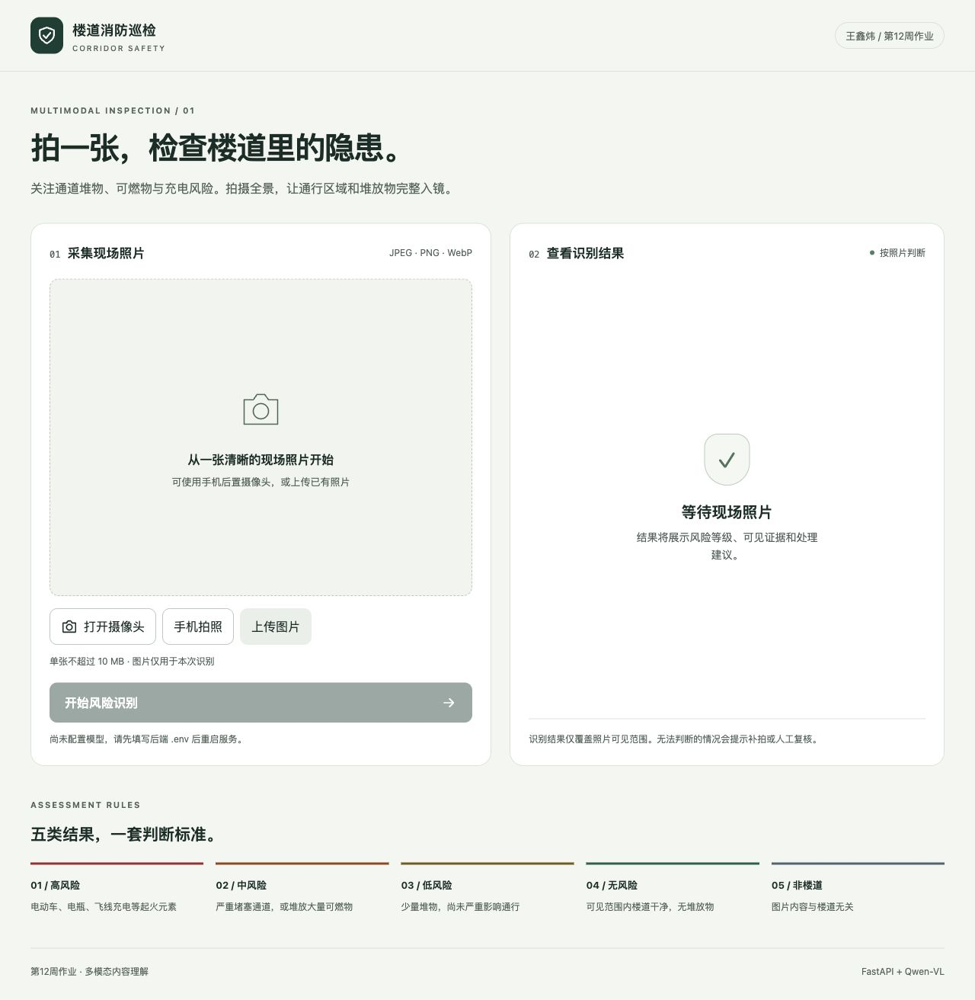
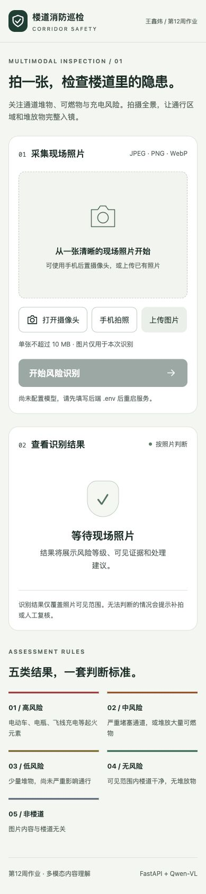

# 第十二周作业 · 王鑫炜

本目录包含两项可独立运行的作业：**楼道消防风险识别网页**和 **LangChain SQL Agent**。
使用 Python 3.11+，建议 Python 3.12。两项作业共用依赖和 `.env`，均从本目录运行。

## 1. 安装与配置

```bash
cd "/Users/wxw/Desktop/hub-iCQD/王鑫炜/week12"
python3.12 -m venv .venv
source .venv/bin/activate
python -m pip install -r requirements.lock.txt
cp .env.example .env
```

如果系统没有 `python3.12`，使用已安装的 Python 3.11+ 路径。也可使用 uv：

```bash
uv venv --python 3.12
source .venv/bin/activate
uv pip install -r requirements.lock.txt
```

编辑 `.env`，填写百炼 API Key 和对应业务空间的 OpenAI 兼容 Base URL。示例里的
`{WorkspaceId}` 必须替换；以控制台显示的地域、空间地址为准。旧账号如果使用课程里的
`https://dashscope.aliyuncs.com/compatible-mode/v1`，应先确认该地址仍适用于自己的账号。
默认视觉模型为 `qwen3-vl-plus`，SQL 模型为支持工具调用的 `qwen-plus`；可按账号权限修改。
密钥仅由 Python 后端读取，不填入网页，不提交 `.env`。

本作业选择题目允许的 **Qwen 方案**。题目中的“ds flash 4.1”缺少供应商和准确模型 ID，
未据此假定其具备图片输入能力。更换接口时需要同时核对视觉输入、工具调用、思考模式等参数支持。
`QWEN_DISABLE_THINKING=true` 用于关闭 Qwen 思考模式；兼容接口不支持该参数时改为 `false`。

## 2. 作业一：楼道消防风险识别

```bash
python -m uvicorn fire_inspection.app:app --host 0.0.0.0 --port 8000
```

电脑打开 <http://localhost:8000>；接口文档 <http://localhost:8000/docs>。
网页提供三种采集方式：

1. **打开摄像头**：`getUserMedia()` 获取实时画面，优先后置摄像头；点击“拍摄这一张”经 Canvas 生成 JPEG。
2. **手机拍照**：`input[type=file][accept="image/*"][capture="environment"]` 请求系统相机。是否直接打开相机由手机及浏览器决定，桌面可能显示文件选择器。
3. **上传图片**：选择 JPEG / PNG / WebP，预览后点击“开始风险识别”。

网页把图片作为 multipart 字段 `image` 上传到 `POST /api/inspect`；后端验证实际文件内容、
大小和像素，处理 EXIF 旋转并重新编码 JPEG，通过 Base64 `image_url` 发送给 Qwen-VL。
模型按 JSON Schema 提取视觉事实，再由 `classify()` 统一分级，返回证据、理由和处理建议。

### 风险标准与优先级

| 类别 | 规则 |
| --- | --- |
| 高风险 | 确认为楼道，且出现电动车、独立电瓶、飞线充电；补充明火/烟雾作为高风险因素 |
| 中风险 | 大量堆物严重影响通行，或存在大量纸箱、木质家具等可燃堆放物 |
| 低风险 | 有少量堆物，未观察到严重堵塞 |
| 无风险 | 照片清晰，楼道可见范围内无堆放物 |
| 非楼道 | 清晰图片与楼道场景无关；例如街道上的电动车不能据此判为楼道高风险 |

对确认的楼道，已观察到的起火因素优先于中、低风险；不能因图片局部模糊把已见的高风险降级。
若不能确认场景、图片质量不足，或无法确定堆放物规模/材质，返回
`status="needs_review", risk_level=null`（待复核），这是处理状态，不是第六种风险类别。
不把“看不清”解释为“没有”。普通自行车不直接当电动车，普通线缆不直接当飞线充电。

### 手机访问与相机权限

手机与电脑处于同一局域网，可用 `http://电脑局域网IP:8000` 打开网页并上传图片。
手机访问电脑的局域网 HTTP 地址时，浏览器通常会禁用 `getUserMedia()`；`localhost` 例外只针对运行浏览器的设备，
手机的 localhost 不指向电脑。

要使用**网页实时相机预览**，通过有受信任证书的 HTTPS 域名/反向代理访问本应用并允许摄像头权限。
也可以尝试“手机拍照”调用系统相机，再上传照片。不能通过忽略证书警告来代替可信 HTTPS。
前端在不支持实时相机、权限拒绝或设备不可用时提供提示；关闭相机、离开页面或切到后台时停止视频轨道。

### 接口示例

```bash
curl -X POST http://localhost:8000/api/inspect -F 'image=@/绝对路径/楼道.jpg'
```

成功字段包括 `status`、`risk_level`、`risk_label`、`reason`、`actions`、`observations`、`model`、`elapsed_ms`。
无效图片返回 400，超出 10 MB 返回 413，请求繁忙返回 429，缺少模型配置返回 503，
模型响应异常返回 502，超时返回 504。失败时不产生风险结论。
照片不写入应用持久存储；上传解析过程中可能有框架临时文件，会随请求关闭。
实际识别会把照片发送到配置的模型服务。本程序是课堂辅助巡检演示，照片结论仅覆盖可见范围。

## 3. 作业二：LangChain SQL Agent

先运行**不需要 API Key 的离线回放**：

```bash
python -m sql_agent --demo count
python -m sql_agent --demo join
python -m sql_agent --demo rewrite --json
```

这些案例使用明确标记的 `ScriptedChatModel` 提供预设工具调用，但实际执行
LangChain graph、真实数据库编译和 SQLite 查询。它们验证程序闭环，**不能证明真实模型理解或修复 SQL 的能力**。
`rewrite` 案例先查不存在的 `Amount` 字段，再改成 `Total`，真实总额为 `2328.60`，不添加未经说明的币种。

配置 `.env` 后进行真正的自然语言查询：

```bash
python -m sql_agent "有专辑的艺术家共有多少位？" --json
python -m sql_agent "购买曲目数量最多的前五个音乐流派是什么？" --json
python -m sql_agent "按国家统计销售额，列出前五名。" --json
```

默认连接本目录附带的 `sql_agent/data/chinook.db`。也可通过 `--db /绝对路径/xxx.db` 指定 SQLite 文件，
但业务提示词与字段权限围绕课程 Chinook 设计，更换业务库需要同步调整。
输出 `queries` 保留真实 SQL、列名、数据行和截断标记；`trace` 保留校验错误与修正后的执行轨迹。
`status=no_query` 表示没有取到数据库结果，不应把模型文字当作已验证的查询答案。

### 与第11周答案的关系

第11周个人答案在 `../week11/`。这里复制其 `database.py` 和 `data/chinook.db`，
保持独立运行，不依赖其他周的 Python 导入，也不修改之前的作业。
原答案是显式七步 workflow；课程 notebook 的 OpenAI Agents 草稿则使用 `Agent`、`Runner`、`function_tool`。
本次改用 LangChain 1.x 的 `create_agent()`、`ChatOpenAI` 和 `@tool`，工具选择、循环和报错反馈由框架管理。

| 工作步骤 | 本次 LangChain 实现 |
| --- | --- |
| 解析数据库 | 复用 `Database.parse()` 读取真实表、字段、外键、行数和日期范围 |
| 选择表 | 模型调用 `list_tables` 与 `describe_tables`，程序按外键补齐中间表 |
| 生成 SQL | 支持 tool calling 的 Qwen 依据字段与业务口径生成 SQLite 查询 |
| 校验 SQL | `check_sql` 使用 `EXPLAIN QUERY PLAN`，不通过执行查询来校验 |
| 执行 SQL | `query_sql` 只接受之前成功校验过的完全相同 SQL |
| 错误修正 | 工具错误回传给模型，修正后重新校验；3 次错误或 graph 步数上限即停止 |
| 结果总结 | 模型根据真实工具结果回答，程序保留 SQL/rows 供核对 |

执行层采用 `mode=ro`、`query_only`、SQLite authorizer、函数与表/列权限约束、指令/时间预算和结果行数/字节限制。
权限错误立即停止当前问题，不能通过改写绕过。编译正确不代表业务正确：仍需检查连接粒度、
发票头/明细重复计数、时间范围和金额口径；模型最后的自然语言总结也可能出错，需与 `queries` 核对。

## 4. 文件与验证

```text
week12/
├── README.md
├── .env.example
├── requirements.txt / requirements.lock.txt
├── common.py
├── fire_inspection/       # 作业一：后端、视觉事实、分级规则和网页
├── sql_agent/             # 作业二：LangChain 工具循环、数据库与离线回放
├── tests/                 # 自动化检查
└── docs/                  # 实现说明、验证报告、浏览器截图
```

```bash
python -m pytest -q
node --check fire_inspection/static/app.js   # 可选：安装了 Node.js 时检查 JS 语法
```

`requirements.txt` 是兼容范围；`requirements.lock.txt` 固定本次验证的确切版本。
测试使用假密钥/注入响应或 HTTP MockTransport，不消耗真实模型额度。
详细验证与未验收项目见 [验证报告](docs/验证报告.md)。

## 5. 参考材料

- 本地课程：`第12周：多模态大模型和RAG应用/Week12_2026Q2/02-多模态大模型/案例-多模态内容理解.ipynb`。
- 本地课程：`第11周-ChatBI数据智能问答/Week11/04_SQL-Code-Agent-Demo/sql-agent.ipynb`。
- 个人答案：`hub-iCQD/王鑫炜/week11/`。
- [百炼图像与视频理解](https://help.aliyun.com/zh/model-studio/vision)：图像输入、Base64 及兼容调用。
- [LangChain SQL Agent 官方教程](https://docs.langchain.com/oss/python/langchain/sql-agent)：工具调用和查询修正循环。
- [MDN getUserMedia](https://developer.mozilla.org/en-US/docs/Web/API/MediaDevices/getUserMedia)：相机权限与安全上下文。

桌面页面预览（未配置模型密钥的真实页面）：



手机宽度页面预览：


