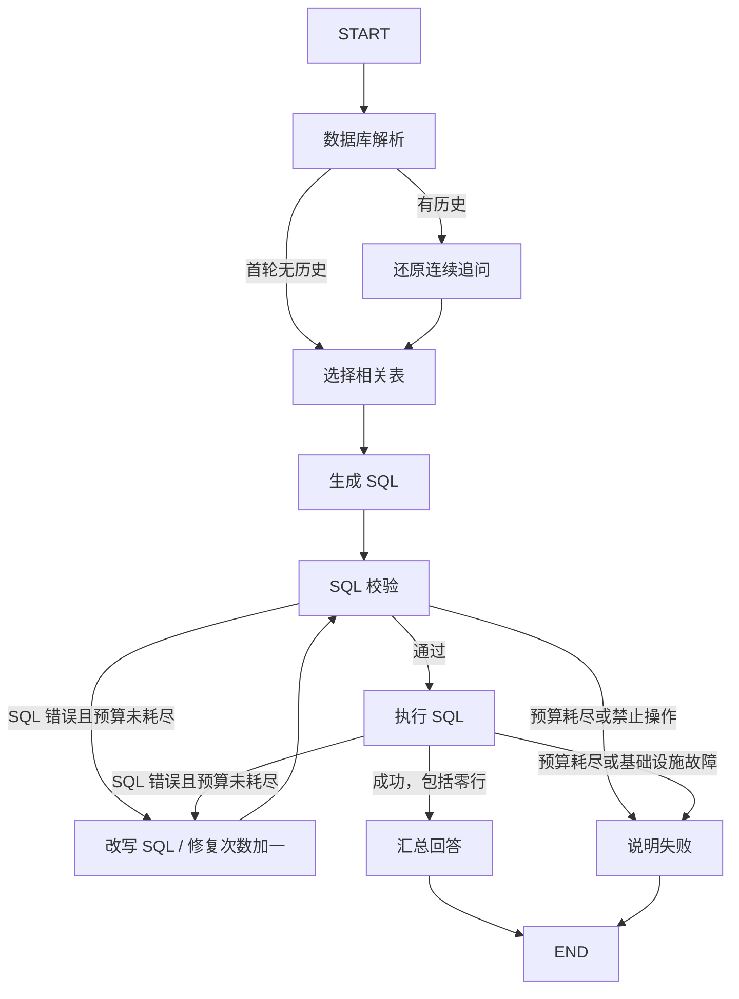

# 第 13 周：LangGraph SQL Agent 与网页对话查询

使用 LangGraph Graph API 实现课程要求的完整 SQL 工作流：数据库解析、选表、SQL 生成、SQL 校验、SQL 改写、SQL 执行和结果汇总。数据使用第 11 周 `sql-agent.ipynb` 配套的 Chinook 数据库。

作业 1 是 `sql_agent.py` 中的完整 LangGraph SQL Agent；作业 2 使用 `web_app.py` 和 `web/` 为同一 Agent 提供网页聊天界面。支持对话记录、实际执行进度、结果表格、SQL 查看、CSV 下载和手机布局。

## 作业 2：启动网页

默认已配置 DeepSeek。打开本地 `.env`，只在 `DEEPSEEK_API_KEY=` 后填写自己的密钥；地址和模型名称已填好。缺少密钥时网页明确显示“DeepSeek · 待配置”，不会自动退回离线模式。

完成下方依赖安装并填写密钥后，在本目录运行：

```bash
# DeepSeek 自由提问和连续追问
python web_app.py

# 如需查看固定离线案例，显式开启演示模式
python web_app.py --demo
```

浏览器打开 **http://127.0.0.1:8013**。DeepSeek 模式可自由输入有关本地数据库的问题，例如“消费金额最高的前3位美国客户是谁”，随后追问“那前五位呢”。网页会展示对追问的完整理解、实际 SQL 与返回结果。离线模式中可勾选“演示自动修复”，观察错误 SQL 经修复后成功执行。

真实模型会收到最近 12 条对话消息，包括历史回答、实际 SQL 和少量结果预览；有历史时先运行指代消解节点，将追问改写为独立查询问题。离线模式只支持下方 4 个固定问题。密钥只保存在服务端；会话记录保存在当前标签页的 sessionStorage 中。

DeepSeek 配置与接入验证见 [DeepSeek接入说明](docs/DeepSeek接入说明.md)。网页初版架构和界面验证见 [作业2说明](docs/作业2说明.md) 与 [作业2验证报告](docs/作业2验证报告.md)。

## 文件

| 文件 | 用途 |
|---|---|
| `sql_agent.py` | 状态定义、模型接口、数据库操作、全部节点、条件边和命令行入口 |
| `web_app.py` | 作业 2 FastAPI 服务、流式聊天接口和网页入口 |
| `model_config.py` | DeepSeek 默认配置、密钥读取、模式与准备状态 |
| `web/` | 不依赖 CDN 或前端构建工具的 HTML、CSS、JavaScript |
| `data/chinook.db` | 课程数据库的副本，11 张表；程序只读访问 |
| `.env.example` | 真实模型配置示例 |
| `requirements.txt` / `requirements-lock.txt` | 依赖范围 / 本次验证的锁定版本 |
| `tests/test_sql_agent.py` | 不消耗模型 API 的工作流与 SQL 集成测试 |
| `tests/test_web_app.py` | 网页服务、流式事件、历史上下文与请求隔离验证 |
| `tests/test_deepseek.py` | DeepSeek SDK 请求、JSON 输出、两轮追问与配置验证 |
| `workflow.mmd` | 从实际编译图导出的 Mermaid 图 |
| `examples/` | 实际运行产生的成功和修复案例、验证记录 |

## 安装和运行

需要 Python 3.10 或以上，建议使用 Python 3.12。在本目录运行：

```bash
python3 -m venv .venv
source .venv/bin/activate
python -m pip install -r requirements-lock.txt

# 不需要模型密钥：离线固定案例 + 真实 SQLite + 真实 LangGraph
python sql_agent.py --demo

# 故意生成不存在的字段，观察校验失败、修复和重新执行
python sql_agent.py --demo --inject-bad-sql

# 零行结果也是成功，不应进入修复循环
python sql_agent.py --demo "查询来自 Atlantis 的客户"

# 零次修复预算：失败后直接说明原因，退出码为 1
python sql_agent.py --demo --inject-bad-sql --max-retries 0

# 所有自动验证
python -m unittest discover -s tests -v
```

Windows 使用 `.venv\Scripts\activate` 激活环境。也可使用 uv：`uv venv --python 3.12`，然后 `uv pip install -r requirements-lock.txt`。

离线模式仅支持以下固定问题，其模型输出是显式写好的演示替身：

- 所有发票的总金额是多少？
- 一共有多少位客户？
- 消费金额最高的前 3 位客户是谁？
- 查询来自 Atlantis 的客户

离线模式真实执行选表后的 SQL、校验与修复路由，但不证明通用自然语言理解能力。自由提问需要下面的真实模型配置。

## 使用 DeepSeek

本地 `.env` 已创建，复制代码到其他机器时可从 `.env.example` 创建。只需填写第一项：

```dotenv
DEEPSEEK_API_KEY=填入你自己的DeepSeek密钥
DEEPSEEK_BASE_URL=https://api.deepseek.com
DEEPSEEK_MODEL=deepseek-flash
SQL_AGENT_PROVIDER=deepseek
SQL_AGENT_MODE=live
```

`.env` 已被 Git 忽略，环境变量优先于文件配置。修改密钥后重启后端并刷新网页。默认模型为官方当前列出的 `deepseek-flash`；如需其他模型，可自行修改 `DEEPSEEK_MODEL`。这里使用 JSON 输出和非思考模式处理各节点，不把模型内部推理传给网页。

```bash
python sql_agent.py "每个国家的客户数量是多少？按数量降序排列"
python sql_agent.py "列出销售额最高的前5种音乐类型"
```

首轮通常调用选表、生成和汇总三个模型节点；连续追问增加一个问题还原节点。修复仅在 SQL 错误时触发。初始选表及修复会包含完整表目录。其他服务的 `OPENAI_API_KEY` 不会被自动拿来调用 DeepSeek。

已使用真实 DeepSeek 完成自由提问和两轮连续追问验证，本次返回结果与独立数据库查询一致。验证摘要见 [真实调用验证](docs/DeepSeek真实调用验证.md)。本次样例通过不代表所有自然语言问题均正确。

## 图结构



节点内部发生模型响应或数据库读取错误时，也会进入 `handle_failure`；实际全部边以 `workflow.mmd` 为准。可运行 `python sql_agent.py --graph` 重新查看，无需模型密钥。

## State、节点和条件边

`SQLState` 是所有节点之间传递的数据。数据库连接、模型客户端通过闭包注入，不放进状态。

| 字段 | 含义 |
|---|---|
| `question` | 原始用户问题，修复时仍要保留 |
| `resolved_question` / `history` | 还原后的独立问题 / 最近对话上下文 |
| `catalog` / `schema` | 全库表结构（包含外键）/ 本次选中表结构 |
| `selected_tables` / `sql` | 当前选表与待执行 SQL |
| `results` | `None` 表示没有成功结果；`[]` 表示成功但没有匹配行 |
| `error` / `error_kind` | 当前错误及类型，成功校验/执行后清空 |
| `fails` | 历史错误列表，修复成功后仍保留，用于复盘 |
| `retry_count` | 已发起的 SQL 修复次数，不是执行失败次数 |
| `summary` / `status` | 最终回答 / running、success 或 failed |
| `truncated` / `trace` | 是否截断展示结果 / 实际访问节点顺序 |

节点返回部分更新。这里未配置列表 reducer，所以 `fails` 和 `trace` 使用 `旧列表 + 新元素` 显式追加，避免覆盖历史或重复拼接。

普通边用于固定下一步，条件边用于判断成功、修复或结束。默认最多修复两次：初次 SQL 加上两次修复，最多校验三版 SQL。修复时传入原问题、旧 SQL、当前错误、历史错误和表结构。连接故障、权限拒绝、超时不盲目改写 SQL。

本作业采用多个模型处理节点组成工作流，不要求每个节点都另建一个自主 Agent：校验、执行、路由用普通 Python；选表、生成、修复、汇总由模型完成。

## 校验与结果边界

- 使用 SQLGlot 解析单条只读查询；支持 SELECT、WITH、JOIN、聚合、子查询及 UNION。
- 用 `EXPLAIN QUERY PLAN` 检查字段、表和 SQLite 语法，不在校验节点实际执行查询。课程旧版 `check_sql` 会执行 SQL，本实现避免重复执行。
- SQLite 使用 `mode=ro`、`query_only` 和 authorizer；不允许修改数据库、访问其他数据库、加载扩展或读写系统文件。
- 单次查询默认有 3 秒计算时间限制；默认最多返回 100 行，额外读取一行判断截断，汇总会收到截断标记。截断前的查询仍可能计算全量聚合。
- SELECT 中存在同名输出列时要求增加别名，避免转字典时悄悄丢失数据。
- 汇总模型故障时保留成功查询结果并返回原始数据，不为了生成文字重新执行 SQL。
- SQL 可执行性校验不能验证业务含义，不能代替对统计口径、关联关系和问题理解的评测。

## 额外参数和验证参考

使用 Python 3.12.14、LangGraph 1.2.19 验证：DeepSeek 接入后合计 53 项自动测试通过，未新增依赖。包括使用真实 OpenAI SDK、模拟 HTTP 传输和实际 SQLite 的两轮查询测试。作业 1 初版的命令行记录与网页初版截图仍保留供对照。

```bash
python sql_agent.py --demo --max-rows 2 "消费金额最高的前 3 位客户是谁？"
python sql_agent.py --demo --json
python sql_agent.py --db /你的路径/其他数据库.db "你的问题"
```

固定数据库参考结果：发票总金额为 `2328.60`，客户数为 `59`；消费金额前三位客户 ID 为 `6、26、57`，对应金额为 `49.62、47.62、46.62`。不根据数据库之外的信息猜测币种。

实现参考：[LangGraph Graph API](https://docs.langchain.com/oss/python/langgraph/graph-api)、[LangGraph Quickstart](https://docs.langchain.com/oss/python/langgraph/quickstart)、[SQLite URI 只读模式](https://sqlite.org/uri.html)、[SQLite authorizer](https://sqlite.org/c3ref/set_authorizer.html)、[SQLGlot](https://github.com/tobymao/sqlglot)。

DeepSeek 参考：[接口与模型名称](https://api-docs.deepseek.com/)、[JSON 输出](https://api-docs.deepseek.com/guides/json_mode/)、[多轮对话](https://api-docs.deepseek.com/guides/multi_round_chat/)。
