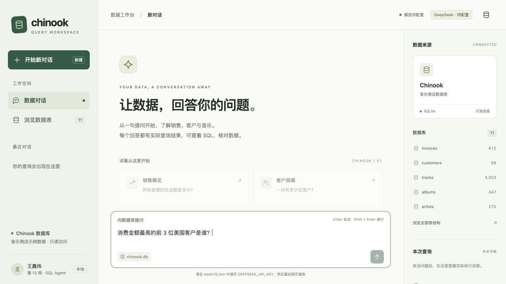

# DeepSeek 自由提问与连续追问

## 只需填写 API Key

打开 `王鑫炜/week13/.env`，在这一行的等号后填写你自己的 DeepSeek API Key：

```dotenv
DEEPSEEK_API_KEY=
```

其他项已设好：服务地址 `https://api.deepseek.com`、模型 `deepseek-flash`、服务商 `deepseek`、模式 `live`。`.env` 已被 Git 忽略，不放入作业提交。

在本目录运行：

```bash
.venv/bin/python web_app.py
```

打开 http://127.0.0.1:8013 。如果后端已经在运行，先停止旧进程，再重新启动并刷新网页。不要带 `--demo`，该参数会明确切换为固定离线演示。

## 连续追问

可以按下面顺序输入：

1. `消费金额最高的前 3 位美国客户是谁？`
2. `那前五位呢？`
3. `改成加拿大，其他条件不变。`

前端会把最近对话中的用户问题、回答、实际执行 SQL 和少量结果预览带到后端。有历史时，图先执行 `resolve_question`：例如将第二句还原为“消费金额最高的前 5 位美国客户是谁”。后续选表、SQL 生成、修复和汇总使用这个完整问题，并保留原始问题。

还原内容与用户原文不同时，网页显示“本次理解”，可以对照 SQL 检查筛选条件与统计口径是否保留。信息不足时模型可以返回澄清问题，图停止执行 SQL，等待用户补充。

浏览器只保留最近 12 条消息作为模型上下文，前端限制消息长度并最多附带 3 行历史结果预览。这是有界上下文，不是无限长期记忆；开始新对话会清空当前查询的历史输入。

## 调用协议与错误处理

- 通过官方兼容格式的 Chat Completions 接口调用 DeepSeek。
- 各模型节点启用 `response_format={"type":"json_object"}`，提示词提供 JSON 格式示例。
- 使用 `thinking.type=disabled` 和 `max_tokens=4096`，输出只解析最终 `content`。
- 对 JSON 模式全空白结果最多再尝试一次；输出截断时明确报告，不执行残缺 SQL。
- 鉴权失败、余额不足和限流分别显示明确提示，不把 SDK 原始请求信息或密钥放进网页。
- 默认是 DeepSeek 真实模型模式；未填写密钥时显示待配置并禁止发送，不自动伪装成离线回答。
- `ready=true` 仅表示填写了非空配置，不代表已经通过服务商鉴权；鉴权以实际请求结果为准。

默认模型按 2026-11-04 的官方文档配置。若服务商后续调整模型名称，修改 `DEEPSEEK_MODEL` 即可。可显式选择 `SQL_AGENT_PROVIDER=openai` 和 `OPENAI_*` 配置使用其他兼容服务，但不会把其他服务密钥自动发给 DeepSeek。

## 本次验证

合计 **53 项自动测试通过**，JavaScript 语法检查通过。原来的 38 项工作流与网页测试继续通过，新增 15 项 DeepSeek 专项测试。

重点验证：

- 仅填写 `DEEPSEEK_API_KEY` 即可使配置就绪。
- 缺少密钥时保持真实模型待配置状态，不回退到离线模式。
- 使用真实 OpenAI SDK 和模拟 HTTP 传输，验证请求发往 DeepSeek 路径、JSON 模式、关闭思考参数、原生多轮消息顺序。
- 用实际 SQLite 执行两轮查询：第一轮返回 3 位美国客户，第二轮“那前五位呢”返回 5 位，并保留 `Country='USA'` 筛选。
- 空白 JSON 的重试次数有上限；401、402、429 错误说明不泄露密钥；输出长度截断不进入执行。
- 网页未填密钥时显示“DeepSeek · 待配置”、明确填写位置，发送按钮禁用。

已完成真实 DeepSeek 网页调用：自由提问和两轮连续追问均通过，本次返回结果与独立数据库查询一致。详见 [真实调用验证摘要](DeepSeek真实调用验证.md)。专项自动测试仍使用模拟响应，不访问外部 API。



## 官方依据

[接口地址与当前模型名](https://api-docs.deepseek.com/)、[JSON 输出](https://api-docs.deepseek.com/guides/json_mode/)、[多轮对话](https://api-docs.deepseek.com/guides/multi_round_chat/)、[思考模式开关](https://api-docs.deepseek.com/guides/thinking_mode/)、[错误码](https://api-docs.deepseek.com/quick_start/error_codes/)。
