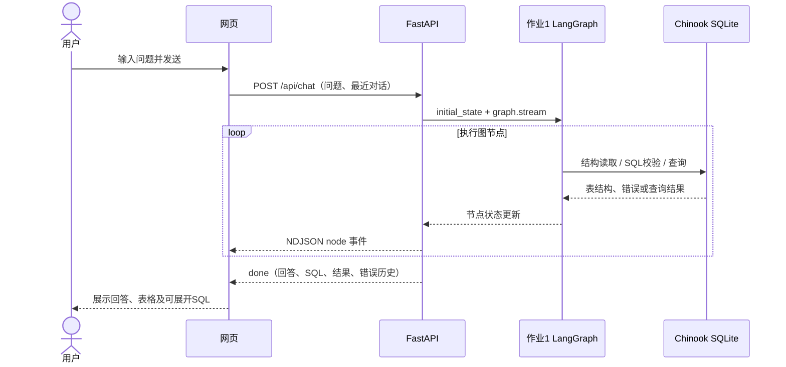

# 作业 2：通过网页对话查询 SQL Agent

用户在网页中输入自然语言，网页通过 HTTP 请求调用 FastAPI，FastAPI 执行作业 1 的 LangGraph 图，并实时返回节点进度及最终答案、SQL 和数据表格。

## 启动

在 `王鑫炜/week13/` 安装依赖后运行：

```bash
python web_app.py
```

访问 http://127.0.0.1:8013 。本地默认仅绑定 `127.0.0.1`。可用 `--port` 指定其他端口。

DeepSeek 接入后，`.env` 中的地址、模型和模式均已配置，只需填写 `DEEPSEEK_API_KEY`。默认使用 `deepseek-flash` 和真实模型模式；缺少密钥时明确提示待配置。固定离线案例需显式运行 `python web_app.py --demo`。详情见 [DeepSeek接入说明](DeepSeek接入说明.md)。

## 架构



前端是原生 HTML/CSS/JavaScript，后端同时提供静态资源和 API，因此不需要另外启动 Node 服务或设置跨域代理。流式内容是节点进度，最终回答在汇总节点完成后显示，未模拟逐字生成效果。

## 功能

- 发送文本、Enter 发送、Shift+Enter 换行，并兼容中文输入法组合输入。
- 生成过程中显示真实节点进度，禁止重复提交；网络中断和查询失败都有明确说明。
- 展示实际返回数据，区分成功但零行与查询失败。
- 展开 SQL、复制 SQL、按结果列排序、下载 UTF-8 CSV。
- 展示已修复次数和历史诊断信息；离线模式支持故障注入演示。
- 浏览 11 张表的真实字段、类型、主键和行数。
- 创建新对话、切换最近对话；当前标签页最多保留 8 个会话。
- 真实模型收到最近 12 条历史消息，包含历史回答、SQL 和少量结果预览；有历史时先把追问还原为独立问题，再选表和生成 SQL。客户端限制上下文长度，服务端再次校验。
- 手机宽度使用可收起导航，表格在容器内横向滚动，页面本身不溢出。

SQL Agent 增加可选 `history` 和 `resolved_question` 字段，旧版 `initial_state(question)` 和命令行入口仍可使用。执行查询、校验、修复和只读约束继续使用作业 1 的实现。

## HTTP 接口

| 方法与路径 | 功能 |
|---|---|
| `GET /` | 网页聊天界面 |
| `GET /api/health` | 服务状态与模式 |
| `GET /api/config` | 模式、是否配置、示例问题、表数和返回行数上限 |
| `GET /api/schema` | 数据库表、字段、主键、行数 |
| `POST /api/chat` | 执行当前问题，返回 NDJSON 事件流 |
| `GET /docs` | FastAPI 自动接口文档 |

请求示例：

```json
{
  "question": "所有发票的总金额是多少？",
  "history": [],
  "inject_bad_sql": false
}
```

`history` 最多 12 条，角色只能是 `user` 或 `assistant`；不接收客户端的 `system` 指令。问题不能空白、最多 2000 字。故障注入仅限离线模式。

事件按行编码为 JSON：

```json
{"type":"start","mode":"demo"}
{"type":"node","node":"execute_sql","label":"执行数据库查询","failed":false,"retry_count":0}
{"type":"done","result":{"status":"success","sql":"...","results":[{"total_amount":2328.6}],"summary":"..."}}
```

最后一行的 `result` 还包括选表、历史错误、修复次数、执行耗时及实际节点轨迹。输入校验失败返回 HTTP 422，模型未配置返回 HTTP 503；流启动后的意外中断返回 `error` 事件。客户端必须收到 `done` 才视为完成。

## 数据与显示边界

- 只有查询问题、历史消息、必要表结构和结果进入模型上下文；完整表目录不会作为聊天响应返回给网页。
- 每个请求重新初始化图状态，不跨请求共享错误历史和修复计数。
- 模型或用户文本通过 `textContent` 显示，不作为 HTML 执行。
- CSV 以 UTF-8 BOM 编码，对危险公式起始的字符串添加前缀，避免被表格软件直接当成公式。
- 对话上下文被转发到模型不等于模型必然理解正确；真实模型对追问的效果仍需要实际模型评测。

实现参考：[FastAPI 静态文件](https://fastapi.tiangolo.com/tutorial/static-files/)、[FastAPI StreamingResponse](https://fastapi.tiangolo.com/advanced/custom-response/)、[LangGraph streaming](https://docs.langchain.com/oss/python/langgraph/streaming)。
