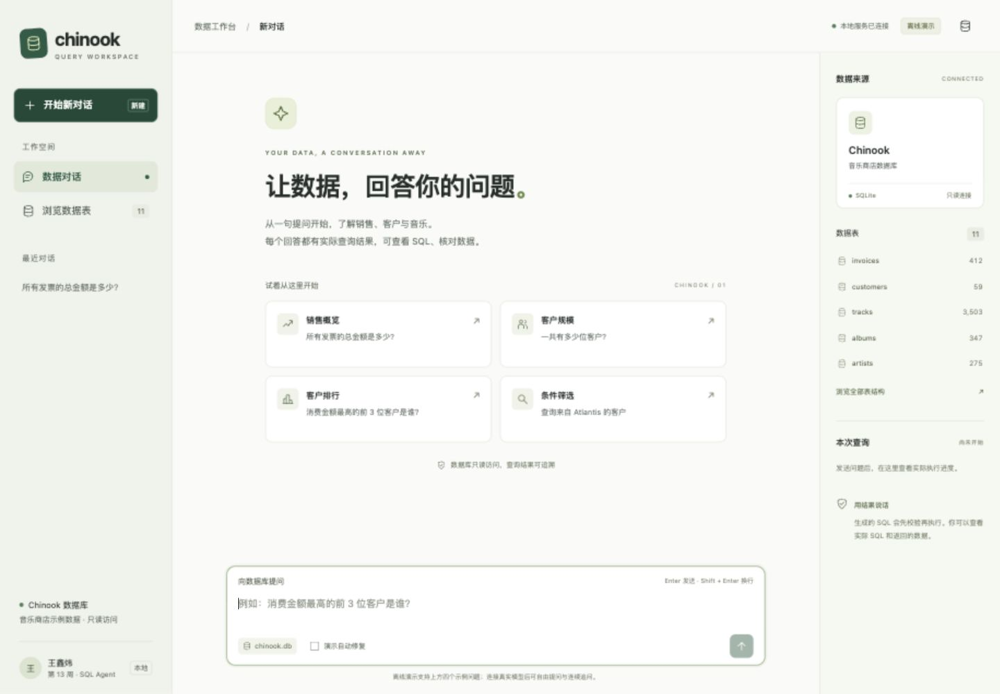
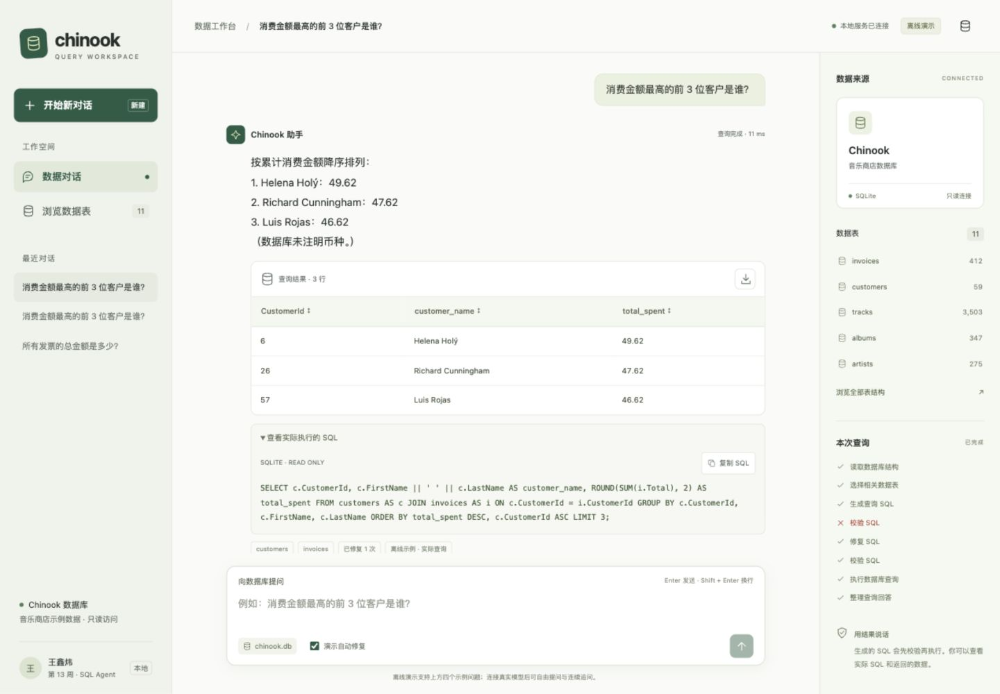
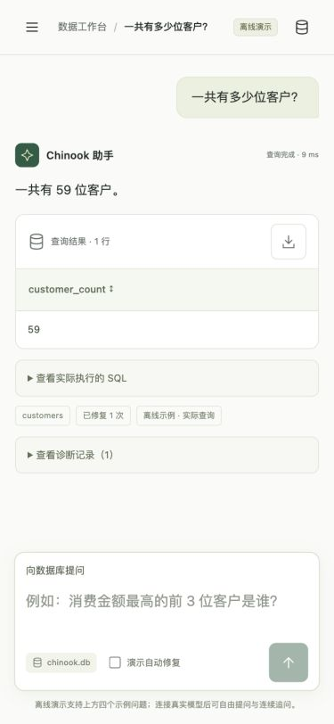

# 作业 2 验证报告

验证日期：2026-11-04。环境：macOS、Python 3.12.14、LangGraph 1.2.19、FastAPI 0.162.0、Uvicorn 0.54.0。

## 自动验证

```bash
python -m unittest discover -s tests -v
node --check web/app.js
uv pip check --python .venv/bin/python
```

结果：38 项测试通过（作业 1 回归测试 24 项，作业 2 服务测试 14 项）；JavaScript 语法检查通过；49 个 Python 依赖兼容性检查通过。

作业 2 验证覆盖：静态资源、服务状态与模式、真实表结构与行数、完整 LangGraph 事件流、SQL 自动修复、空结果、联表查询、输入限制、未配置真实模型时明确报错、历史消息送入各模型节点、修复次数耗尽、请求状态隔离和结果截断标记。

## 浏览器验证

通过本机网页 http://127.0.0.1:8013 实际操作，未通过修改页面内容伪造结果。

| 场景 | 结果 |
|---|---|
| 点击发票总额示例 | 显示 `2328.60`，表格中实际聚合值为 `2328.6` |
| 输入前三位客户问题 | 返回客户 ID `6、26、57`，金额 `49.62、47.62、46.62` |
| 勾选演示自动修复 | 首次字段错误后进入修复节点，再校验、执行，显示已修复 1 次 |
| 展开 SQL | 显示实际执行的 JOIN、GROUP BY、ORDER BY 和 LIMIT 语句 |
| 点击 CSV 导出 | 下载 UTF-8 CSV，表头及三行数值与 SQL 返回结果一致 |
| 点击金额列排序 | 升序显示 `46.62、47.62、49.62`，原始查询结果不被修改 |
| 浏览数据表 | 弹窗显示全部 11 张表、实际字段和行数 |
| 创建新对话、切换导航 | 网页恢复空会话，可在手机宽度展开和收起导航 |
| 375×812 窄屏 | 页面宽度为 375，无页面横向溢出；客户数结果显示为 59 |
| 812×375 横屏 | 页面宽度为 812，无页面横向溢出，问题输入框可用 |
| 减少动态效果设置 | `prefers-reduced-motion: reduce` 生效，已实现关闭过渡和旋转动画的规则 |
| 未展开的手机导航 | `visibility: hidden`，不保留屏幕外可聚焦按钮 |
| 输入 HTML 样式文本 | 原样显示为文本，聊天区域未生成 img 元素，也未执行脚本 |
| 不受支持的离线问题 | 明确显示查询未完成，提供编辑问题后重试入口 |
| 浏览器错误日志 | 本次检查未出现 JavaScript error 日志 |

浏览器为测试设置的尺寸与媒体偏好均在验证后恢复。

## 界面截图

桌面首页：



桌面联表查询与 SQL：



手机查询结果：



## 验证边界

本次真实运行了 FastAPI、LangGraph 和 SQLite 查询，模型服务未配置实际 API 密钥。离线模型替身支持 4 个固定问题；真实模型接口的请求构造和历史上下文传递经过模拟测试，但真实模型自由提问、连续追问的语义准确性及网络表现尚未做端到端验证。

SQL 能够执行不代表业务口径一定正确，模型回答仍应结合展示的 SQL 和结果核对。
