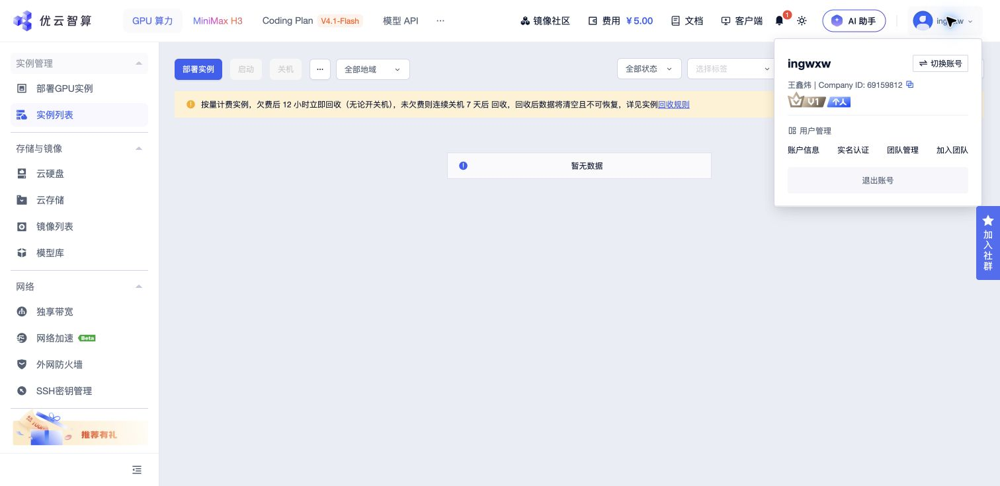

# 作业一：优云智算账号

- 学生：王鑫炜
- 控制台：https://console.compshare.cn/
- Company ID：**69159812**
- 获取时间：2026-11-12（北京时间）
- 证据：登录后展开账号菜单，页面直接显示姓名与 Company ID。

本次只读取账号信息；未购买、租用或启动付费云实例。Redis/Kafka 镜像实践使用本机 Docker，在已有云镜像内的运行方法见本目录 README；不将本机结果描述为优云云端运行结果。
