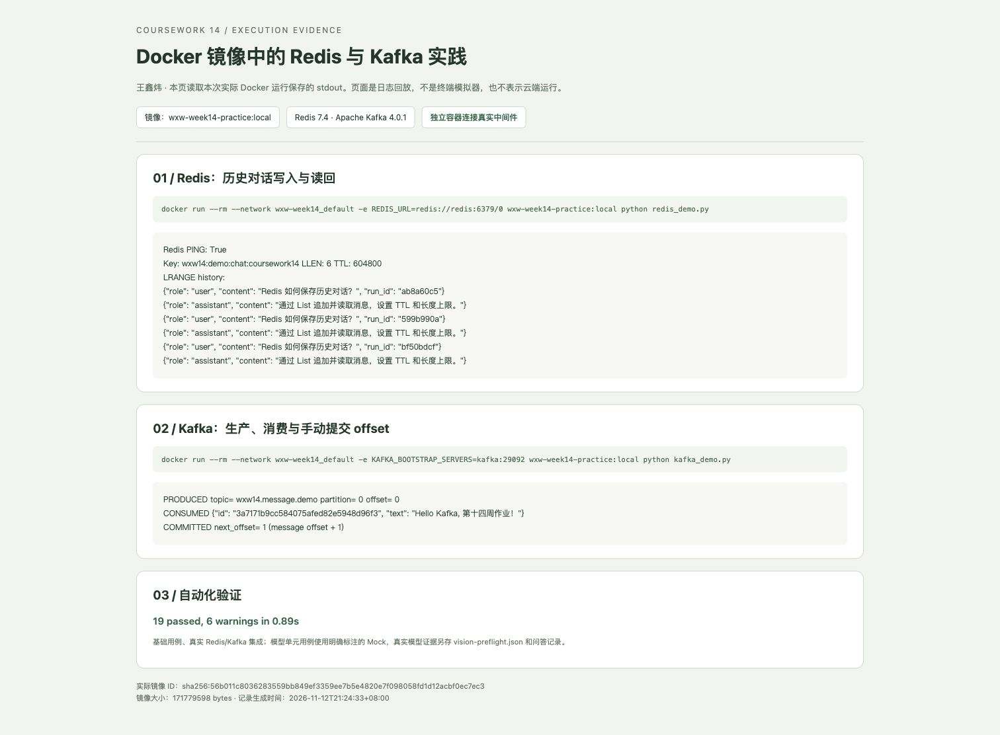

# 作业1验收记录

学生：王鑫炜。原始运行日期：2026-11-12（北京时间）。

- 优云智算 Company ID：**69159812**，登录后账号菜单直接可见，截图见 [账号记录](Company-ID.md)。用户自行完成短信验证与登录。
- 实际构建镜像：`wxw-week14-practice:local`，镜像 ID 为 `sha256:56b011c8036283559bb849ef3359ee7b5e4820e7f098058fd1d12acbf0ec7ec3`，大小 `171779598` bytes。可核对 [镜像元数据](practice-image.json)。
- Redis 实践：主机连续两次运行后 `LLEN` 分别为 2、4；镜像内运行后为 6，并读回之前的历史，TTL 为 `604800` 秒。见 [第一次](redis-demo-run-1.txt)、[第二次](redis-demo-run-2.txt)、[镜像内运行 stdout](redis-container-run.txt)。
- Kafka 镜像内实践：生产到 `wxw14.message.demo` 的 partition 0、offset 0，消费到相同唯一消息 ID，手动提交后 next offset 为 1。随后主机独立运行得到 offset 1、next offset 2。见 [镜像内 stdout](kafka-container-run.txt)、[主机 stdout](kafka-host-run.txt)。

下面的截图展示已保存真实 stdout 的可读页面，不冒充实时终端；原始文本与生成页面的脚本均随作业保存。

