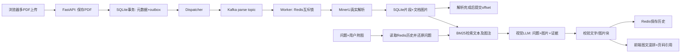

# 作业2：Kafka + MinerU 多模态 RAG 文档问答

本目录包含多 PDF 上传、Kafka 异步任务、MinerU 解析与状态、多模态问答及 Redis 历史记录。完整结果和截图见 [验收记录](docs/验收记录.md)。

## 运行网页

本机可直接双击 `启动网页.command`；启动脚本会复用 `week14/.venv` 中已经安装的依赖。复制到其他机器后可按下列命令安装本目录的独立环境。


需要 Python 3.12、Docker 和 Docker Compose。建议先安装 uv。本项目监听本机回环地址，按个人课堂工作区设计。

```bash
cd "/Users/wxw/Desktop/hub-iCQD/王鑫炜/week14/作业2"
uv venv --python 3.12
uv pip install --python .venv/bin/python -r requirements.txt -i https://mirrors.aliyun.com/pypi/simple
cp .env.example .env
# 编辑 .env，填写支持图片输入的模型密钥
bash scripts/start.sh
```

本机也可双击 `启动网页.command` 启动。打开 **http://127.0.0.1:8014**。上传 `examples/` 中的两份原创 PDF，观察待解析 → 解析中 → 解析完成；点击“梳理核心内容”或自行提问。点击“附加图片”选择 `examples/question.png`，输入“请结合附图解释为什么浏览器不需要等待解析”，即可验证图问一起送入视觉模型。回答内显示文档插图和文字，并提供文件名、页码引用。

本次已在本机配置并实际调用 `deepseek-flash`，其当前官方接口支持图片输入。密钥仅保存在本地 `.env`，被 `.gitignore` 和 `.dockerignore` 排除。复制到其他机器时自行配置密钥。也支持兼容接口的 Qwen-VL 等视觉模型：同时修改 `LLM_BASE_URL`、`LLM_MODEL` 和相应密钥，不能只把纯文本模型名称替换进去。

MinerU 固定为 **2.5.4**，默认 pipeline + CPU，首次解析会从 ModelScope 下载官方模型。模型加载期间网页仍显示真实“解析中”。默认关闭公式和表格专用识别以降低 CPU 演示开销，可通过 `MINERU_FORMULA_ENABLE`、`MINERU_TABLE_ENABLE` 开启。不是把 PyMuPDF 抽字冒充 MinerU；PyMuPDF 只用于上传文件有效性、页数检查。

`requirements-lock-macos.txt` 保存本次 macOS/Apple Silicon 的实际依赖版本；其他平台优先使用 `requirements.txt`。本地 venv、模型权重和 `runtime/` 均不提交。

## 实现对应关系

| 要求 | 实现 |
|---|---|
| 多份 PDF 上传，经 Kafka 送到后端 | `POST /api/documents` 保存原件与 outbox；Dispatcher 发送任务；独立 `app.worker` 消费 |
| MinerU 解析与存储 | `app/parser.py` 调用真实 CLI 或自托管 `/file_parse`，落盘 Markdown/JSON/图片，SQLite 保存检索片段 |
| 展示解析状态 | 前端每两秒读取后端持久化状态；显示待解析、解析中、解析完成，失败另列且可重试 |
| 图文混排回答 | 视觉模型返回文字/图片块；后端只接受本轮已检索文档中的合法 image_id；前端依次插入文字、插图和图注 |
| 用户图片与问题一起发给 LLM | 附件验证、重新编码为 PNG，Base64 image_url 与 question 同在 user content；文档图片也作为真实视觉输入 |
| 对话历史与追问 | Redis List 保存问答和附件引用；最近10条消息用于问题还原及后续回答；最多保留100条，TTL七天 |

PDF **字节不直接塞进 Kafka**。Kafka 消息携带 `document_id/event_id/attempt`，Worker 从与 API 共享的持久卷取原件。这样仍是 Kafka 驱动的上传解析任务，同时避免 broker 大消息限制。多机部署须把共享卷替换为对象存储，并传对象引用。

## 数据路径与一致性



元数据和 outbox 在同一个 SQLite 事务落库；Kafka 发送失败时 outbox 保留待重试。Worker 写入结果后才提交消费 offset。重复投递通过文档 ID、attempt 和状态校验处理；Redis 锁阻止同一文档并发解析。失败事件进入 `.dead` topic，页面允许显式重新解析，新 attempt 不受旧消息影响。这是**至少一次投递 + 幂等处理**，不宣称端到端 exactly-once。

检索采用英文词和中文二元词 BM25，加词项重合度用于极小语料；相关文本会关联同页/邻页图注及插图。图片提问先经过视觉问题还原，得到可检索文字，再生成最终答案。它不是 CLIP 图片向量相似度检索，也不保证任意资料或问题都能命中。没有相关文档证据时，提示模型明确说明证据不足。

## 容器或云端部署

完整应用也提供 Dockerfile 和 Compose `app` profile：

```bash
# .env 配置 MINERU_MODE=cli，模型在 Worker 容器内首次下载
docker compose --profile app up -d --build
# 查看真实日志
docker compose logs -f api worker
# 停止本次服务（保留 Redis/Kafka 数据卷）
docker compose --profile app down
```

或使用单独 MinerU 服务：启动 `mineru-api --host 0.0.0.0 --port 8015`，设置 `MINERU_MODE=api` 和 `MINERU_API_URL`。本项目的 HTTP 适配器针对固定 2.5.x `/file_parse` JSON 协议；升级 MinerU 需要再次核对协议。完整应用镜像及远程 MinerU 模式的验证状态，以验收记录为准，不由 Dockerfile 的存在推断已运行。

本地开发也可分别启动：

```bash
source .venv/bin/activate
python -m app.worker
python -m uvicorn app.main:app --host 127.0.0.1 --port 8014
```

## 文件和验证

```text
app/                 FastAPI、Outbox、Kafka Worker、MinerU、检索、视觉问答
web/                 无外部CDN依赖的HTML/CSS/JavaScript
Dockerfile           完整应用镜像配方
compose.yaml         独立Redis/Kafka及可选API/Worker容器
examples/            两份原创PDF、架构图、提问图
tests/               基础/真实Redis/Kafka集成测试；模型Mock明确标识
docs/                RAG使用记录、验收报告和真实截图
runtime/             本机原件/解析结果/SQLite/日志（不提交）
```

```bash
python -m pytest -q -m 'not integration'
python -m pytest -q  # 真实Redis/Kafka先启动；模型单元测试不计入真实模型验收
node --check web/app.js
```

只在本机使用时不需要账号体系；如果部署到共享服务器，须增加认证、按用户隔离文档、反向代理/HTTPS及资源配额。图片问答实际会把所选资料片段、相关图片和最近历史发送到 `.env` 配置的模型供应商。样例都是本次原创课程资料。

参考：[MinerU 使用说明](https://opendatalab.github.io/MinerU/usage/quick_usage/)、[Apache Kafka Docker](https://kafka.apache.org/40/getting-started/docker/)、[Redis List](https://redis.io/docs/latest/develop/data-types/lists/)、[DeepSeek 视觉输入](https://api-docs.deepseek.com/guides/vision/)。
