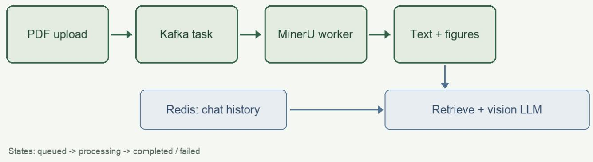

# 多模态 RAG：从文档到答案

王鑫炜 / 第十四周原创演示资料 / 2026-11-12

# 一、上传与异步解析

浏览器一次可上传多份 PDF。后端先保存原文件，并在 SQLite 的同一事务中写入文档元数据和 outbox。  
接口返回 202，不等待 MinerU 完成。Dispatcher 在 Kafka 确认后将 outbox 标为已发送。

# 二、解析状态与可靠消费

文档最初为待解析（queued）。Kafka Worker 领取任务后写为解析中（processing），调用真实 MinerU，存储文本片段和图片后写为解析完成（completed），最后提交消费 offset。失败时显示 failed 并允许重试。

# 三、多模态问答

检索文档文本和图片说明，关联同页插图。视觉大模型同时接收用户问题、用户附图、检索片段和文档插图；返回经过校验的文字块与图片块，前端按顺序图文混排。回答标注文档名称和页码。

# 四、对话历史

Redis List 保存用户与助手消息，使用 RPUSH 追加，LRANGE 读取最近历史，LTRIM 限制长度，EXPIRE 设置有效期。追问时从 Redis 取历史，先还原问题，再检索和生成。

  
图1：Kafka 异步文档解析与 Redis 对话历史的数据路径。