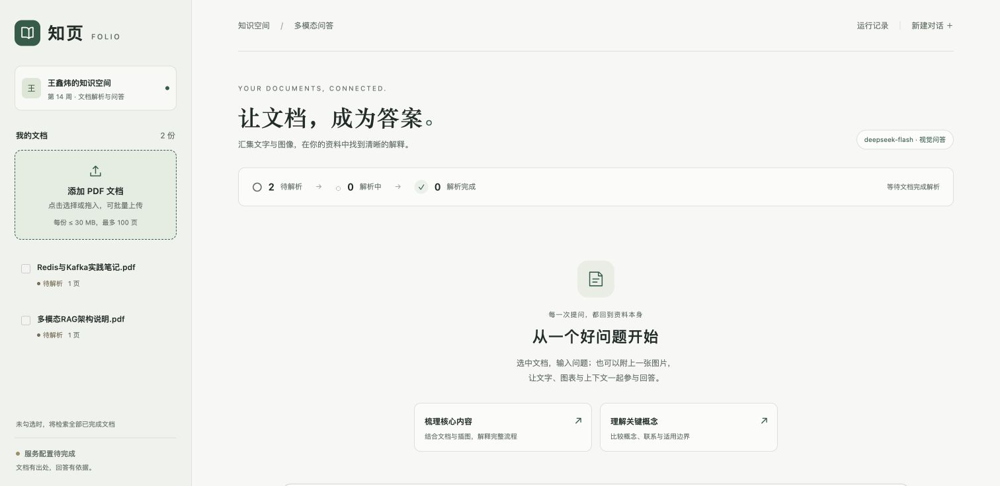
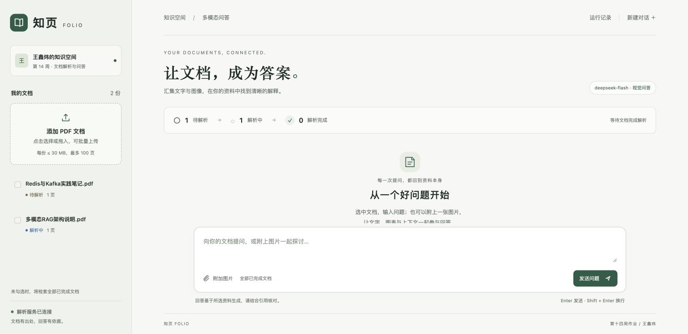
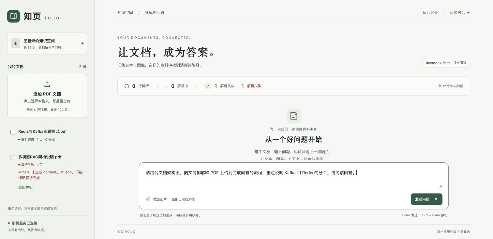
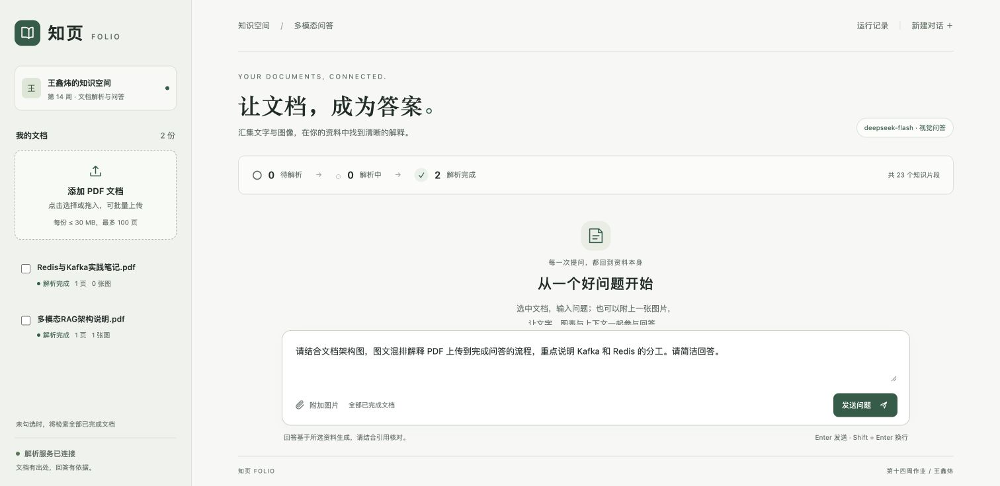
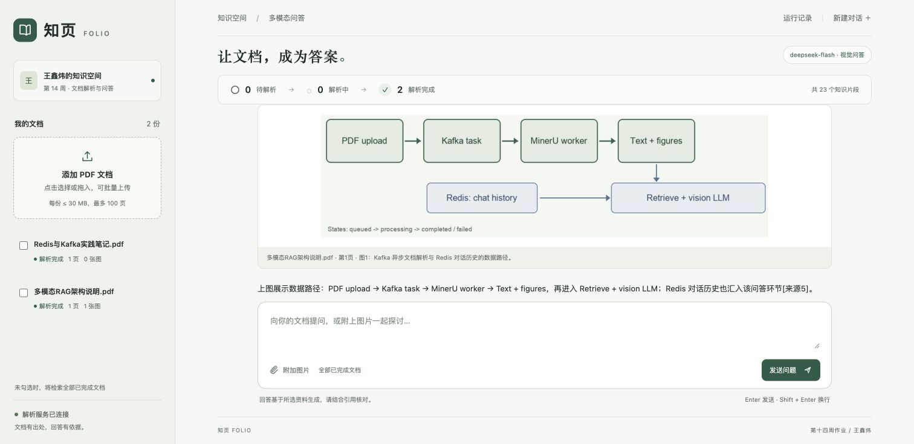
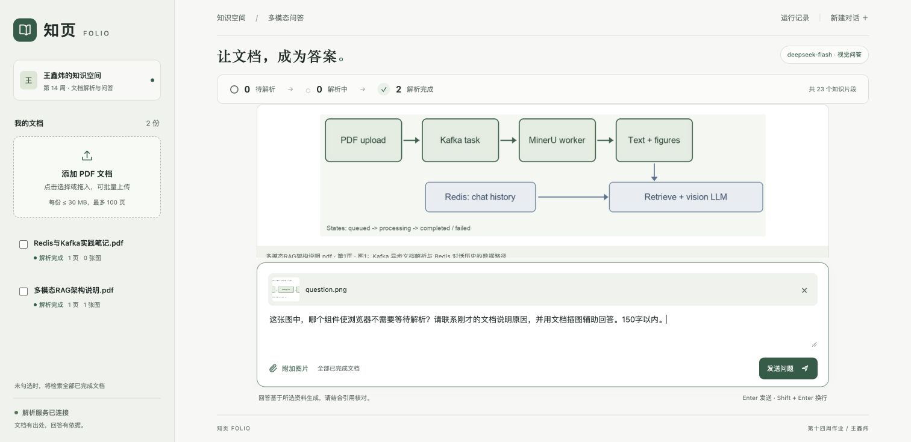
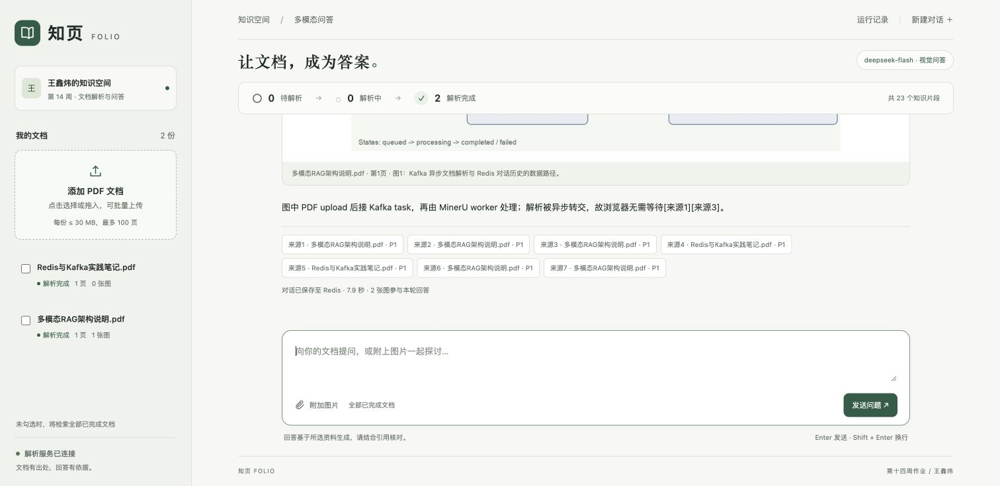
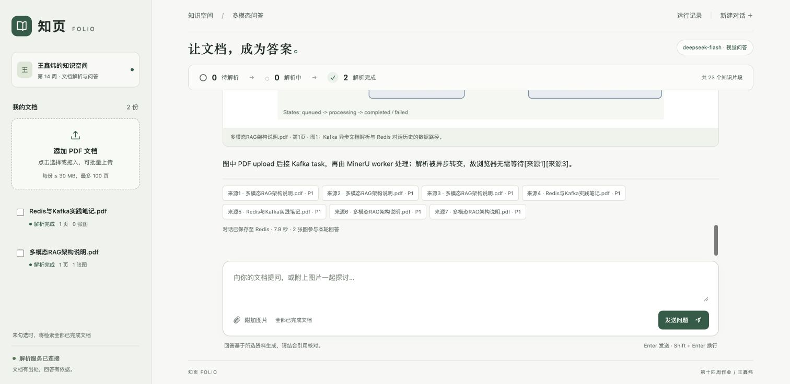
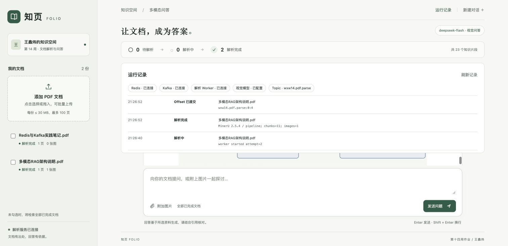
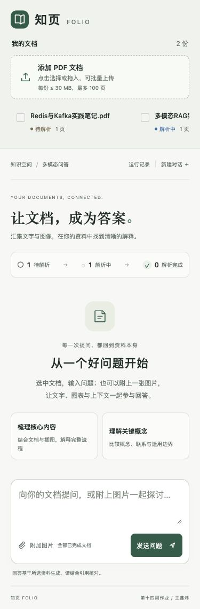

# 作业2验收记录

学生：王鑫炜。原始运行日期：2026-11-12（北京时间）。

真实 Kafka、MinerU 和 DeepSeek 链路已验证；完整自动化测试共 19 项通过。

## 真实上传、解析与存储

通过网页一次选择两份原创 PDF 上传，接口创建两条文档及相应事务 outbox。Kafka/Worker 就绪后处理之前已落库的待解析任务，不依赖浏览器持续连接。

| 原创样本 | 页数 | MinerU 输出/入库片段 | 文档插图 | 最终状态 |
|---|---:|---:|---:|---|
| 多模态RAG架构说明.pdf | 1 | 11 | 1 | completed，attempt 2 |
| Redis与Kafka实践笔记.pdf | 1 | 12 | 0 | completed，attempt 1 |

真实解析器为 **MinerU 2.5.4 / pipeline / CPU**。原始 Markdown、content_list 和图片已导出到 [MinerU原始输出](mineru-output/)。完整文档状态、outbox 和事件保存在 [解析链路 JSON](rag-pipeline.json)。

本次首次预热与 Worker 同时请求约 713 MB 的阅读顺序模型，导致第一份文档的模型下载锁等待达到 600 秒后失败。系统显示“解析失败”，没有伪造解析完成。补齐模型分片并验证官方 SHA-256、停止预热进程后，在网页点击“重新解析”：21:26:40 进入 attempt 2，21:26:52 完成，实际约 11.5 秒。第二份文档于 21:26:28 完成。

该模型大小为 `713217212` bytes，SHA-256 为 `9df7c046b212c1892a649cbf98f2a521bbb32741e8cbc06f10ffd4247b53c451`，校验记录见 [官方模型完整性](mineru-model-check.json)。首次运行建议等待模型预热结束；慢速网络下可增加 `.env` 中的 `PARSE_TIMEOUT`，失败后使用页面重试。

## 图文问答和历史恢复

使用服务端现有配置实际调用 `deepseek-flash`。当前模型接口已通过 `/models` 和真实图片请求核验图片输入能力；没有把纯文本模拟回答算作视觉验收。预检见 [真实图片调用](vision-preflight.json)。

| 网页真实调用 | 历史消息数 | 本轮回答阶段图片输入数 | 返回块 | 实际耗时 |
|---|---:|---:|---|---:|
| 文字提问，要求结合文档架构图解释流程 | 0 | 1 张文档插图 | text → image → text → text | 4.603 秒 |
| 上传 question.png，并联系上一轮连续追问 | 2 | 1 张用户附图 + 1 张文档插图 | text → image → text | 7.926 秒 |

图片追问先调用视觉模型还原检索问题，再将问题、真实 Base64 图片、检索证据及历史送入回答调用。表中“图片输入数”对应最终回答调用，问题还原的调用统计也保存在记录中。两轮回答均引用所选 PDF 的第 1 页，插图来自 MinerU 解析结果。

Redis 实际保存 **4 条消息**（两问两答），设置七天 TTL。刷新网页后恢复两轮对话、用户附图和文档图片；浏览器核验三张会话图片全部加载成功。真实模型名、token usage、检索结果、图片块、耗时、历史数量保存在 [真实RAG对话](rag-real-chat.json)。

## 自动化与界面检查

最终执行 `python -m pytest -q`：**19 passed**。检查覆盖批量上传原子性、无效 PDF 拒绝、重试代次、MinerU 图片及页码保留、路径限制、缺少 MinerU/密钥时明确失败、检索文档隔离、历史图片回放、模型图片块引用限制、真实 Redis 跨客户端持久化、Worker 幂等、真实 Kafka outbox 确认、失败事件保留和两轮对话历史复用。

HTTP MinerU 适配用例使用显式 MockTransport，验证 `/file_parse` JSON/Base64 图片协议映射；模型单元用例使用显式 Mock。它们不计作远端 MinerU 服务或真实模型验收。实际 MinerU 验收使用本机 CLI，实际模型验收见上表。测试有 6 条第三方弃用警告，不影响本次结果。完整输出见 [最终自动测试](automated-test-log.txt)。

`node --check web/app.js` 和应用 Python 语法检查通过。桌面视口宽度/scrollWidth 均为 1512；375×812 手机视口均为 375；667×375 横屏视口均为 667，没有页面横向溢出。刷新后 DOM 为 2 条用户消息、2 条助手消息、2 张回答插图，错误区为空。见 [浏览器核验数据](browser-checks.json)。

## 验证边界

本次 RAG 验证在本机完成。完整应用 Dockerfile、Compose app profile 和远程 MinerU 适配器提供了部署方式，但完整应用镜像、远程 GPU/HTTP MinerU 服务没有在本次作为真实运行链路验收。

本作业的检索为 BM25 文本/图注检索加页面插图关联；不是图片向量检索。单节点 Redis/Kafka 与 SQLite 适用于个人课堂演示，不据此宣称生产级高可用或端到端 exactly-once。两轮正确样例不保证任意 PDF 和任意问题都能正确检索与回答。

最终目录已执行交付的 `scripts/start.sh`，再次核验两份文档、23 个片段、1 张文档图、4 条 Redis 消息和 3 次图片访问均正常。本目录的 10 张 JPEG 均可读取，Markdown 链接无断链，Git 可见文件未包含密钥、虚拟环境或运行数据。详见 [最终目录检查](final-directory-check.json)。

目录拆分后已从 `week14/作业2` 重新启动，文档、图片和 Redis 历史恢复正常，19 项测试全部通过。见 [拆分后测试记录](after-split-test-log.txt)。
