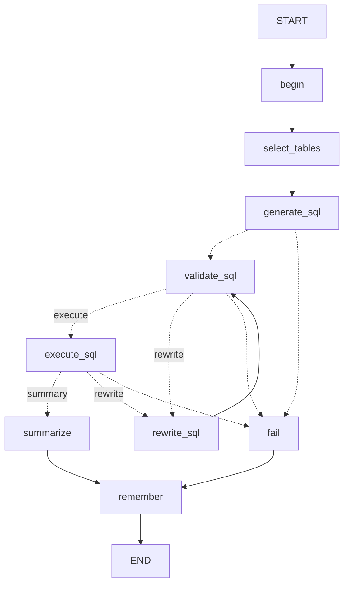

# SQL Chat —— LangGraph 版 SQL Agent + 网页对话查询

用 **LangGraph** 复刻 `week12/作业2/sql_agent_langchain.py`（原版仍保留在原处，未改动），并配一个网页：在浏览器里用中文提问，
后端 Agent 自动完成 **选表 → 写 SQL → 校验 → 改写 → 执行 → 总结**，把自然语言回答、SQL 和查询结果表格一起返回。

数据库：`chinook.db`（音乐商店示例库，11 张表）。

## 目录结构

```
week13/
├── sql_agent_langgraph.py   # 本作业：LangGraph 版 Agent（可单独命令行运行）
├── app.py                   # FastAPI 后端：把 Agent 包成 HTTP / SSE 接口
├── static/
│   └── index.html           # 前端对话页面
├── requirements.txt
├── .env.example             # 配置模板（复制为 .env 填写）
└── chinook.db               # 示例数据库（从 week12/作业2 复制，便于本目录独立运行）

../week12/作业2/
├── sql_agent_langchain.py   # 原版（LangChain LCEL 手写编排），保持不动
└── chinook.db
```

## 快速开始

```bash
conda activate py312
cd 盛杰厚/week13
pip install -r requirements.txt

cp .env.example .env        # 编辑 .env，填入 DEEPSEEK_API_KEY
uvicorn app:app --host 0.0.0.0 --port 8001
```

浏览器打开 <http://localhost:8001>。

> 首次启动要导入 langchain / langgraph，再加上解析 chinook.db 的库结构，大约需要几秒；
> 页面打开时右侧「数据表」面板出现即表示后端已就绪。

### 没有 API Key 也能跑

```bash
MOCK=1 uvicorn app:app --host 0.0.0.0 --port 8001
```

`MOCK=1` 时不调用大模型，用本地规则模拟「表选择 / 写 SQL / 汇总」，可以完整走通
「提问 → 执行 → 展示 SQL 与结果表格」的前后端流程，用来调试页面。

### 命令行运行 Agent（不开网页）

```bash
export DEEPSEEK_API_KEY=你的key
python sql_agent_langgraph.py "每个客户的消费总额是多少？"
python sql_agent_langgraph.py "那前 5 个呢？" --thread same   # 同 --thread 可继续上文
```

## LangGraph 复现：图结构

原版 `action()` 里是「函数顺序调用 + 一个 `for retry in range(max_retry)` 循环」。
在 LangGraph 版里，7 个步骤变成 7 个节点，原来的重试循环变成 `rewrite_sql → validate_sql` 这条**环**，
用条件边（`add_conditional_edges`）决定下一步走哪：



与原版的对应关系：

| 原版（LangChain 版） | LangGraph 版 |
| --- | --- |
| `DBParser` | 不变，Agent 初始化时解析一次库结构 |
| `select_tables()` | 节点 `select_tables` |
| `generate_sql()` | 节点 `generate_sql` |
| `validate_sql()` | 节点 `validate_sql` |
| `rewrite_sql()` | 节点 `rewrite_sql` |
| `execute_sql()` | 节点 `execute_sql` |
| `summarize()` | 节点 `summarize` |
| `for retry in range(max_retry)` | `validate_sql` / `execute_sql` 上的条件边 + `rewrite_sql → validate_sql` 的环 |
| `action()` 返回的 dict | 图的最终 `State`（字段基本一致，多出 `steps` 执行轨迹） |
| —（原版没有） | 节点 `begin` / `remember`：初始化本轮状态、维护多轮对话历史 |
| —（原版没有） | `InMemorySaver` 检查点 + `thread_id`：区分浏览器会话 |

为了网页多轮对话新增的能力：

- **对话历史**：`State["history"]` 保存最近 20 条问答，传给表选择 / SQL 生成 / 汇总，
  所以可以追问「那前 10 个呢？」；
- **会话隔离**：前端把 `session_id` 作为 LangGraph 的 `thread_id`，不同浏览器标签互不影响；
- **执行进度**：`run_stream()` 按节点流式产出，后端转成 SSE 推给前端。

## 页面功能

- 输入框提问：Enter 发送、Shift + Enter 换行；
- 回答气泡里展示自然语言结论，下面是可展开的「执行详情」：
  - 每个节点的执行状态与耗时（✓ / ↻ 重试 / ✗ 失败）；
  - 实际执行的 SQL（可一键复制）；
  - 查询结果表格（最多展示前 200 行，超出会标注总行数）；
  - 选中的表、SQL 改写次数；
- 执行过程中实时显示当前走到哪一步（SSE 推送，不用等几十秒才看到反馈）；
- 左侧「数据表」面板列出库结构，可展开看字段与主键；
- 「新对话」清空当前会话的多轮记忆。

## 接口

| 方法 | 路径 | 说明 |
| --- | --- | --- |
| GET | `/` | 前端页面 |
| GET | `/api/health` | 健康检查（模型、是否 MOCK、是否配置 Key） |
| GET | `/api/schema` | 库结构（表名 + 字段 + 主键） |
| POST | `/api/chat` | 一次性返回完整结果 |
| POST | `/api/chat/stream` | SSE 流式：`start` → 若干 `step` → `done`（或 `error`） |
| POST | `/api/reset` | 清空某个 `session_id` 的对话记忆 |

请求体：

```json
{ "message": "每个客户的消费总额是多少？", "session_id": "浏览器生成的唯一 ID" }
```

`done` 事件的数据：

```json
{
  "answer": "自然语言回答",
  "sql": "SELECT ...",
  "tables": ["customers", "invoices"],
  "validated": true,
  "failed": false,
  "columns": ["CustomerId", "Customer", "TotalSpent"],
  "rows": [[6, "Helena Holý", 49.62]],
  "row_count": 10,
  "truncated": false,
  "retries": 0,
  "steps": [{ "node": "select_tables", "title": "表选择", "status": "ok", "elapsed_ms": 5 }],
  "elapsed_ms": 2412
}
```

## 配置项

环境变量优先于 `.env`（模板见 `.env.example`）：

| 变量 | 默认值 | 说明 |
| --- | --- | --- |
| `DEEPSEEK_API_KEY` | 空 | 模型服务 API Key（必填，除非 `MOCK=1`；也兼容 `API_KEY`） |
| `DEEPSEEK_BASE_URL` | `https://api.deepseek.com` | OpenAI 兼容接口地址 |
| `DEEPSEEK_MODEL` | `deepseek-flash` | 模型名称 |
| `DB_URL` | 本目录 `chinook.db` | 数据库连接地址，也可指向 MySQL |
| `MOCK` | `0` | 设为 `1` 用本地规则模拟，不调用大模型 |
| `MAX_RETRY` | `5` | SQL 校验/改写最多重试次数 |

## 常见问题

- **`ModuleNotFoundError: No module named 'websockets.asyncio'`**
  langgraph 依赖 `websockets>=13`，旧环境里可能是 12.0。升级即可：
  `pip install -U "websockets>=13"`。
- **端口被占用**：换一个端口，例如 `uvicorn app:app --port 8002`。
- **回答很慢 / 超时**：一次提问通常会调用 3 次大模型（选表、写 SQL、汇总），
  校验失败时还会多一次改写；模型服务本身较慢时请耐心等待，页面上会实时显示进度。
- **MOCK 模式的局限**：本地规则只认关键词、不真正理解多轮上下文，
  追问（如「那前 5 个呢」）不会继承上一句；它只用于调试前后端，真实效果请配置 API Key。
