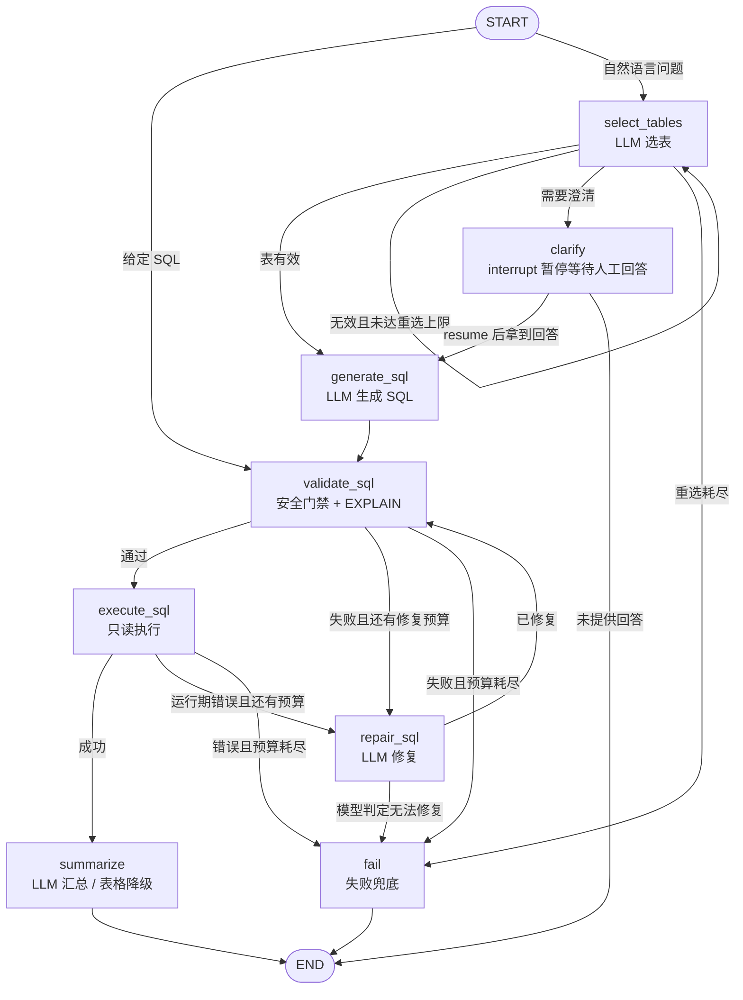

# Week13 作业一 · LangGraph 版 SQL Agent

用 **LangGraph `StateGraph`** 复刻 week12 的 LangChain 版 SQL Agent。输入同一个问题、同一个 `data/chinook.db`，CLI 输出与 week12 **完全相同的 JSON 字段**，方便直接对比两条链路。

## 1. 做了什么

- 把 week12 的「选表 → 生成 SQL → 校验 → 执行 → 失败修复 → 汇总」手写循环，改成显式的图节点与条件边。
- 用 `TypedDict` 定义 `AgentState`，每个节点只返回自己更新的字段；节点轨迹通过 `Annotated[list, operator.add]` 累加。
- `repair_attempts` 有硬上限（默认 3），由条件边控制，**不存在无限循环**。
- 保留离线 `--mock` 开关：不调用外部模型，用确定性规则驱动同一张图，真实执行 SQLite。
- 支持 `--sql` 直接给定 SQL，跳过选表/生成节点，方便只验证校验、执行、汇总链路。
- 加入 **Human-in-the-loop**：`clarify` 节点用 `interrupt()` 暂停，用户回答后从检查点继续生成 SQL。
  问题千变万化，与其让模型猜口径，不如在真正有歧义时把选择权交回给人。

## 2. 图结构



### 节点职责

| 节点 | 类型 | 职责 |
| --- | --- | --- |
| `select_tables` | LLM | 从数据库目录中选择最少表集合；代码校验表是否存在、是否有外键连通 |
| `generate_sql` | LLM | 基于所选表的 schema / 样例 / 外键生成单条 SELECT |
| `validate_sql` | 确定性 | 单语句、只读关键字、`EXPLAIN` 编译；不执行 |
| `execute_sql` | 确定性 | 只读 SQLite 执行，带超时、行数、单元格长度限制 |
| `repair_sql` | LLM | 根据错误码修复 SQL；可返回 `cannot_fix` |
| `summarize` | LLM | 只依据结果集生成答案；调用失败时降级为确定性表格 |
| `clarify` | HITL | 信息不足或有多种口径时 `interrupt()` 暂停，抛出澄清问题与选项；恢复后直接进入生成，不重复选表 |
| `fail` | 确定性 | 修复耗尽或无法修复时的统一兜底 |

### 关键条件边

- `select_tables → select_tables`：选表结果非法时带反馈重选，最多 2 次（`max_selection_attempts`）。
- `validate_sql → repair_sql`：校验失败且 `repair_attempts < max_repair_attempts`。
- `validate_sql → fail`：校验失败且预算耗尽。
- `execute_sql → repair_sql`：运行期错误与校验失败**共享同一份修复预算**。
- `repair_sql → fail`：`cannot_fix=True`，不再重试。
- `clarify → generate_sql`：用户已回答（`clarification_answer` 非空）时继续；否则结束。
  中断依赖 checkpointer（`MemorySaver`）+ `thread_id`，CLI/API 每次运行生成一个线程 ID。

### 状态字段（`AgentState`）

`question`、`context`（含多轮上下文）、`tables`、`schema_context`、`sql`、`attempts`、`validation`、`execution`、`selection`、`selection_retries`、`repair_attempts`、`answer`、`error`、`failure_message`、`cannot_fix`、`clarification_answer`、`clarification_options`、`trace`。

## 3. 运行方式

在 `week13/作业一` 目录下：

```powershell
# 1) 离线演示（无 API key 也能跑通整图，真实执行 SQLite）
python run.py --mock "总共有多少张专辑？"

# 2) 演示修复节点：首次故意给错表名，图会走 repair 再成功
python run.py --mock --scenario repair "总共有多少张专辑？"

# 3) 直接给定 SQL，跳过选表/生成
python run.py --sql "SELECT COUNT(*) AS album_count FROM albums;" --mock

# 4) 查看节点轨迹
python run.py --mock --show-trace "总共有多少张专辑？"

# 5) 演示 HITL：clarify 中断 → 用 --answer 恢复 → 跑完后续节点
python run.py --mock --scenario clarify --answer "按销量：invoice_items.Quantity 汇总" "那个歌手的总销量最高？"

# 6) 真实模型调用（需先在 .env 填写 DEEPSEEK_API_KEY）
python run.py "总共有多少张专辑？"
# 真实模型触发澄清时，交互式终端会直接提示；非交互环境用 --answer 恢复
python run.py --answer "查询全部客户各自的总消费" "某个客户的总消费是多少？"
```

常用参数：`--log-level DEBUG`、`--max-repair-attempts N`、`--tables a,b`、`--answer "..."`。

HITL 行为：

- 命中 `clarify` 时，CLI 把澄清问题与选项打印到 **stderr**；交互式终端可输入序号或自由文本。
- 非交互环境（管道 / CI）不会挂死：未提供 `--answer` 时输出 `{"status":"interrupted", "thread_id", "interrupt", "error"}` 并以退出码 2 结束。
- 恢复后从同一检查点直接进入 `generate_sql`，不会再次选表或重复提问。
- 流程完成后的 JSON 仍是原来的 10 个字段，不受 HITL 影响。

输出仍是 week12 的同一组字段：

```
question / answer / sql / tables / row_count / truncated /
repair_attempts / evidence / caveats / error
```

## 4. 依赖与环境

- Python 3.11+（本机验证使用 `A:\conda_envs\study`，Python 3.12）
- 依赖见 `requirements.txt`：`langgraph`、`langchain`、`langchain-openai`、`sqlalchemy`
- 数据库：`data/chinook.db`（SQLite，只读打开）
- 模型配置：复制 `.env.example` 为 `.env` 并填写 `DEEPSEEK_API_KEY`

```powershell
conda activate study
pip install -r requirements.txt
```

## 5. 与 week12 LangChain 版本的差异

| 维度 | week12（LangChain） | week13（LangGraph） |
| --- | --- | --- |
| 编排方式 | `SQLAgentWorkflow._run()` 里手写 `for` 循环和 if 分支 | `StateGraph` 节点 + 条件边，流程图即代码 |
| 状态 | `QueryState` 在方法内逐字段赋值 | `AgentState` TypedDict，由图统一管理 |
| 修复循环 | `for repair_index in range(max+1)` | `validate/execute → repair → validate` 条件边，预算由路由函数控制 |
| 过程可见性 | 只有日志 | 每节点写入 `trace`，CLI `--show-trace`、API/前端直接消费 |
| 人工介入 | 无，clarify 直接返回问题并结束 | `clarify` 用 `interrupt()` 暂停，回答后从检查点继续执行 |
| 复用方式 | CLI 直接调用编排类 | 同一 `SQLAgentGraph` 同时被 CLI 与 week13 作业二 API 复用 |
| 输出契约 | 10 个字段 | **保持一致**，便于对比 |

LLM 提示词、结构化输出模型、SQL 校验器和执行器的约束保持不变。

## 6. 本地验证记录（2026-11-04）

环境：`A:\conda_envs\study`（Python 3.12，langgraph 1.2.9）。

以下均为真实执行结果：

- `python run.py --mock "总共有多少张专辑？"`
  - `answer = "查询结果：album_count = 347。"`，`row_count = 1`，`repair_attempts = 0`
  - 命中节点：`select_tables → generate_sql → validate_sql → execute_sql → summarize`
- `python run.py --mock --scenario repair "总共有多少张专辑？"`
  - 首次 SQL 使用不存在的表 `album`，校验返回 `unknown_object`
  - 修复后 SQL 为 `SELECT COUNT(*) AS album_count FROM albums`
  - `repair_attempts = 1`，`answer` 仍为 347
  - 命中节点：`select_tables → generate_sql → validate_sql → repair_sql → validate_sql → execute_sql → summarize`
- `python run.py --sql "SELECT COUNT(*) AS album_count FROM albums;" "库里一共有多少张专辑？"`
  - 未配置 API key 时，汇总节点自动降级为表格输出
  - `row_count = 1`，表格中 `album_count = 347`，`caveats` 明确说明降级原因
- 多表 JOIN（mock）：`销售额最高的前 10 笔发票` 返回 10 行，选中 `invoices + customers`
- **真实 DeepSeek 调用**：`python run.py "总共有多少张专辑？"`（deepseek-flash）
  - 3 次 `POST https://api.deepseek.com/chat/completions` 均返回 `200 OK`
  - 模型选表 `albums`，生成 `SELECT COUNT(*) AS AlbumCount FROM albums`
  - 最终答案 `总共有 347 张专辑。`，`evidence = ["AlbumCount = 347"]`
  - 命中 5 个节点，总耗时 7.38s，`repair_attempts = 0`

> 真实模型调用已在本地 `.env`（`DEEPSEEK_API_KEY` + `SQL_AGENT_MODEL=deepseek-flash`）下验证通过。`.env` 已加入 `.gitignore`，不会提交到仓库。复现命令即上面的 `python run.py "总共有多少张专辑？"`。

### HITL 验证（2026-11-04，Python 3.12 / langgraph 1.0.10）

- **Mock 中断**：`python run.py --mock --scenario clarify "那个歌手的总销量最高？..."`
  输出 `status=interrupted`、`thread_id` 与两个澄清选项，退出码 2（非交互环境不挂起）。
- **Mock 恢复**：追加 `--answer "按销量：invoice_items.Quantity 汇总"` 后完成
  `select_tables → clarify → generate_sql → validate_sql → execute_sql → summarize`，
  `row_count=10`，trace 中 `clarify` 的 `detail.answer` 记录人工回答。
- **真实模型中断**：`python run.py "某个客户的总消费是多少？"`（deepseek-flash）
  模型返回 `needs_clarification=true`，给出澄清问题与 3 个选项
  （具体措辞由模型生成，不同运行可能略有差异）。
- **真实模型恢复**：`python run.py --answer "查询全部客户各自的总消费" "某个客户的总消费是多少？"`
  恢复后生成 SQL 并执行，`row_count=59`，`repair_attempts=0`，答案正确指出
  Helena Holý 总消费最高（49.62）。同一链路也通过 HTTP API 验证（见作业二 README）。

## 7. 目录结构

```
作业一/
├── run.py                  # CLI 入口
├── requirements.txt
├── .env.example
├── data/chinook.db
├── README.md
└── sql_agent_lg/
    ├── graph.py            # StateGraph、节点、条件边、输出组装
    ├── providers.py        # DeepSeek 真实链路 + Mock
    ├── prompts.py          # 四个节点的系统提示词
    ├── catalog.py          # schema / 外键 / 样例（确定性）
    ├── validator.py        # 安全门禁 + EXPLAIN
    ├── executor.py         # 只读执行与限额
    ├── models.py           # Pydantic 数据契约
    ├── config.py           # .env / 限额 / mock 开关
    └── cli.py
```

## 8. 已知限制

- Mock 模式只覆盖常见问题模板，用于演示图流转，不代表真实模型的泛化能力。
- `--sql` 直接给定 SQL 时，选表节点被跳过，`tables` 由表名正则推断。
- 多轮上下文只取最近 3 轮，且仅用于 LLM 提示；Mock 仍按关键词选 SQL。
- 只支持 SQLite 只读查询；写操作会在校验节点被拒绝。
- HITL 使用进程内 `MemorySaver`：CLI 的“中断 → 回答”必须在同一次运行内完成；
  API 的检查点在服务进程内共享，进程重启后未完成的 thread 不可恢复。
- 澄清只做一轮（clarify 节点中断一次）；回答后直接生成 SQL，不会继续追问。
